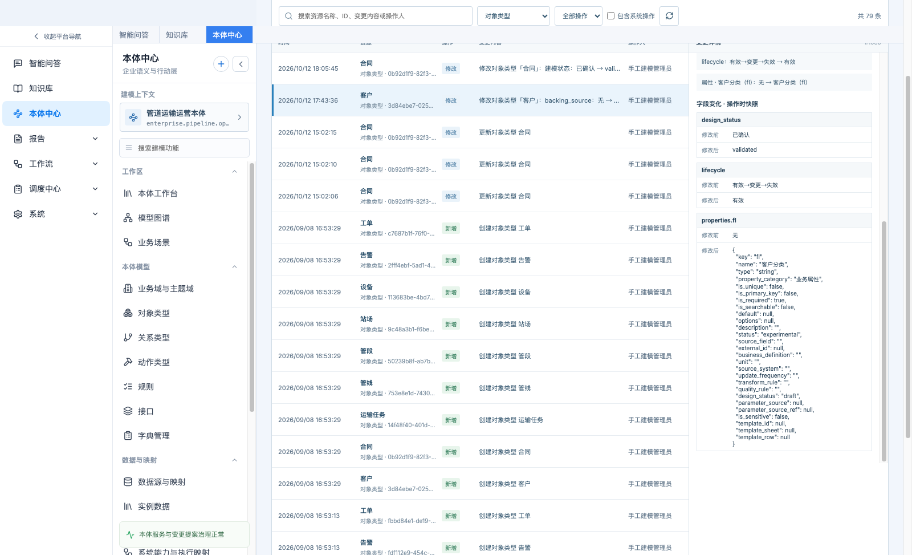
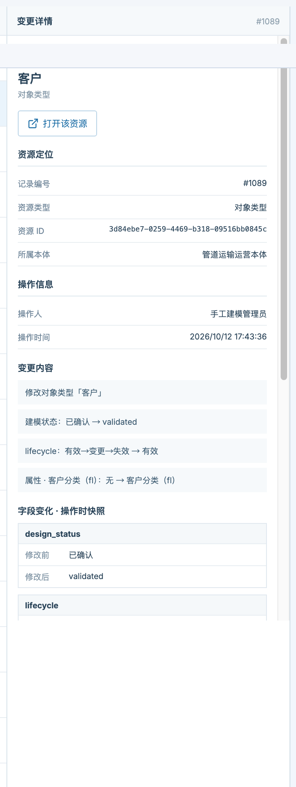

# 变更记录 · 产品需求文档

> 本体中心 → 变更与发布 → 变更记录（路由 `#/ontology/governance/activity`）

| 项目 | 内容 |
|---|---|
| 功能名称 | 变更记录 |
| 所属模块 | 本体中心 → 变更与发布 |
| 页面路由 | `#/ontology/governance/activity` |
| 适用对象 | 本体建模人员、数据治理人员、评审人 |
| 文档状态 | 评审中 |
| 更新日期 | 2026-10-12 |

---

## 1. 功能概述

变更记录回答一个问题：**这个本体上，谁在什么时候，把哪个资源，从什么改成了什么。**

它只展示当前本体的操作流水，不与其他本体的记录混排；每条记录都定位到一个具体资源，并支持在「记录」与「资源」之间双向跳转——看到变更就能直接跳过去修，修完还能回到原来那条记录。

## 2. 目标与使用场景

- **追溯**：发布前核对「这次到底改了什么」，而不是只看一句操作摘要。
- **定位**：从一条变更直接跳到出问题的对象、关系或映射去修改。
- **审计**：按人、时间、资源类型回溯建模过程，并可选择是否包含系统自动操作。
- **交接**：新成员通过变更流理解模型是如何一步步演进出来的。

## 3. 页面结构

页面为「左侧列表 + 右侧详情」两栏：列表用于快速扫读与筛选，详情用于看清一条记录的全部证据。

*图 1　变更记录整页：列表、筛选工具条与右侧详情*

## 4. 列表区

### 4.1 列说明

| 列 | 内容 |
|---|---|
| 时间 | 操作时间，精确到秒 |
| 资源 | 资源名称 + 资源类型 + 资源 ID（ID 可复制用于排查） |
| 操作 | 新增 / 修改 / 删除；发布等其它操作按原始操作名展示 |
| 变更内容 | 变更摘要；有字段级差异时直接显示「字段：旧 → 新」 |
| 操作人 | 显示为可读名称，例如「手工建模管理员」 |

### 4.2 筛选与搜索

*图 2　筛选工具条*

- **关键词**：可搜索资源名称、资源 ID、变更内容、操作人。
- **资源类型**：24 类，包括对象类型、关系类型、动作类型、接口、规则、数据源、治理资产、数据映射等。
- **操作**：全部 / 新增 / 修改 / 删除。
- **包含系统操作**：默认关闭；勾选后显示系统自动产生的记录，便于把人工操作与系统操作分开看。
- **分页**：默认每页 20 条，可切换；右上角显示当前筛选下的总条数。

## 5. 详情区

*图 3　变更详情：资源定位、操作信息、变更内容与字段变化*

### 5.1 头部与资源定位

- 头部：操作类型徽标（新增 / 修改 / 删除）+ 资源名称 + 资源类型 + 「打开该资源」按钮。
- 资源定位：记录编号、资源类型、资源 ID、所属本体。
- 操作信息：操作人、操作时间。

### 5.2 变更内容

逐行展示本次变更的摘要。两侧相同的「空变化」（例如旧值与新值都是空）不会展示，避免出现“无 → 无”这类没有信息量的行。

### 5.3 字段变化 · 操作时快照

*图 4　字段级差异：修改前 / 修改后*

- 以「字段 + 修改前 + 修改后」的形式呈现。
- 属性类变化会细化到属性级，例如「属性 · 客户分类（fl）」。
- 删除类记录额外展示「删除前资源摘要」，保留删除时刻的资源状态。

## 6. 资源往返跳转

| 方向 | 行为 |
|---|---|
| 记录 → 资源 | 点「打开该资源」跳转到该资源的编辑或查看页，并自动选中该资源 |
| 资源 → 记录 | 各资源页详情里的「变更记录」入口，进入该资源的专属记录视图 |
| 返回 | 从资源页回到变更记录时，恢复原来的记录选中与页码 |
| 资源已删除 | 提示「该资源已不存在或不属于当前本体」，可关闭提示；历史记录仍然保留 |
| 无独立页面 | 旧版对象类型组、共享属性、智能构建提案、建模证据、属性等，明确说明无法跳转，不给无效按钮 |

## 7. 规则与口径

| 规则 | 说明 |
|---|---|
| 记录范围 | 仅当前本体；不做跨本体混排 |
| 字段级差异的产生 | 修改类操作保存操作前后的资源快照并逐字段比较；新增与删除保存单边快照 |
| 比较范围 | 只比较语义字段；ID、创建 / 更新时间、密钥等内部字段不参与 |
| 空值口径 | `None` 与空字符串都表示「未设置」，不产生「无 → 无」这类空变化 |
| 属性变化粒度 | 细化到 `properties.<字段>`，例如「属性 · 交付日期（deliveryDate）」 |
| 覆盖资源 | 本体、业务域、主题域、对象类型、接口、关系类型、动作类型、业务规则、数据源、治理资产、数据映射、业务场景、系统能力、动作执行映射、权限策略、规则与函数 |
| 历史记录 | 功能上线前写入的记录可能只有文本摘要，没有结构化字段差异；系统不推断未记录的旧值 |

## 8. 边界与已知限制

- 实例数据的增删改目前只记录操作摘要，尚未提供字段级差异。
- 发布、智能构建提案合并等操作按原始操作名展示，不归入新增 / 修改 / 删除三类。
- 变更记录是只读审计视图，不提供「回滚到某条记录」。
- 不展示实例数据内容与生产接口运行结果。

## 9. 验收要点

- [ ] 列表只显示当前本体的记录，切换本体后记录随之切换。
- [ ] 修改类记录能看到「字段：旧 → 新」，属性变化细化到属性级。
- [ ] 空值变化（`None` 与空字符串互换）不出现「无 → 无」。
- [ ] 「打开该资源」能跳到对应资源并选中，再跳回来仍选中同一条记录。
- [ ] 删除类资源跳转时给出明确提示，而不是空白页。
- [ ] 关键词、资源类型、操作、包含系统操作四项筛选可组合，切换筛选时不丢作用域。
- [ ] 分页与总条数一致。
