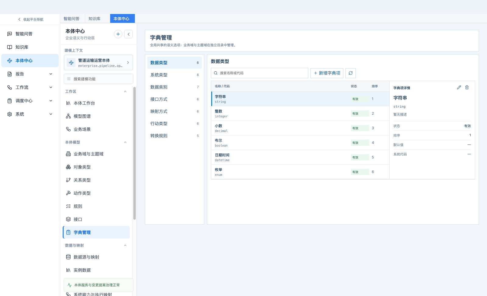
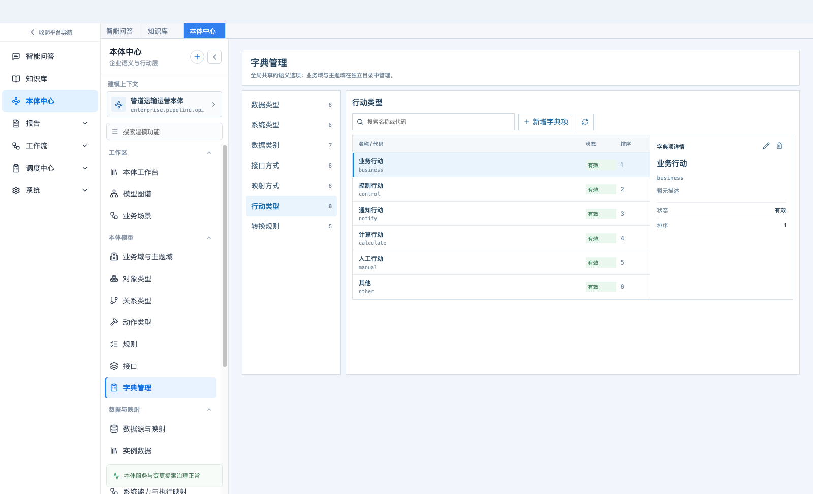
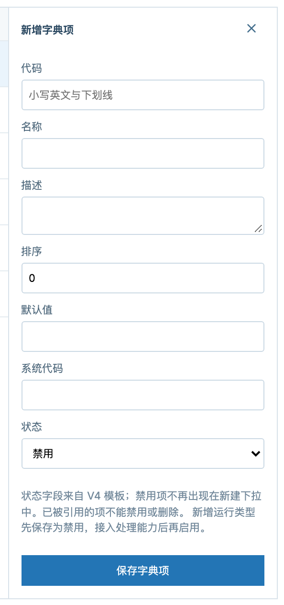
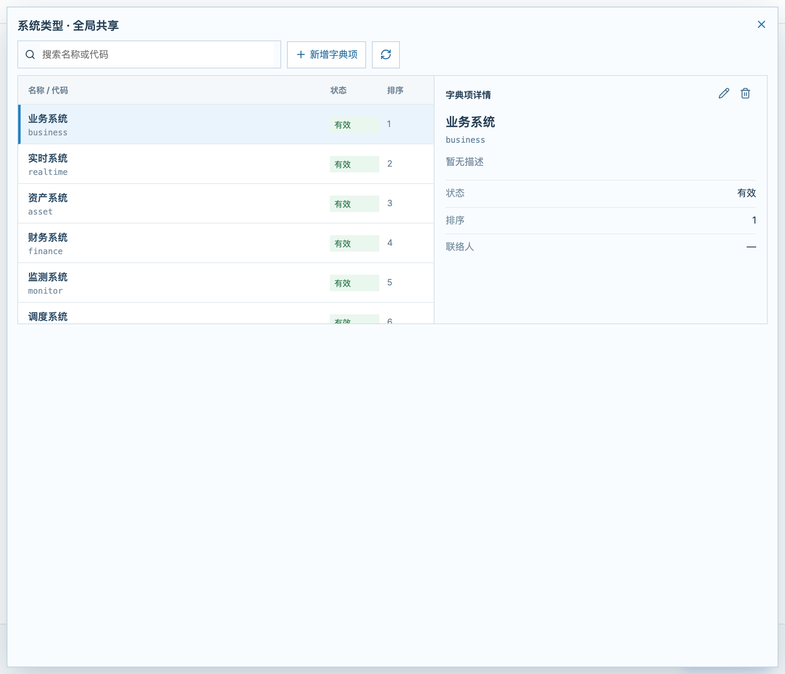

# 字典管理 · 产品需求文档

> 本体中心 → 本体模型 → 字典管理（路由 `#/ontology/model/dictionaries`）

| 项目 | 内容 |
|---|---|
| 功能名称 | 字典管理（全局共享语义选项） |
| 所属模块 | 本体中心 → 本体模型 |
| 页面路由 | `#/ontology/model/dictionaries` |
| 适用对象 | 本体建模人员、数据治理人员 |
| 文档状态 | 评审中 |
| 更新日期 | 2026-10-12 |

---

## 1. 功能概述

字典管理维护**全局共享**的建模选项，让同一个概念在所有本体里写法一致——避免一个本体写「直接映射」、另一个本体写「direct」。

业务域与主题域属于本体目录实体，**不在**字典里管理；它们有独立的目录页面。

## 2. 字典类别

系统统一管理 7 类全局字典：

| 类别 | 代码 | 典型字典项 |
|---|---|---|
| 数据类型 | `data_type` | 字符串 string、整数 integer、小数 decimal、布尔 boolean、日期时间 datetime、枚举 enum |
| 系统类型 | `system_type` | 业务系统 business、实时系统 realtime、资产系统 asset、财务系统 finance、监测系统 monitor、调度系统 dispatch |
| 数据类别 | `data_category` | 主数据、交易数据、时序数据、分析数据 等 |
| 接口方式 | `interface_type` | 数据库、接口、REST API、文件交换、消息队列 等 |
| 映射方式 | `mapping_way` | 直接映射、表达式转换、枚举映射 等 |
| 行动类型 | `action_type` | 业务行动、通知行动、控制行动 等 |
| 转换规则 | `xform_rule` | 单位标准化、状态值归一 等 |

## 3. 页面结构

页面为「左侧类别导航 + 右侧（列表 + 详情）」结构：左侧切换字典类别，右侧维护该类别下的字典项。

*图 1　字典管理整页：左侧 7 类字典，右侧字典项列表与详情*

## 4. 类别导航与字典项列表

*图 2　切换到「行动类型」类别*

- 左侧 7 个类别入口，每项实时显示该类别的字典项数量。
- 列表列：名称 / 代码、状态（有效 / 禁用）、排序值。
- 工具条：按名称或代码搜索、新增字典项、刷新。

## 5. 字典项详情与编辑

*图 3　字典项详情*

*图 4　新增 / 编辑字典项*

**通用字段**：代码、名称、描述、排序、状态。

**类别特有字段**：数据类型可维护「默认值」「系统代码」；系统类型可维护「联络人」。

- **代码**：创建后不可修改，它是被模型引用的稳定标识。
- **状态**：有效 / 禁用。禁用项不再出现在新建下拉中，但历史值仍可查看。
- **编辑**：详情右上角铅笔图标；**删除**：垃圾桶图标，删除前二次确认。

## 6. 表单内联管理

在数据源、数据映射、对象属性、行动等表单中，每个字典下拉旁都有「管理此字典」，点开即为就地管理面板，可以不离开当前表单完成增删改；新建的字典项会自动写回当前表单，省去“保存表单 → 去字典页新增 → 回来重填”的往返。

*图 5　登记数据源表单里的内联字典管理（系统类型）*

## 7. 规则与口径

| 规则 | 说明 |
|---|---|
| 代码不可改 | 代码是稳定引用标识，创建后不能修改 |
| 在用项不可禁用或删除 | 服务端校验并返回 409，提示“字典项已被模型引用，不能删除 / 禁用；请先处理引用” |
| 名称被引用时不可改名 | 历史数据中存在按名称保存的引用，直接改名会断链；服务端返回 409 并提示先完成引用迁移 |
| 禁用项不出现在新建下拉 | 已有历史值仍可在详情与下拉中看到，标注为「已禁用，历史值」 |
| 行为类新增默认禁用 | 数据类型、接口方式、映射方式、行动类型、转换规则新增时先保存为禁用，接入处理能力后再启用 |
| 字典外历史值保留 | 已保存但不在字典中的取值显示为「（已有值，待规范）」，不静默丢弃 |
| 排序 | 数值排序，用于控制下拉中字典项的先后顺序 |

## 8. 与建模的关系

- **数据类型**：影响对象属性与规则参数的类型定义。
- **系统类型、数据类别、接口方式、转换规则**：影响数据源登记。
- **映射方式**：影响语义映射的转换配置。
- **行动类型**：影响动作类型的定义。
- 字典项的增删改会立即刷新所有使用该字典的下拉选项。

## 9. 边界与已知限制

- 同一字段存在「按代码保存」与「按名称保存」两种历史写法，尚未统一迁移；这也是改名守卫采用保守策略的原因。
- 暂未对字典外取值做强制校验，也没有「字典外取值清单」用于批量归一。
- 字典是全局资源，不属于任何本体，因此字典项的编辑目前不写入本体的变更记录。
- 内联面板中对当前选中项改名或删除时，外层表单不会自动回写取值，需要重新选择。

## 10. 验收要点

- [ ] 7 类字典均可增删改查，代码创建后不可修改。
- [ ] 在用字典项的禁用与删除被服务端拒绝，并给出可读原因。
- [ ] 按名称被引用的字典项改名被拒绝，并提示先处理引用。
- [ ] 禁用项不出现在新建下拉，历史值仍可见。
- [ ] 表单内联管理可新增字典项并自动写回当前表单。
- [ ] 左侧类别导航的项数随增删实时变化。
