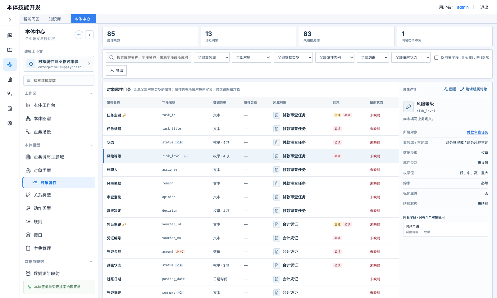
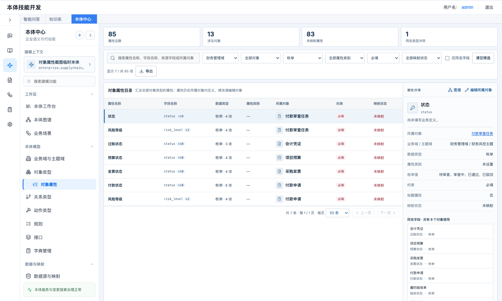
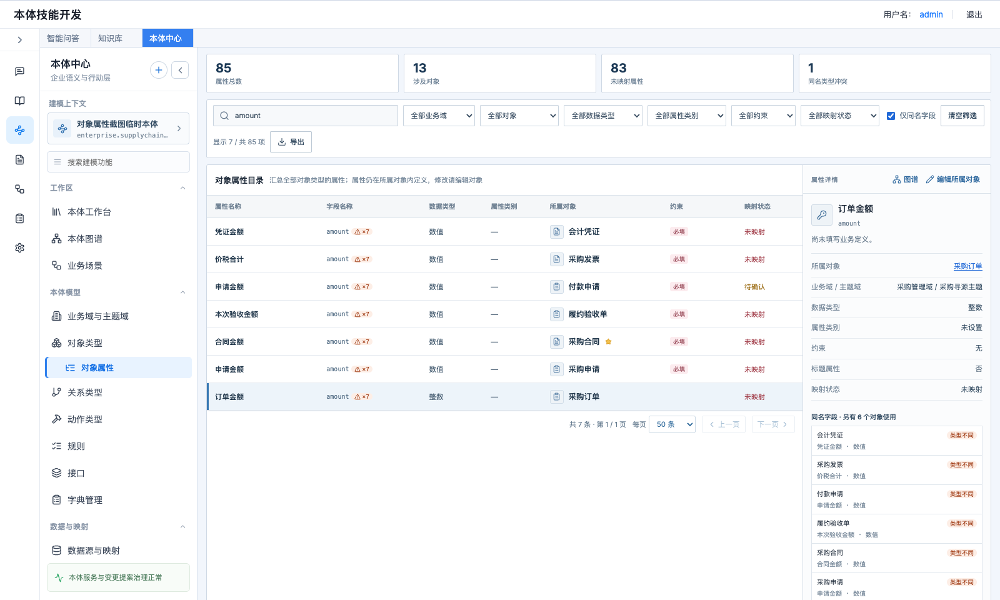
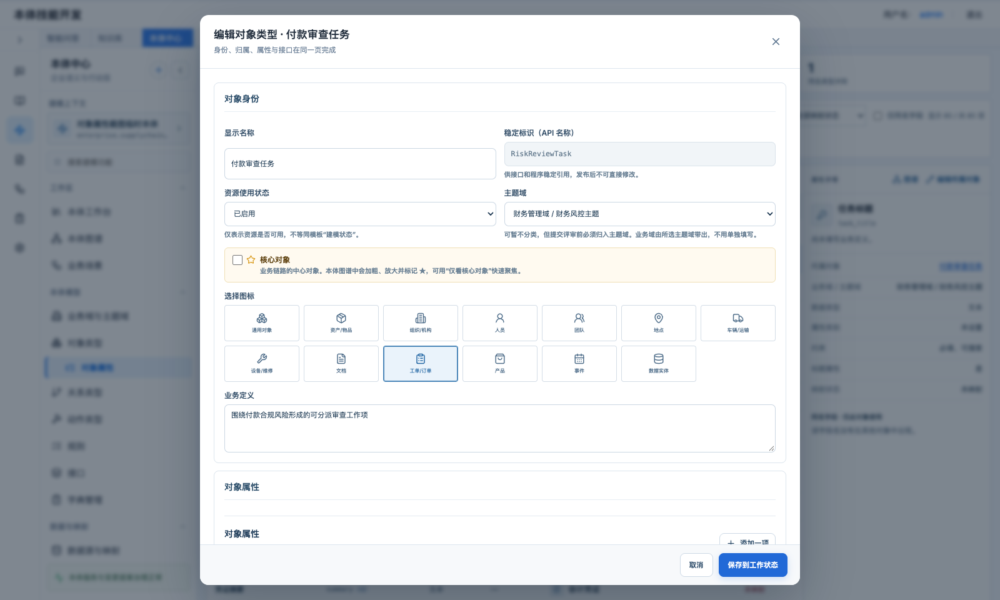
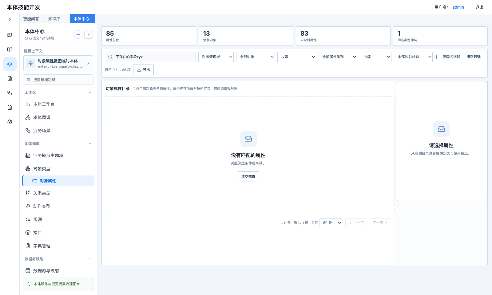

# 对象属性 · 产品需求文档

> 本体中心 → 本体模型 → 对象类型 → 对象属性（路由 `#/ontology/model/object-properties`）

| 项目 | 内容 |
|---|---|
| 功能名称 | 对象属性（全部对象属性目录） |
| 所属模块 | 本体中心 → 本体模型 |
| 页面路由 | `#/ontology/model/object-properties` |
| 适用对象 | 本体建模人员、数据治理人员 |
| 文档状态 | 待评审 |
| 更新日期 | 2026-10-16 |
| 参考原型 | manual 分支 `frontend/src/pages/ObjectProperties.jsx`、`frontend/src/propertyCatalog.js` |

---

## 1. 场景与痛点

建模人员和治理人员经常要横向看属性，例如：

- 本体里一共有哪些“金额”类字段，口径是否一致；
- 哪些属性还没有映射到数据源；
- 同一个字段名 `status` 在不同对象里，数据类型是否一样。

现在属性只能进到每个对象类型的详情里逐个查看。对象一多就没法横向比较，也没法快速找出未映射、类型不一致的属性。

## 2. 方案概述

在“对象类型”下新增子菜单“对象属性”，把当前本体中**所有对象类型的属性**汇总成一张目录，支持搜索、多维筛选、导出，并能直接跳到所属对象进行编辑或在图谱中定位。

- **只读汇总**：属性仍定义在所属对象内。本页不新增数据表，修改属性要编辑所属对象。
- **范围**：只汇总对象属性，不包含关系属性。
- **后端**：不新增接口，复用现有两个接口，在前端完成汇总：
  - `GET /api/ontologies/{id}/object-types`
  - `GET /api/ontologies/{id}/enterprise/data-mappings`

## 3. 页面结构

```text
┌─────────────────────────────────────────────────────────────────────────┐
│ [属性总数] [涉及对象] [未映射属性] [同名类型冲突]          ← 统计卡        │
├─────────────────────────────────────────────────────────────────────────┤
│ 搜索框 │业务域│所属对象│数据类型│属性类别│约束│映射状态│□仅同名字段│清空筛选│
│ 显示 n / 共 m 项   [导出]                                                │
├──────────────────────────────────────────────────────┬──────────────────┤
│ 对象属性目录（表格 + 分页）                            │ 属性详情          │
└──────────────────────────────────────────────────────┴──────────────────┘
```



*图 1　对象属性整页：统计卡、筛选工具条、属性目录与右侧属性详情*

## 4. 功能与交互

### 4.1 菜单入口

- 左侧导航“对象类型”下方新增二级菜单“对象属性”，缩进显示，图标为列表树。
- 页面标题为“对象属性”，副标题为“汇总查看全部对象类型的属性定义与映射情况”。
- 切换当前本体后，页面重新加载为新本体的数据。

### 4.2 统计卡

| 卡片 | 口径 | 点击 |
|---|---|---|
| 属性总数 | 当前本体全部对象属性条数 | 不可点 |
| 涉及对象 | 至少有一个属性的对象类型数 | 不可点 |
| 未映射属性 | 映射状态为“未映射”的属性数 | 切换“映射状态 = 未映射”筛选，再点取消，选中时卡片高亮 |
| 同名类型冲突 | 在多个对象中出现、且数据类型不一致的**字段名**个数（按字段名去重） | 勾选“仅同名字段”并清空搜索词 |

统计卡始终按全量计算，不随筛选变化。

### 4.3 搜索与筛选

| 控件 | 规则 |
|---|---|
| 搜索框 | 不区分大小写的包含匹配。匹配范围：属性名称、字段名称、业务定义、来源字段、所属对象显示名称、所属对象 API 名称 |
| 业务域 | 选项取自当前本体对象所属的业务域。切换后清空“所属对象”筛选 |
| 所属对象 | 选了业务域时，只列出该业务域下的对象 |
| 数据类型 | 选项只列出当前已用到的数据类型，按数据类型字典显示中文名 |
| 属性类别 | 选项只列出当前已用到的属性类别 |
| 约束 | 主键 / 必填 / 唯一 / 可搜索，单选 |
| 映射状态 | 已确认 / 待确认 / 未映射 / 无需映射，口径见 4.6 |
| 仅同名字段 | 只显示字段名在 2 个及以上对象中出现的属性 |

- 各条件之间为“且”的关系。
- 任一条件生效时显示“清空筛选”按钮，点击后恢复全部条件。
- 工具条显示 `显示 n / 共 m 项`。
- 条件变化或修改每页条数后，回到第 1 页。



*图 2　组合筛选：财务管理域 + 枚举 + 必填*

### 4.4 属性目录表格

| 列 | 显示 |
|---|---|
| 属性名称 | 加粗；主键后面带钥匙图标 |
| 字段名称 | 等宽字体。字段名出现在多个对象中时带 `×n` 角标；同名字段数据类型不一致时角标变为红色并带 ⚠，悬停提示“同名字段在其他对象中数据类型不同” |
| 数据类型 | 中文名；枚举类型追加“· n 项” |
| 属性类别 | 未设置时显示“—” |
| 所属对象 | 对象图标 + 显示名称；核心对象带 ★ |
| 约束 | 主键、必填、唯一以小标签显示（可搜索只在详情里显示） |
| 映射状态 | 文字着色：已确认为绿，待确认为黄，未映射为红，无需映射为灰 |

- **排序**：按对象类型的返回顺序排列，同一对象内按属性定义顺序排列。本期不支持点击表头排序。
- **分页**：默认每页 50 条，可选 20 / 50 / 100 / 200 / 300。
- **单击行**：选中该行，右侧显示详情。未选中任何行时，默认选中当前页第一行。
- **双击行**：打开所属对象的编辑表单，见 4.7。

### 4.5 属性详情

**头部按钮**
- “图谱”：跳转 `#/ontology/graph?focus=<对象ID>`，在本体图谱中定位所属对象。
- “编辑所属对象”：打开对象编辑表单。

**标题区**：属性名称和字段名称，下方是业务定义。业务定义取 `description`，为空时取 `business_definition`，都为空时显示“尚未填写业务定义。”

**信息列表**（值为空的行不显示）：

| 字段 | 说明 |
|---|---|
| 所属对象 | 链接样式。点击后把“所属对象”筛选设为该对象 |
| 业务域 / 主题域 | 未归类时显示“未分类” |
| 数据类型、属性类别 | 属性类别为空时显示“未设置” |
| 枚举值 | 仅枚举类型显示，用“、”连接 |
| 单位 | 有值时显示 |
| 约束 | 主键、必填、唯一、可搜索，用“、”连接；都没有时显示“无” |
| 标题属性 | 该属性是不是所属对象的标题属性：是 / 否 |
| 来源字段（模板）、来源系统（模板） | 模板导入时带入的值，有值时显示 |
| 映射状态 | 同表格 |

**同名字段**
- 标题为“同名字段 · 另有 n 个对象使用”，或“仅此对象使用”。
- 逐条列出其他对象中同字段名的属性，格式为“对象名 / 属性名 · 数据类型”。类型与当前属性不同的条目带红色“类型不同”标签。
- 没有同名字段时显示“该字段名没有在其他对象中出现。”



*图 3　同名字段：amount 在 7 个对象中出现，“订单金额”为整数，与其他对象的数值类型不一致*

### 4.6 计算口径

**映射状态**

取该属性的属性映射：`mapping_type = property`，且 `target_object_type` 等于对象 API 名称、`target_property` 等于字段名称。

| 情况 | 状态 |
|---|---|
| 没有映射，属性类别为“计算属性” | 无需映射 |
| 没有映射，其他类别 | 未映射 |
| 有映射，且全部已确认 | 已确认 |
| 有映射，且至少一条未确认 | 待确认 |

单条映射算“已确认”的条件：`binding_mode = governed`，并且满足下面任一条：
- `design_status` 有值时，取值为“已确认”、`validated` 或 `confirmed`；
- `design_status` 为空时，`status = active`。

该口径必须与对象类型列表的“映射状态”保持一致，建议两处共用同一函数。

**同名字段**：在当前本体内按字段名称（`key`）精确匹配，区分大小写。只要同名字段中有数据类型不同的，就视为“类型冲突”。

### 4.7 编辑所属对象

- 双击行，或点击详情中的“编辑所属对象”，打开对象编辑弹窗。该弹窗与“对象类型”页使用**同一个**表单组件，字段、校验和保存逻辑一致。
- 保存成功后，提示“对象类型已保存到工作状态”，重新加载目录，并刷新左侧本体统计。
- 本页不提供单个属性的快捷编辑和删除，后续可复用图谱检查器中的属性快捷编辑组件。



*图 4　双击行打开所属对象的编辑表单*

### 4.8 导出

- 点击“导出”，下载当前**筛选结果的全部条目**（不受分页限制）。
- 格式为 CSV，UTF-8 编码并带 BOM，Excel 直接打开不乱码。
- 文件名为 `本体名-对象属性.csv`。
- 列依次为：所属对象、对象 API 名称、业务域、主题域、属性名称、字段名称、数据类型（中文名）、属性类别、主键、必填、唯一、映射状态、业务定义。
- 主键、必填、唯一三列为真时填“是”，否则留空。
- 筛选结果为空时，导出按钮不可点。

### 4.9 空状态与异常

| 情况 | 显示 |
|---|---|
| 本体还没有任何属性 | “暂无对象属性 / 创建对象类型并定义属性后，会在这里汇总展示。” |
| 筛选后无结果 | “没有匹配的属性 / 调整筛选条件后再试。”，并附“清空筛选”按钮；右侧详情显示“请选择属性” |
| 加载中 | 统一加载态 |
| 接口失败 | 统一错误态，显示错误信息和“重试”按钮 |



*图 5　筛选无结果*

## 5. 联动

| 位置 | 变化 |
|---|---|
| 左侧导航 | “对象类型”下新增“对象属性” |
| 本体图谱 | 接收 `focus` 参数，定位所属对象（图谱已支持） |
| 对象类型 | 映射状态口径与本页共用 |

## 6. 验收标准

1. 左侧导航“对象类型”下出现“对象属性”，点击进入本页，标题正确。
2. 属性总数等于当前本体所有对象的属性数之和；切换本体后数据随之变化。
3. 搜索 `amount`，能命中所有字段名为 amount 的属性；搜索对象名，能命中该对象的全部属性。
4. 选择某个业务域后，“所属对象”下拉只列出该域的对象，表格只显示该域的属性。
5. 多个筛选条件同时生效时结果为交集；点“清空筛选”后恢复全量。
6. 同一字段名出现在多个对象中时显示 `×n`。类型不一致时显示红色 ⚠，“同名类型冲突”统计卡计数正确，详情中对应条目带“类型不同”。
7. 映射状态与对象类型页一致：计算属性无映射时为“无需映射”；有一条映射未确认时为“待确认”。
8. 点“未映射属性”统计卡，只显示未映射的属性；再点一次恢复。
9. 导出的 CSV 用 Excel 打开中文不乱码，条数等于当前筛选结果数（不受分页影响）。
10. 双击行打开所属对象的编辑表单，保存后目录立即反映修改。
11. 点击详情中的“图谱”，进入本体图谱，并选中、定位所属对象。

## 7. 本期不做与后续规划

| 项 | 说明 |
|---|---|
| 关系属性 | 本期不纳入，后续可加“对象属性 / 关系属性”切换 |
| 属性快捷编辑与删除 | 本期只能编辑整个对象；后续复用图谱的属性快捷编辑组件 |
| 批量操作 | 如批量改属性类别、批量设必填，暂不支持 |
| 表头排序 | 暂不支持 |
| 大数据量 | 前端汇总适合几千条以内的属性；超出时改为后端分页和筛选接口 |
| 共享属性 | 同名字段目前只做提示，后续可引导沉淀为共享属性（`shared_property_id`） |
