# 本体图谱 · 产品需求文档

> 本体中心 → 工作区 → 本体图谱（路由 `#/ontology/graph`）

| 项目 | 内容 |
|---|---|
| 功能名称 | 本体图谱（原“模型图谱”） |
| 所属模块 | 本体中心 → 工作区 |
| 页面路由 | `#/ontology/graph`，支持参数 `domain`、`subject`、`focus` |
| 适用对象 | 本体建模人员、业务评审人员 |
| 文档状态 | 待评审 |
| 更新日期 | 2026-10-16 |

---

## 1. 背景与目标

原“模型图谱”只能看：对象和关系要改，得回到对象类型、关系类型等列表页逐个找；画布嵌在页面里，对象一多就看不清；业务域、主题域只是两个下拉框，没法一眼看出分类边界；对象表单里的“核心对象”设置在图上没有任何体现。

本次迭代把图谱改成**可以直接维护本体结构的工作台**：

- 在图上直接完成对象、关系、属性、主题域的新建、编辑、复制和删除；
- 支持全屏和完整的视图控制；
- 以业务域过滤范围、以主题域着色，核心对象突出显示。

映射、接口、动作、规则等细节配置仍在各自页面维护，图谱只负责本体**结构**。

## 2. 新增功能一览

| # | 功能 | 一句话说明 |
|---|---|---|
| F1 | 更名为“本体图谱” | 菜单、标题、页面文案统一改名 |
| F2 | 业务域过滤 | 标签多选过滤图谱范围，可显示跨域关联 |
| F3 | 主题域着色与高亮 | 每个主题域一种颜色，点选后高亮该主题域、其余淡化 |
| F4 | 核心对象突出显示 | 核心对象放大、加粗、标 ★，可只看核心对象 |
| F5 | 全屏与视图控制 | 全屏、缩放、适配、重新布局、导出图片、记住布局 |
| F6 | 搜索定位 | 搜索下拉直接定位对象，被过滤隐藏时自动放开 |
| F7 | 本体检查器 | 右侧面板随选中项切换对象 / 关系 / 总览三种视图 |
| F8 | 直接新建与编辑 | 双击编辑、双击空白新建，表单与列表页共用 |
| F9 | 连线建关系 | 从一个对象拖到另一个对象即可新建关系 |
| F10 | 复制对象 / 关系 | 复制时必须确认并修改唯一标识，可连同关系复制 |
| F11 | 删除与影响检查 | 删除前列出引用影响，按规则阻止或级联 |
| F12 | 右键菜单 | 节点、连线、空白处各有一组快捷操作 |
| F13 | 只看关联对象 | 聚焦某个对象及其一跳关联 |
| F14 | 检查器卡片操作 | 属性、关系、主题域等每张小卡片带编辑 / 删除图标 |
| F15 | 快捷键 | Esc、Delete、Enter、⌘D、F、L |

## 3. 页面结构

```text
┌──────────────────────────────────────────────────────────────┬──────────────┐
│ 工具栏：本体名 │ 搜索 │ 新建对象 │ 连线建关系 │ 视图图标组 │ 图例统计 │              │
├──────────────────────────────────────────────────────────────┤  本体检查器   │
│ 业务域：[全部] [域A 5] [域B 3] …      □仅核心对象 □跨域关联 □关系名称 │（可收起）     │
├──────────────────────────────────────────────────────────────┤              │
│ 主题域：●主题1 4  ●主题2 3  ●未分类 1 …          点击主题域高亮其对象 │  对象 / 关系 │
├──────────────────────────────────────────────────────────────┤  / 总览       │
│                                                              │              │
│                         画布                                  │              │
│                                                              │              │
│ 单击查看 · 双击编辑 · 右键更多操作 · 双击空白处新建对象 · Delete 删除 │              │
└──────────────────────────────────────────────────────────────┴──────────────┘
```

- **视图图标组**：放大、缩小、适配全图、重新布局、导出图片、收起/展开检查器、全屏。
- **图例统计**：`对象 当前范围数/总数`、`核心 n`、`关系 n`；开启跨域关联且存在时显示 `跨域 n`。
- **画布空状态**：本体没有对象时，显示“新建对象类型”按钮；过滤后没有对象时，显示“清除过滤”按钮。

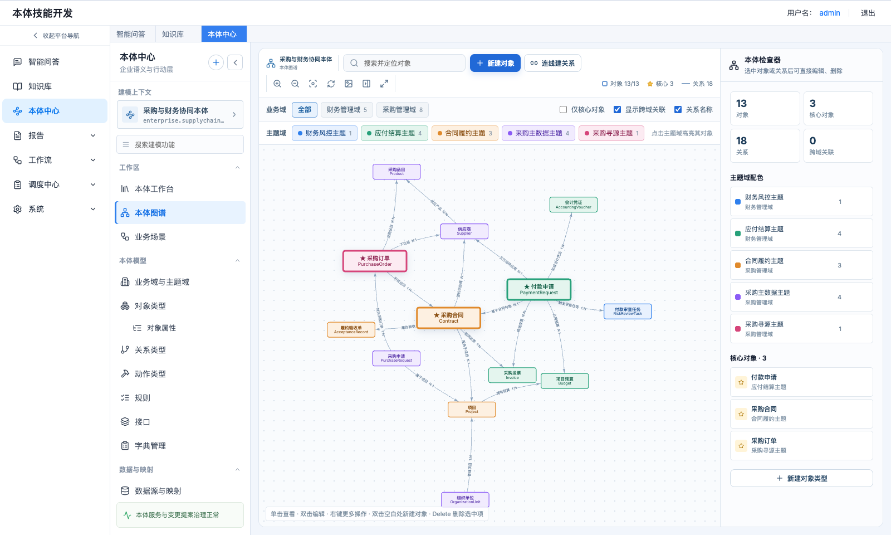

*图 1　本体图谱整页：工具栏、业务域 / 主题域过滤栏、画布与右侧本体检查器*

## 4. 功能与交互说明

### F1 更名为“本体图谱”

- 左侧菜单、页面标题、浏览器标签页、页面内文案统一由“模型图谱”改为“本体图谱”。
- 修复“业务域与主题域”页里“在本体图谱中查看”的跳转：原先跳到一个不存在的地址，会被重定向回工作台。现在会带着当前业务域、主题域参数打开图谱。

### F2 业务域过滤

- 业务域以标签形式平铺，每个标签显示该域下的对象数；对象数为 0 的标签不可点。
- **多选**：点击标签加入或移出过滤范围，选中的标签带 ✓；点“全部”清空过滤。
- 有未归类对象时，额外出现“未分类”标签，可以单独筛出来。
- 范围外的对象和关系从画布隐藏；范围变化后，画布自动适配到可见对象。
- **显示跨域关联**（默认开）：范围外但和范围内对象有关系的对象，以虚线描边、淡化显示；跨域关系用橙色虚线表示。关闭后只显示范围内的对象。
- **关系名称**（默认开）：关闭后连线上不再显示关系名和基数，适合对象多、连线密集时使用。
- URL 参数 `domain` 可以预设业务域过滤。

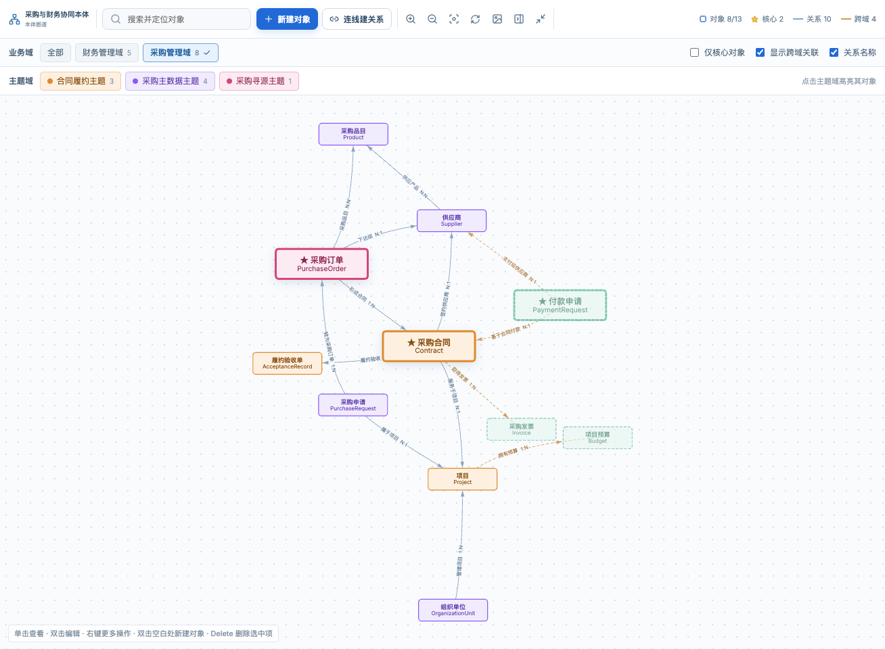

*图 2　只看“采购管理域”：范围外但有关系的“付款申请”“采购发票”“项目预算”以虚线淡化显示，跨域关系为橙色虚线*

### F3 主题域着色与高亮

- 每个主题域分配一种固定颜色（10 色循环），节点底色、描边、文字按所属主题域上色；未分类对象为灰色。
- 主题域标签行只列出**当前范围内**有对象的主题域，标签带色点和对象数。
- **点击主题域标签**：该主题域的对象加深描边并保留阴影，其余对象和连线淡化；再点一次取消高亮。
- 业务域过滤变化后，若已选中的主题域不在新范围内，自动取消高亮。
- 也可从右键菜单“高亮所在主题域”、检查器总览中的主题域卡片触发。
- URL 参数 `subject` 可以预设高亮的主题域。

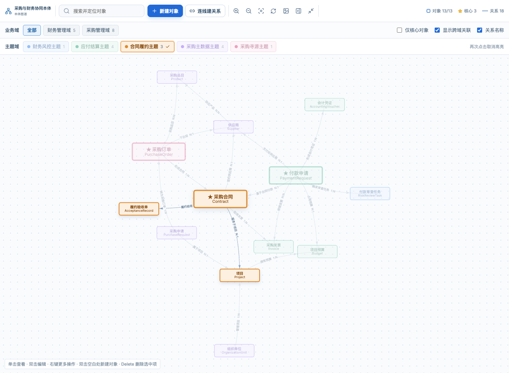

*图 3　点选“合同履约主题”：该主题域的对象保持实色，其余对象和连线淡化*

### F4 核心对象突出显示

- **设置入口**：
  - 对象编辑表单“对象身份”区新增“核心对象”勾选。原先被收进只读区，现在恢复为可编辑；
  - 图谱右键菜单“设为核心对象 / 取消核心对象”；
  - 检查器对象视图的快捷按钮“设为核心对象”。
- **图上表现**：核心对象的节点更大、边框加粗（3px）、标题字号放大，名称前加 ★；布局时质量加倍，更容易处在图的中心。
- **仅核心对象**：勾选后只显示核心对象及它们之间的关系；若同时开启跨域关联，上下文对象也只保留核心对象。
- 核心关系（关系表单勾选“核心关系”）的连线加粗显示。
- 对象类型列表同步显示“核心”标记，并新增“仅核心对象”筛选。

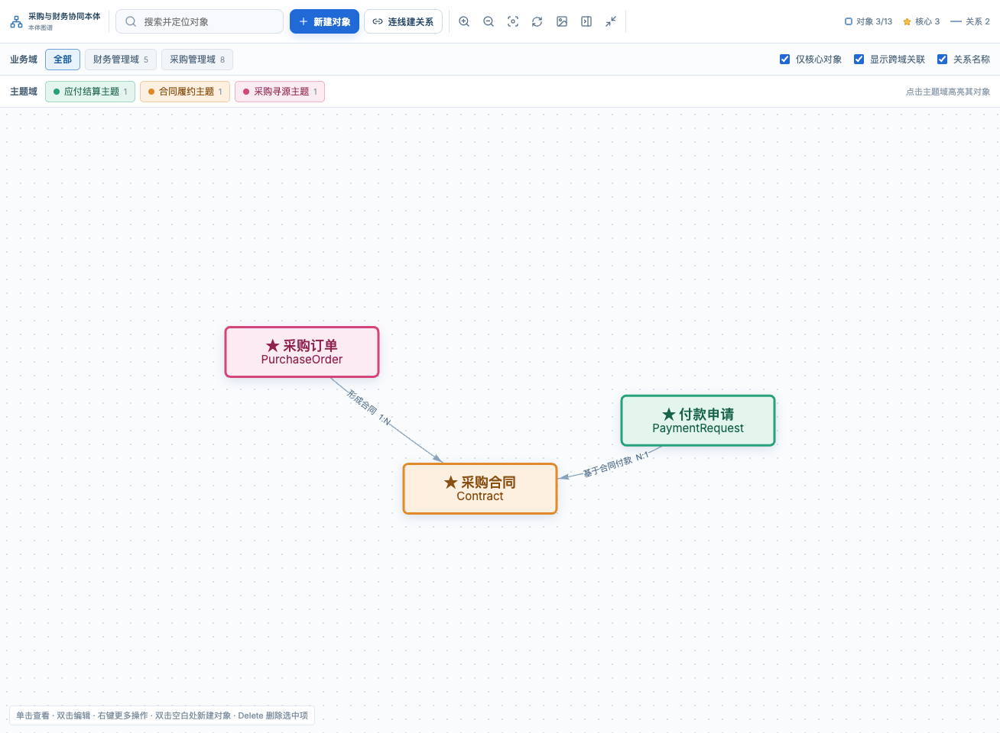

*图 4　勾选“仅核心对象”：只显示带 ★ 的核心对象及它们之间的关系*

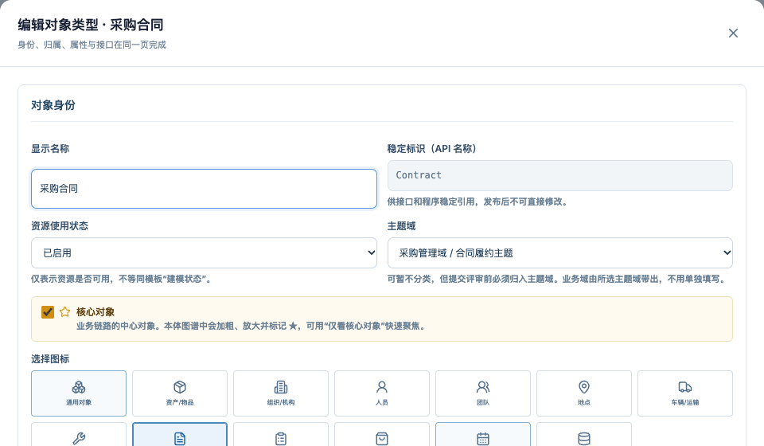

*图 5　对象编辑表单“对象身份”区的“核心对象”勾选*

### F5 全屏与视图控制

| 控件 | 交互 |
|---|---|
| 全屏 | 图谱铺满整个视口并压在平台导航之上，同时请求浏览器系统全屏。再次点击或按 Esc 退出；退出浏览器全屏时页面同步退出。全屏下弹窗、提示照常可用 |
| 放大 / 缩小 | 每次按 1.25 / 0.8 倍缩放，范围 0.15–3 倍；滚轮缩放同样可用 |
| 适配全图 | 把当前可见对象全部收进视野（快捷键 F） |
| 重新布局 | 只对可见对象重新排布，完成后自动适配 |
| 导出图片 | 把当前画布导出为白底 PNG，文件名为“本体名-本体图谱.png” |
| 收起检查器 | 右侧检查器收起后画布占满宽度 |

- **记住布局**：拖动节点后，位置按本体保存在浏览器本地。下次打开时直接还原，不再重排。新建的对象放在当前视野中央，或双击、右键时的位置。
- 过滤、着色、增删改都是增量更新画布，不会打乱已有布局。

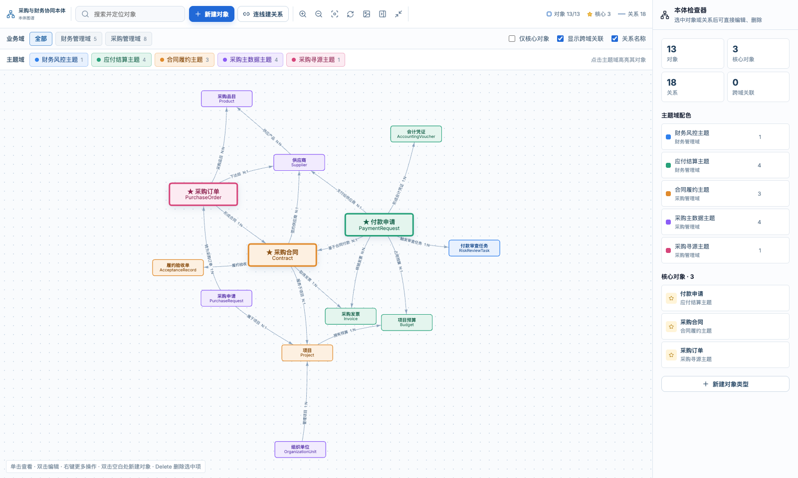

*图 6　全屏查看：图谱铺满视口，工具栏、过滤栏和检查器保留*

### F6 搜索定位

- 工具栏搜索框按显示名称、API 名称、模板 ID 模糊匹配，下拉最多显示 8 条，每条带主题域色点和所属主题域。
- 点击结果或按 Enter（取第一条）：画布聚焦到该对象并选中，检查器切到对象视图。
- 目标被当前过滤隐藏时，只放开挡住它的那一项过滤（例如把它所在的业务域加入范围、关闭“仅核心对象”），然后再定位。
- 按 Esc 清空搜索。
- URL 参数 `focus=对象ID` 打开图谱即定位。对象类型列表、关系类型列表、对象属性页的“图谱”按钮都使用这个参数。


*图 7　搜索下拉：显示主题域色点、核心标记和所属主题域*

### F7 本体检查器

右侧面板按当前选中项切换三种视图，顶部的 × 用于取消选择。

**总览视图（未选中时）**
- 统计卡：对象、核心对象、关系、跨域关联数量；
- 主题域配色：列出当前范围的主题域、颜色和对象数，点击即高亮（同 F3）；
- 核心对象：列出当前范围的核心对象，点击定位；
- “新建对象类型”按钮。

**对象视图**
- 头部：图标（主题域配色）、名称、核心标记、API 名称；
- 操作按钮：编辑、复制、新建关系、删除；快捷按钮：设为核心对象、只看关联对象；
- 基本信息：业务域 / 主题域、对象类别、资源状态、标题属性；
- 关联关系列表：用“出 / 入”标出方向，点击切换到该关系；
- 对象属性列表：主键带钥匙图标，必填带标记；
- 底部链接“在对象类型目录中查看”。

**关系视图**
- 头部：名称、核心标记、API 名称；
- 操作按钮：编辑、复制、删除；
- 起点 → 终点卡片（中间显示基数），点击卡片定位到对应对象；
- 基本信息：反向名称、来源系统、起点键 / 终点键、资源状态；
- 关系属性列表。


*图 8　总览视图：统计、主题域配色、核心对象*


*图 9　对象视图：操作按钮、快捷按钮、基本信息、关联关系与对象属性*

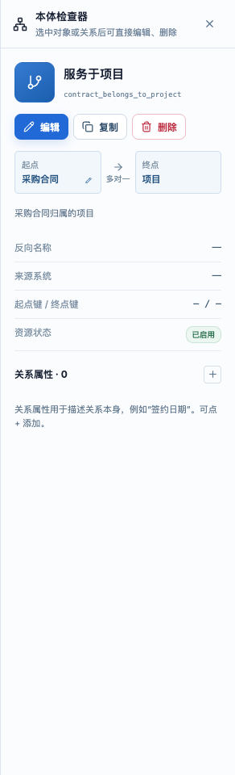

*图 10　关系视图：起点 → 终点卡片（中间为基数）、基本信息与关系属性*

### F8 直接新建与编辑

| 操作 | 结果 |
|---|---|
| 单击节点 / 连线 | 选中，检查器切到对应视图 |
| 单击空白处 | 取消选中，检查器回到总览 |
| 双击节点 | 打开对象编辑表单 |
| 双击连线 | 打开关系编辑表单 |
| 双击空白处 | 在该位置新建对象 |
| 工具栏“新建对象” | 打开新建对象表单；当前有高亮主题域时，表单预选该主题域 |

- 图谱使用的对象表单、关系表单与对象类型列表、关系类型列表是**同一套组件**，字段、校验和保存逻辑完全一致。
- 关系表单新增两项便利：选好起点和终点后自动生成关系 API 名称（可改，改过之后不再自动覆盖）；“反转”按钮一键交换起点和终点。
- 保存成功后提示“已创建 / 已保存 xxx”，画布定位并选中该对象或关系；若它被当前过滤隐藏，自动放开对应过滤。

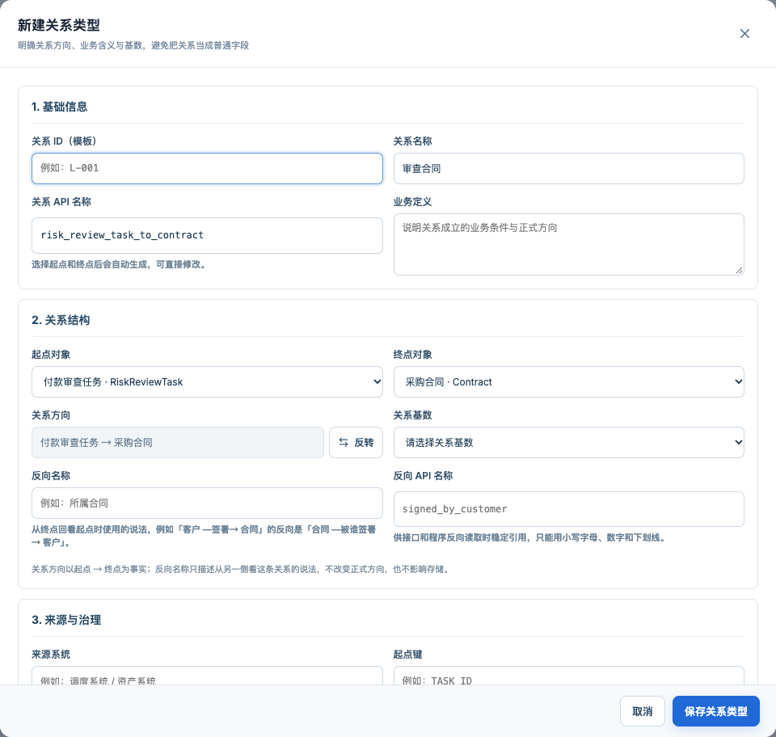

*图 11　从“付款审查任务”新建关系：起点已预填，选好终点后自动生成关系 API 名称，可一键反转方向*

### F9 连线建关系

1. 点击工具栏“连线建关系”或按 L，按钮变为“连线中…”，画布顶部出现提示条，光标变为十字；
2. 按住起点对象，拖到终点对象上松开；
3. 自动打开新建关系表单，起点、终点和关系 API 名称已经带好，补齐关系名称和基数后保存；
4. 松开后自动退出连线模式。

- 退出连线模式：再点一次按钮、按 Esc、右键画布，或点提示条上的“退出”。
- 连线模式下单击、双击不触发选中和编辑，避免误操作。

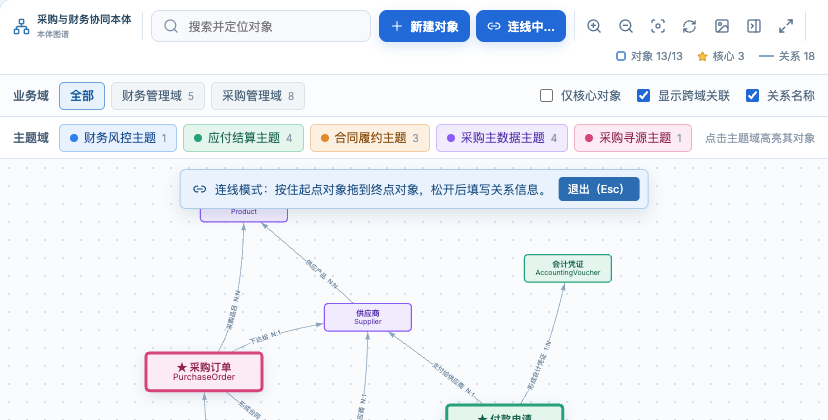

*图 12　连线模式：按钮变为“连线中…”，画布顶部出现操作提示与退出按钮*

### F10 复制对象 / 关系

对象 API 名称、关系 API 名称在本体内唯一，所以复制**不是一键克隆**：系统先带出源对象的完整定义，给出不重名的默认值，用户确认并修改后才保存。

**入口**：右键菜单“复制对象… / 复制关系…”、检查器的“复制”按钮、选中后按 ⌘D（Windows 为 Ctrl+D）。

#### 复制对象

弹窗分三个页签，可以任意切换；底部实时显示“将创建 1 个对象、n 个关系”。

**① 副本身份**
- 顶部显示“复制自 源对象 → 副本”的对照；
- 显示名称默认为“源名称（副本）”，已存在时依次为“（副本2）”“（副本3）”；
- API 名称默认为“源名称Copy”，已存在时加数字；
- 名称与已有对象重复，或 API 名称格式不对时，输入框下方立即报错，“创建副本”按钮不可点；
- 可修改主题域、资源使用状态、核心对象、业务定义；
- 资源状态默认为“试验中”，不沿用源对象的“已启用”；
- 明确告知**不复制**：模板对象 ID、实现接口、数据映射、实例数据。副本保存后需要自己建立映射，避免两个对象共用同一份映射。

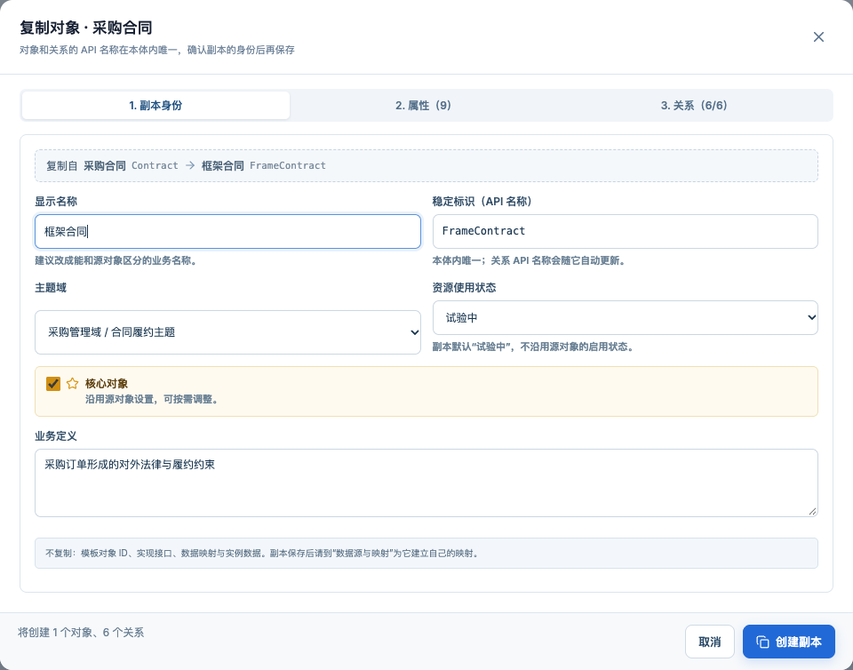

*图 13　复制对象 · 副本身份：顶部为“复制自”对照，底部实时显示将创建的对象和关系数*


*图 14　API 名称与已有对象重复时，输入框下方立即报错*

**② 属性**
- 带入源对象的全部属性，可以增删、改名、改类型；主键仍须唯一。

**③ 关系**
- 列出源对象的所有关联关系，默认全部勾选，可逐条取消，或一键“全部复制 / 全部不复制”；
- 每条勾选的关系可修改：关系名称、关系 API 名称、起点、终点；
- 源对象所在的一端自动替换为副本（自关联时两端都替换），另一端保持不变，也可以改成其他对象；
- 关系 API 名称自动生成：若原名称中含有源对象名，就替换成副本名（例如 `purchase_contract_to_supplier` → `frame_contract_to_supplier`），否则加 `_copy`。修改副本 API 名称时，未手动改过的关系名称跟着更新；
- 两端都不是副本时给出提示：“这条关系两端都不是副本，复制后与副本无关”；
- 复制的关系沿用基数、方向、关系属性、来源系统、起止键等配置；状态重置为“试验中”，模板 ID 清空，反向 API 名称加 `_copy`。

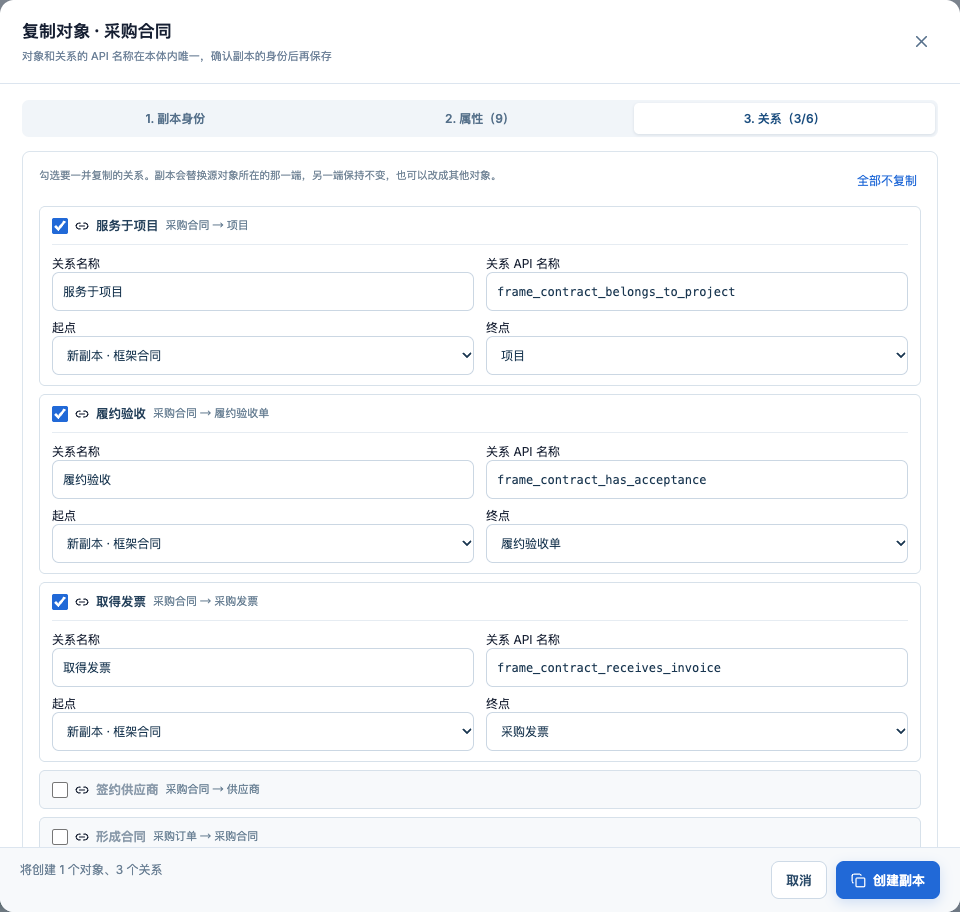

*图 15　复制对象 · 关系：逐条勾选；源对象一端换成“新副本”，API 名称随副本名自动生成*

**保存规则**
- 保存前统一校验：对象显示名称、API 名称不重复；勾选的关系名称非空、API 名称格式正确，且与已有关系及彼此之间都不重复。
- 先创建对象，再逐条创建关系。某条关系失败时不回滚对象，而是提示“对象已复制，但 n 个关系未能创建：原因”。
- 成功后提示“已复制为‘xxx’，并复制 n 个关系”，画布定位并选中副本。

#### 复制关系

- 打开关系表单，带入源关系的全部配置；名称默认“源名称（副本）”，API 名称默认“源名称_copy”（已存在时加序号）。
- 表单顶部提示：关系 API 名称唯一，请确认名称；通常还需要调整起点或终点，否则会得到两条含义重复的关系。
- 主按钮文案为“创建副本”。

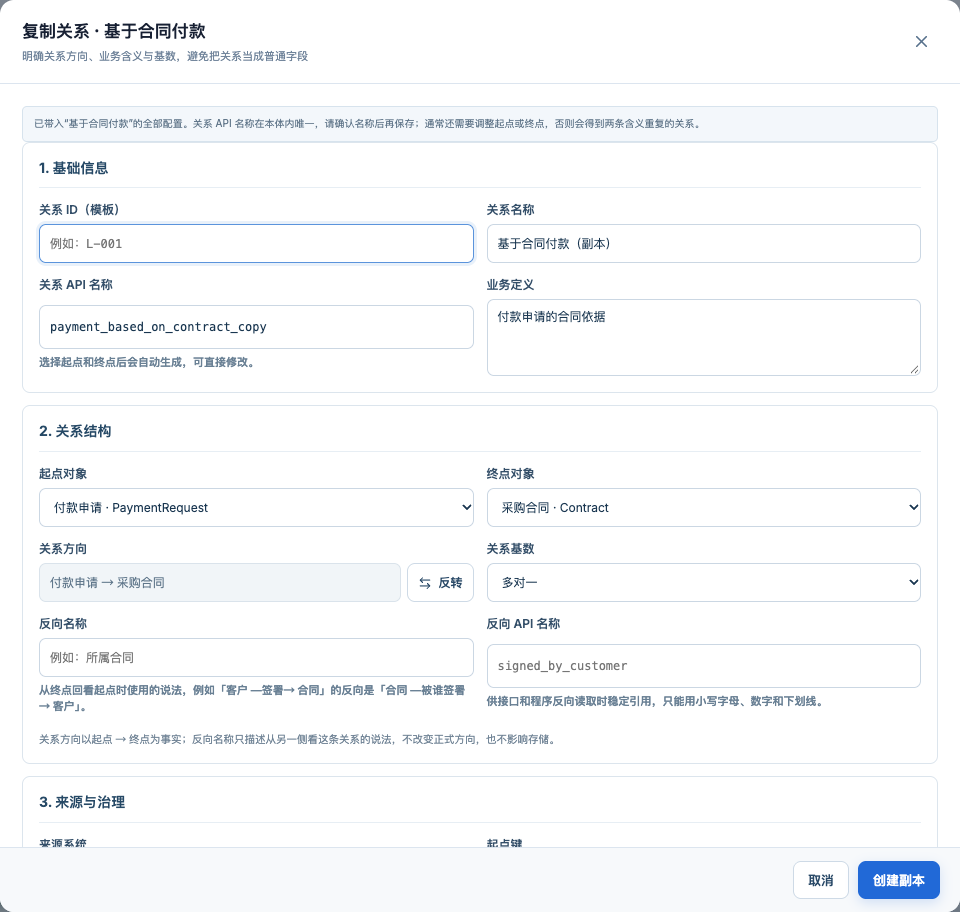

*图 16　复制关系：带入全部配置，名称加“（副本）”，API 名称加 _copy*

### F11 删除与影响检查

**入口**：检查器的“删除”按钮、右键菜单、选中后按 Delete / Backspace。打开删除确认弹窗后，先检查引用影响，再决定能否删除。

**删除对象**
- 弹窗列出四类影响：关联关系、动作类型、规则、实例数据的数量。
- 处理规则：

| 情况 | 处理 |
|---|---|
| 对象状态为“已启用”或“核心推荐” | 不能删除，提示先改为“已弃用”，提供“编辑对象状态”入口 |
| 被动作、规则或实例数据引用 | 不能删除，列出具体引用，并提供“前往动作类型 / 规则 / 实例数据”入口 |
| 只被关系引用 | 列出全部关系，勾选“同时删除这 n 个关系”后才能确认；其中有“已启用”的关系时不能删除 |
| 无任何引用 | 直接确认删除 |

**删除关系**：“已启用”的关系不能删除；其余情况说明起点 → 终点，确认即可删除。

- 删除只影响当前工作状态，已发布版本不受影响。
- 删除的若不是当前选中项（例如在对象视图里删除一条关系），当前选中保持不变。

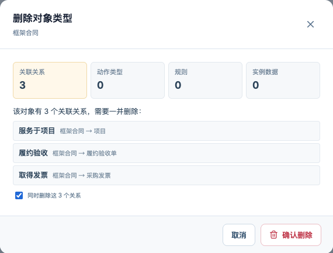

*图 17　只被关系引用：列出全部关系，勾选“同时删除”后才能确认*

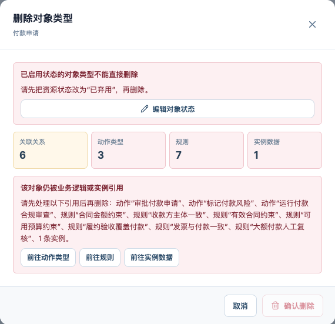

*图 18　已启用且被动作、规则、实例引用：不能删除，列出具体引用并给出处理入口*

### F12 右键菜单

| 右键位置 | 菜单项 |
|---|---|
| 对象 | 编辑对象、复制对象…（⌘D）、从此对象新建关系、设为 / 取消核心对象、只看关联对象、高亮所在主题域、删除对象 |
| 关系 | 编辑关系、复制关系…（⌘D）、定位起点、定位终点、删除关系 |
| 空白处 | 在此处新建对象、新建关系、适配全图、重新布局 |

- 右键对象或关系时同时选中它；菜单头部显示对象或关系的名称。
- 点击菜单项、拖动画布、缩放或按 Esc 时关闭菜单。

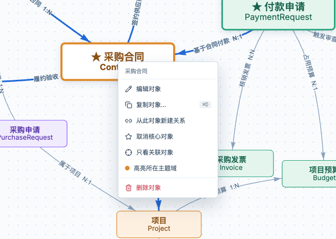

*图 19　右键对象*

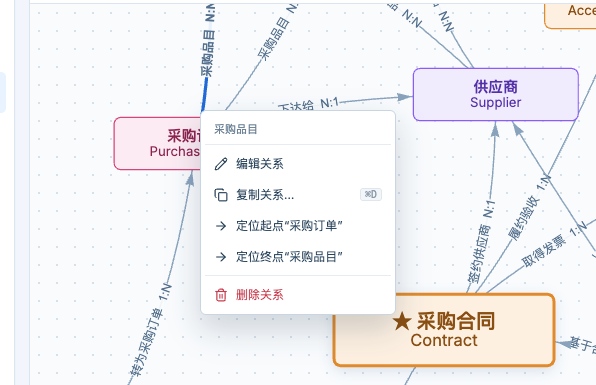

*图 20　右键关系*

### F13 只看关联对象

- 入口：右键菜单、检查器对象视图的“只看关联对象”。
- 画布只显示该对象和与它直接相连的对象（一跳），这时业务域过滤和“仅核心对象”暂不生效。
- 顶部提示条：“正在查看‘xxx’及其直接关联的 n 个对象”，点“返回全图”或按 Esc 退出。

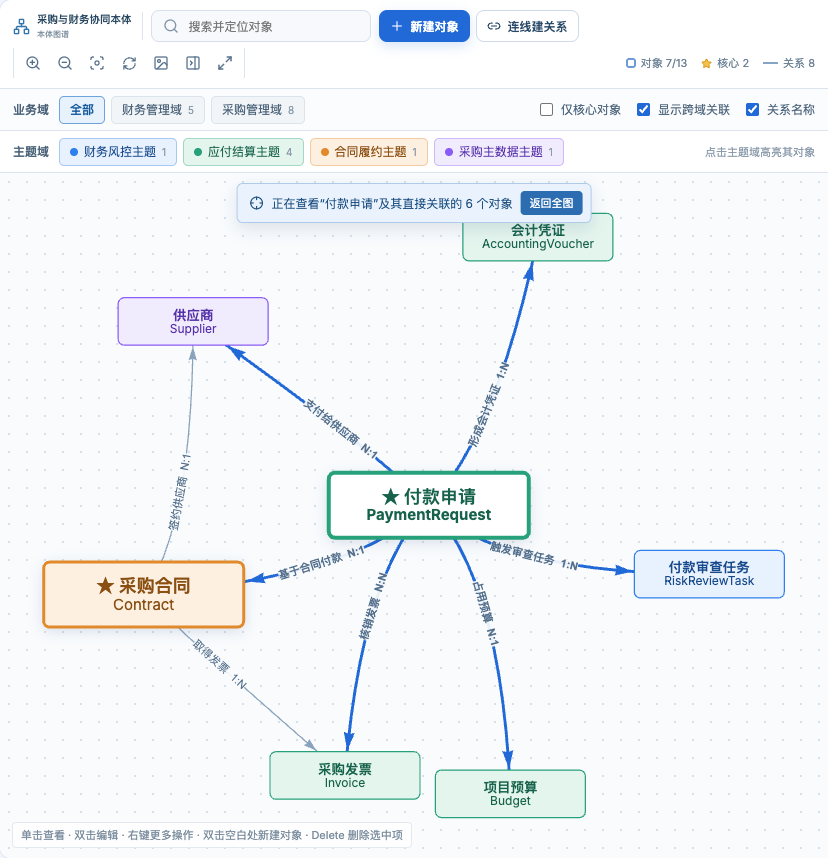

*图 21　只看“付款申请”及其直接关联的 6 个对象*

### F14 检查器卡片操作

检查器中的每张小卡片右侧带两个图标，**编辑**（铅笔）和**删除**（垃圾桶）。鼠标悬停或键盘聚焦卡片时显示，触屏设备上常显。点图标不会触发卡片本身的点击。

| 卡片位置 | 卡片点击 | 编辑图标 | 删除图标 |
|---|---|---|---|
| 对象视图 · 关联关系 | 切换到该关系 | 打开关系表单 | 删除该关系（走 F11 规则） |
| 对象视图 · 对象属性 | 双击 / Enter 编辑 | 打开属性快捷编辑 | 删除该属性；**主键没有删除图标** |
| 关系视图 · 起点 / 终点 | 定位到该对象 | 打开对象表单 | 无 |
| 关系视图 · 关系属性 | 双击 / Enter 编辑 | 打开属性快捷编辑 | 删除该属性 |
| 总览 · 主题域配色 | 高亮该主题域 | 编辑主题域 | 删除主题域；“未分类”没有操作图标 |
| 总览 · 核心对象 | 定位到该对象 | 打开对象表单 | 取消核心标记（× 图标） |

“关联关系”“对象属性”“关系属性”的标题右侧有 + 按钮，分别用于新建关系、添加属性。

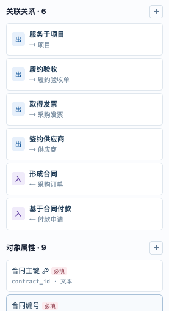

*图 22　卡片操作：悬停时右侧出现编辑 / 删除图标，标题右侧的 + 用于新增；主键属性没有删除图标*

**属性快捷编辑**
- 字段：属性名称、属性字段名称、数据类型、属性类别（仅对象属性）、枚举值（类型为枚举时）、业务定义、主键（仅对象属性）/ 唯一 / 必填。
- 校验：名称必填；字段名称以英文字母开头，只含字母、数字、下划线，并在所属对象内唯一；枚举至少一个值。
- 主键：勾选新主键后原主键自动取消；不能直接取消唯一的主键，需要先在另一项属性上勾选主键。
- 改字段名称时：若它是对象的标题属性或状态属性，引用跟着更新；若已有属性映射，输入框下方提示“改名后映射会失效，需要到‘数据源与映射’重新绑定”。
- 保存时整体保存所属对象或关系，进入当前工作状态并记录变更。

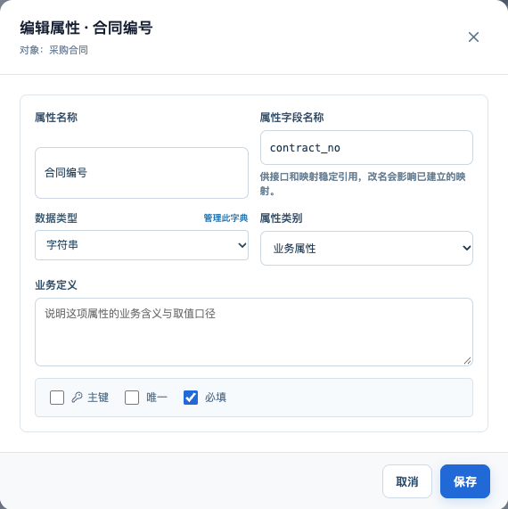

*图 23　属性快捷编辑：保存时整体保存所属对象*

**删除属性**
- 主键不能删除，提示更换主键的方法；
- 有属性映射时提示映射会失效；
- 是标题属性或状态属性时，提示删除后改为默认值。

**主题域编辑 / 删除**
- 编辑：名称、所属业务域、使用状态、负责人、业务说明；稳定编码只读。保存后画布颜色和标签名称同步更新。
- 删除：提示其下 n 个对象会变为“未分类”，对象本身及其属性、关系、规则、动作不会被删除。若删除的正是当前高亮的主题域，同时取消高亮。

### F15 快捷键

在画布或页面上按下时生效；输入框中输入、弹窗打开时不响应。

| 按键 | 作用 |
|---|---|
| Esc | 依次退出：右键菜单 → 连线模式 → 只看关联对象 → 全屏 → 取消选中 |
| Delete / Backspace | 删除选中的对象或关系（打开删除确认） |
| Enter | 编辑选中的对象或关系 |
| ⌘D / Ctrl+D | 复制选中的对象或关系 |
| F | 适配全图 |
| L | 进入 / 退出连线模式 |

## 5. 相关页面联动

| 页面 | 变化 |
|---|---|
| 对象类型 | 新建 / 编辑表单与图谱共用；恢复“核心对象”勾选；列表显示核心标记，新增“仅核心对象”筛选；详情加“图谱”按钮定位对象；行双击编辑 |
| 关系类型 | 表单与图谱共用（自动生成 API 名称、反转方向）；详情加“图谱”按钮；行双击编辑 |
| 对象属性（新菜单） | 位于“对象类型”下方，汇总全部对象属性；可按业务域、对象、数据类型、属性类别、约束、映射状态、同名字段筛选，可导出 CSV；详情可编辑所属对象或在图谱中定位 |
| 业务域与主题域 | 修复“在本体图谱中查看”的跳转地址 |

## 6. 验收标准

1. 菜单和页面标题显示“本体图谱”；从“业务域与主题域”页跳转后，自动带上业务域、主题域的过滤和高亮。
2. 选择业务域后只显示该域对象；开启跨域关联时，范围外的关联对象以虚线淡化显示。
3. 点击主题域标签后，该主题域对象保持实色，其余淡化；再点一次恢复。
4. 把对象设为核心后，图上立即放大、加粗并显示 ★；“仅核心对象”只显示核心对象。
5. 全屏后图谱铺满视口，按 Esc 退出；拖动节点后刷新页面，布局保持不变。
6. 搜索被过滤隐藏的对象时，自动放开对应过滤并定位。
7. 双击节点、连线可以编辑；双击空白处可以新建；保存后画布不重新排布。
8. 连线模式下，从对象 A 拖到对象 B，打开的关系表单已预填起点、终点和 API 名称。
9. 复制对象时，默认名称不与已有对象重复；把 API 名称改成已有名称时，立即报错且不能保存；勾选的关系以副本为端点创建成功。
10. 复制关系时表单带入全部配置，API 名称不重复。
11. 删除有关系引用的对象，必须勾选“同时删除关系”；被动作、规则、实例引用或已启用的对象不能删除，并给出处理入口。
12. 检查器中关系、属性、主题域、核心对象卡片都能通过图标直接编辑或删除；主键属性没有删除图标。
13. 修改属性字段名称时，标题属性引用同步更新；已有映射时给出失效提示。

## 7. 已知限制与后续规划

| 项 | 现状 | 建议 |
|---|---|---|
| 工作状态校验 | 本体处于评审中或已发布时，图谱仍可直接修改；后端写接口未校验本体状态 | 非 draft 状态下图谱只读，提示“派生工作状态后可编辑”；后端补状态校验 |
| 多步写入的原子性 | 复制对象并复制关系、删除对象并删除关系，由前端逐条调用接口，中途失败会留下部分结果（已在提示中说明） | 后端提供批量接口，在一个事务内完成 |
| 布局存储 | 布局保存在浏览器本地，换设备或换人后失效 | 布局存到后端，按本体共享 |
| 大图性能 | 对象超过约 200 个时，物理布局变慢、难以阅读 | 按主题域分组框或折叠 |
| 后续可选优化 | — | 节点上显示质检角标；框选后批量改主题域 / 设核心 / 删除；拖到主题域标签上改归属；与上一发布版的差异高亮；撤销最近一次操作 |
