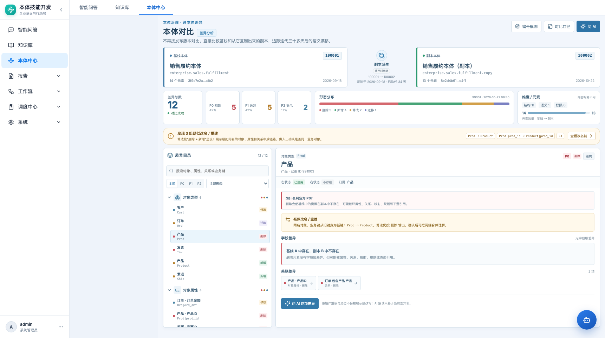
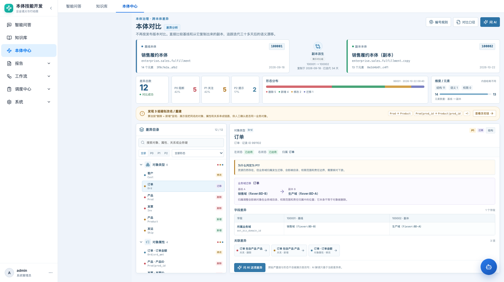

# 本体对比工作台 · 产品需求文档

> 本体中心 → 变更与发布 → 本体对比（路由 `#/ontology/governance/compare`）

| 项目 | 内容 |
|---|---|
| 功能名称 | 本体对比工作台 |
| 所属模块 | 本体中心 → 变更与发布 |
| 页面路由 | `#/ontology/governance/compare` |
| 适用对象 | 本体管理员、业务域负责人、建模/研发人员 |
| 文档状态 | 待评审 |
| 更新日期 | 2026-10-22 |
| 原型 | `frontend/src/pages/VersionCompare.jsx`、`compareMock.js`、`compareInsights.js` |

## 1. 背景与目标

标品本体先建好一份基线，之后复制出客户副本继续迭代。一个月后需要回答：

- 副本到底改了什么？
- 哪些是删除/迁移/改名，哪些只是字段变化？
- 哪些改动会破坏下游引用，哪些可以先忽略？
- 需要人先看哪几条，再看哪几条？

本页不再要求用户选择发布版本，而是直接比较两个本体：

```text
基线本体 A（100001）  ← 复制 →  副本本体 B（100002）
                                      ↓ 迭代 34 天
                                 本体对比
```

目标：

1. 在首屏建立 A/B 关系、元素规模和差异总览。
2. 让用户从“总差异”逐级下钻到“单条字段差异”。
3. 用可视化表达严重级、形态、元素变化和迁移方向。
4. 把“疑似改名/重建”作为人工确认线索，避免误把改名当纯删除。
5. 为 AI 追问提供稳定的差异上下文。

## 2. 范围与非目标

### 2.1 本期范围

- A/B 基线卡片、编号、复制时间、迭代天数、元素数、哈希。
- 差异总览：总数、严重级、形态、维度、元素规模。
- 疑似改名/重建提示。
- 差异目录（对象类型/对象属性/关系/规则/行动）与搜索、筛选。
- 单条差异详情：状态、字段差异、存在性、业务域迁移、关联差异。
- 右侧 AI 解读入口（详见 03）。
- 编号规则、对比口径两个信息面板。

### 2.2 非目标

- 自动合并、自动回滚、自动改模型。
- 多分支（A/B/C）同时对比；本期固定 A/B 演示对。
- 权限漂移对比（算法一期未实现）。
- 生产运行影响推断、实例数据对比。
- 真实后端对比接口适配（本期为 mock 工作台）。

## 3. 页面结构

```text
┌ 页头：本体对比 / 差异分析        [编号规则] [对比口径] [问 AI] ┐
├ A 基线卡片       副本派生       B 副本卡片                     ┤
├ 总差异 │ P0/P1/P2 │ 形态分布 │ 维度 + 元素/哈希                ┤
├ 疑似改名提示（3 组）                             [查看改名链]  ┤
├──────────────┬───────────────────────────────────────────────┤
│ 差异目录      │ 差异详情                                       │
│ 搜索/筛选     │ 状态 / 严重级 / 字段差异 / 关联差异            │
│ 分类树        │ [问 AI 这项差异]                               │
└──────────────┴───────────────────────────────────────────────┘
```



## 4. 详细需求

### 4.1 页头

- 标题“本体对比”，旁边显示“差异分析”标签。
- 副标题说明“不再按发布版本对比，直接比较基线和副本”。
- 右侧按钮：编号规则、对比口径、问 AI。
- 该页面是跨本体视图，隐藏当前本体的二级导航，避免误以为在对比左侧当前本体。

### 4.2 A/B 基线卡片

| 元素 | 规则 |
|---|---|
| 角色 | 左“基线本体”，右“副本本体” |
| 编号 | 6 位；左 `100001`，右 `100002` |
| 名称/命名空间 | 显示本体名和 namespace |
| 元素数 | 分别显示；本期 mock 为 14 / 13 |
| 内容哈希 | 显示短哈希；顶部总览提示是否一致 |
| 时间 | 左为基线更新时间；右为副本最近更新时间 |
| 中间关系 | 显示“副本派生”、编号变化、复制日期、迭代天数 |

- 副本必须是基线的派生关系；展示“复制于 …，已迭代 N 天”。
- 若未来找不到派生关系，中间显示“未登记复制来源”，但仍允许对比。

### 4.3 总览

| 指标 | 口径 |
|---|---|
| 差异总数 | `summary.total` |
| P0/P1/P2 | `summary.by_severity`，显示数量和百分比 |
| 形态分布 | 新增/删除/修改/迁移，堆叠条 + 图例 |
| 维度 | 结构/语义/权限计数 |
| 元素数量 | `global.elem_counts.left/right`，横向比例条 |
| 内容哈希 | `content_hash_same` 取反显示“不同/一致” |
| 对比任务 | 任务编号、对比时间、算法版本 |

- 差异总数必须等于当前 drifts 数；若后端分页，需在总数旁标注“已加载 n/N”。
- 严重级颜色固定：P0 红、P1 琥珀、P2 蓝。
- 百分比按总数四舍五入；不显示无意义的 0.0%。

### 4.4 疑似改名/重建提示

算法第一阶段不识别 `renamed/rekeyed`，只输出 removed + added。展示层做**提示**，不改原始数据：

- 检测规则：同资源类型下，removed 与 added 的业务显示名相同，或属性父对象/字段名相同，或关系名相同且端点可映射。
- 每条提示显示旧业务键 → 新业务键。
- 默认只展示 2 条，其余折叠为 `+N`；按钮“查看改名链”定位到第一条旧资源。
- 详情页对命中的资源显示“疑似改名/重建”提示，明确“算法仍按删除/新增输出”。
- 严禁自动合并两条记录或自动降级 P0。



### 4.5 差异目录

- 分组顺序：对象类型 → 对象属性 → 关系 → 业务规则 → 业务行动；空组不显示。
- 分组头显示总数和 P0/P1/P2 小圆点。
- 支持展开/收起、搜索、P0/P1/P2 筛选、形态筛选。
- 搜索范围：显示名、业务键、归属对象、资源类型。
- 列表项显示：严重级圆点、业务名称、业务键、形态标签。
- 过滤后分组计数显示“当前可见 / 总数”。
- 当前选中项高亮；过滤后原选中项不可见时，自动选中首个可见项。

### 4.6 差异详情

**头部**

- 资源类型 + 业务键、业务名称、归属对象、记录 ID。
- 严重级、形态、维度三个标签。

**状态区**

- 左状态、右状态；不存在显示“不存在”。
- 归属对象；备注（如“仅扩展字段变化”）。

**严重级解释**

- 用一句业务语言解释为什么是该级别，不改变算法级别。
- P0 删除：可能破坏属性、关系、映射、规则和下游引用。
- P1 迁移：目录、权限范围、责任边界受影响。
- P1 新增：需确认属性、映射、权限和引用是否补齐。
- P2 修改：不改变存在性，但可能影响口径理解或程序读取。

**字段差异**

- 表格三列：字段、基线值、副本值。
- 值格式化：
  - `*_id` 若可解析为业务域/主题域，显示“名称（code）”。
  - `extend_params` 尝试 JSON 美化。
  - 空值统一显示“—”。
- 删除/新增且无字段差异时，显示“存在性”卡片，不显示空表。

**业务域迁移**

- 当 `form=moved` 且字段为 `oot_biz_domain_id` 时，显示迁移卡片：
  - 基线域 → 副本域
  - 说明归属调整影响目录、权限、责任，不等于删除。

**关联差异**

- 展示与该资源相关的对象、属性、关系差异。
- 当前规则：
  - 对象：同业务键的属性/关系；
  - 属性：父对象、同父对象属性、涉及父对象的关系；
  - 关系：两端对象及其实体。
- 点击关联项跳转到对应详情。
- 同名的删除/新增关系可能同时出现，必须显示形态标签区分。

**嵌套差异**

- 若 `embedded_diffs` 非空，以折叠组展示；当前 mock 为空，但组件需支持。

**底部**

- “问 AI 这项差异”打开 AI 抽屉，并预填当前资源的问题。
- 提示：原始严重级和形态不会被展示层改写。

### 4.7 空态

- 过滤无结果：详情显示“没有匹配的差异，调整筛选或清空搜索”。
- 无差异：显示“两个本体在当前对比范围内没有差异”，仍保留总览和 AI 入口。
- 对比失败：显示错误原因和重试按钮，不允许展示半份结果。

## 5. 数据契约

本期以 mock 为准，字段与算法输出对齐：

```json
{
  "summary": { "total": 12, "by_form": {}, "by_severity": {} },
  "global": { "content_hash_same": false, "elem_counts": { "left": 14, "right": 13 } },
  "drifts": [{
    "drift_id": "removed|对象类型|Prod",
    "dimension": "structural",
    "form": "removed",
    "res_type": "对象类型",
    "res_id": 991003,
    "res_key": "Prod",
    "field_diffs": [],
    "severity": "P0",
    "left_status": "已启用",
    "right_status": "",
    "embedded_diffs": [],
    "note": "",
    "owner": { "res_id": "991003", "res_key": "Prod", "name": "产品" }
  }],
  "domain_names": {},
  "contract_notes": []
}
```

- `res_key` 是跨本体稳定业务键；不能按 `res_id` 配对。
- `field_diffs` 是唯一字段差异来源；展示层不得自行比对字段值。
- `summary` 必须与 drifts 一致；不一致时以前端重算结果为准并给出警告（后续）。

## 6. 验收标准

| 编号 | 验收项 |
|---|---|
| C1 | 首屏能看到 A/B 编号、名称、复制关系、元素数和哈希状态 |
| C2 | 总览数字与 12 条 drifts 一致，P0/P1/P2 为 5/5/2 |
| C3 | 形态分布为删除 5、新增 4、修改 2、迁移 1 |
| C4 | 分类树可展开/收起；筛选 P0 后只剩 5 条 |
| C5 | 选中“产品”显示 P0、删除、结构、状态和存在性说明 |
| C6 | 选中“订单”显示业务域迁移卡片：销售域 → 生产域 |
| C7 | 点击关联差异能跳到对应资源详情 |
| C8 | 命中改名链时显示提示，但原始 P0 不被自动改写 |
| C9 | “问 AI 这项差异”能打开带当前上下文的抽屉 |
| C10 | 1366 / 1722 宽度无横向溢出；无版本选择入口 |

## 7. 待确认问题

1. “疑似改名”确认后，是否允许在评审记录里人工合并两条差异？
2. 多分支（A/B/C）对比是二期还是本期必须？
3. 严重级阈值是否由后端固定，还是允许业务按资源类型覆盖？
4. 删除对象时，是否需要在详情里直接列出映射/规则/接口的引用数量？
5. 对比结果是否需要导出 CSV / PDF 评审包？
