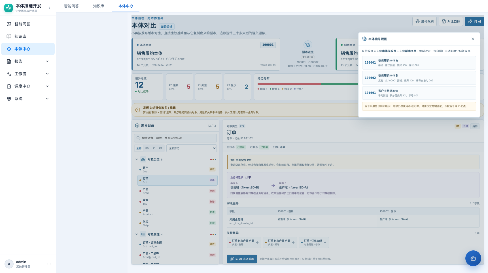

# 本体编号与副本派生 · 产品需求文档

> 本体中心 → 本体对比 / 本体复制

| 项目 | 内容 |
|---|---|
| 功能名称 | 本体编号与副本派生规则 |
| 所属模块 | 本体中心 → 变更与发布 |
| 适用对象 | 本体管理员、交付实施、业务域负责人 |
| 文档状态 | 待评审 |
| 更新日期 | 2026-10-22 |
| 依赖 | 本体对比工作台、整体复制本体 |

## 1. 背景

过去用“发布版本”区分基线和新版本。实际使用中，更常见的模式是：

```text
先建好 A 本体
  → 复制出 B 本体继续迭代一个月
  → 需要时比较 A 与 B
  → 复制本身也是备份手段
```

问题：

- 发布版本和“复制副本”是两套概念，用户容易混淆。
- 多个副本之间没有稳定、可读的编号。
- 复制关系没有显式展示，评审时不知道 B 是从 A 来的，还是独立创建的。
- 用内部 UUID 做展示不可读，也不适合在会议、工单、验收材料中引用。

因此需要一套面向业务的本体编号规则，并把“复制来源”记录成正式关系。

## 2. 编号规则

采用 6 位编号：

```text
前 3 位：本体族编号（family_no）
后 3 位：副本序号（copy_seq）
```

示例：

| 编号 | 场景 | 说明 |
|---|---|---|
| `100001` | A 本体首次创建 | 族号 100，序号 001 |
| `100002` | 从 A 复制出 B | 族号不变，序号 002 |
| `100003` | 再从 A 复制出 C | 同一族继续递增 |
| `101001` | 手动新建客户主数据本体 | 新族号 101，序号 001 |

规则：

- **复制**：继承基线的前 3 位族号，后 3 位在族内自增。
- **手动新建**：分配一个未使用的新族号，后 3 位固定从 `001` 开始。
- **副本的副本**：仍属于同一族，继续递增；不产生新族号。
- **编号不复用**：删除本体后编号保留，避免历史材料指向错对象。
- **编号只用于识别**：内部资源仍使用 UUID；对比按业务键，不按编号或 UUID 匹配。
- **上限**：单族最多 999 个副本；超过后需要扩展位数或迁移规则，作为后续边界处理。

## 3. 复制来源

复制本体时记录：

| 字段 | 说明 |
|---|---|
| `origin_ontology_id` | 直接复制来源本体 ID |
| `origin_ontology_no` | 直接来源编号 |
| `root_ontology_id` | 族根本体 ID（A） |
| `root_ontology_no` | 族根编号（100001） |
| `copied_at` | 复制时间 |
| `copy_reason` | 复制原因（交付、备份、试验分支等，可选） |

展示：

- A/B 卡片中间显示“副本派生”。
- 显示 `100001 → 100002`、复制日期、迭代天数。
- 列表/详情中显示“来源本体”链接；点击可跳到基线。
- 若历史数据没有来源，显示“未登记复制来源”，不阻断对比。

## 4. 编号分配

建议后端提供原子分配器：

```text
create_ontology(manual):
  family_no = next_available_family()   # 如 102
  copy_seq = 1
  ontology_no = family_no * 1000 + copy_seq

copy_ontology(source):
  family_no = source.family_no
  copy_seq = max(copy_seq in family) + 1
  ontology_no = family_no * 1000 + copy_seq
```

要求：

- 分配必须在事务/锁内完成，避免两个并发复制拿到同一编号。
- 分配失败时复制整体失败，不允许出现“复制成功但没有编号”的本体。
- 编号不可由用户手工填写，避免冲突；如需导入历史编号，走单独迁移工具。
- 编号生成后不可修改。

## 5. 页面与交互

### 5.1 对比页

- 基线卡片右上角显示编号；副本卡片同理。
- 中间显示“编号变化 + 复制关系 + 迭代天数”。
- 点击“编号规则”打开说明面板，展示 A/B/C 三个例子。




### 5.2 本体列表/切换器

- 本体名称旁显示编号，例如“销售履约本体 `100001`”。
- 同一族的副本在切换器中按编号排序，并标记“基线/副本”。
- 复制动作的确认弹窗展示“将生成编号 `100003`”和来源编号。

### 5.3 复制完成

- 成功提示：`已复制为 100003，来源 100001`。
- 提供“打开副本”和“与来源对比”两个动作。
- 复制操作写入变更记录，资源类型为“本体”，备注包含来源编号和新编号。

## 6. 与现有版本/备份的关系

- 产品层不再要求用户理解“发布版本”才能对比。
- 历史发布版本可以保留为底层只读快照，不作为对比入口。
- “备份”可以使用复制能力实现，但备份不强制产生新编号？**待确认**：
  - 方案 A：备份也生成编号，和副本同规则；
  - 方案 B：备份不生成新编号，只记录快照时间；
  - 推荐 A：统一走复制，减少两套机制。
- “发布”仍可保留为治理动作，但不再是与对比强绑定的概念。

## 7. 边界与异常

| 场景 | 处理 |
|---|---|
| 并发复制同一基线 | 事务内取最大序号 + 1；编号不得重复 |
| 复制失败 | 回滚本体、资源、编号；不产生孤儿编号 |
| 历史本体没有编号 | 迁移时按创建顺序补号；保留原 UUID |
| 用户删除副本 | 编号不回收；来源关系保留在变更记录 |
| 复制到其他空间/租户 | 编号是否全局唯一需确认；建议至少在同一平台全局唯一 |
| 单族超过 999 | 阻止复制并提示迁移方案；不静默扩展位数 |
| 手工导入编号冲突 | 拒绝导入并给出冲突清单 |

## 8. 验收标准

| 编号 | 验收项 |
|---|---|
| N1 | 手动新建本体获得新族号，编号末三位为 001 |
| N2 | 复制 100001 得到 100002；再复制得到 100003 |
| N3 | 副本的副本仍在同一族，不产生新族号 |
| N4 | 并发复制 10 次，编号无重复、无跳号以外的异常 |
| N5 | 删除副本后编号不复用 |
| N6 | A/B 对比页正确显示编号和复制来源 |
| N7 | 历史无编号本体迁移后编号稳定、可追溯 |
| N8 | 编号不能由用户手工修改 |

## 9. 待确认问题

1. 备份是否必须生成新编号？是否允许“快照备份”不占编号？
2. 编号是否需要跨租户/跨环境全局唯一？
3. 族号是否允许业务含义（如 100=销售、101=客户），还是纯顺序分配？
4. 单族 999 的上限是否足够，是否需要预留字母段？
5. 历史发布版本与副本编号如何映射，是否需要迁移说明？
