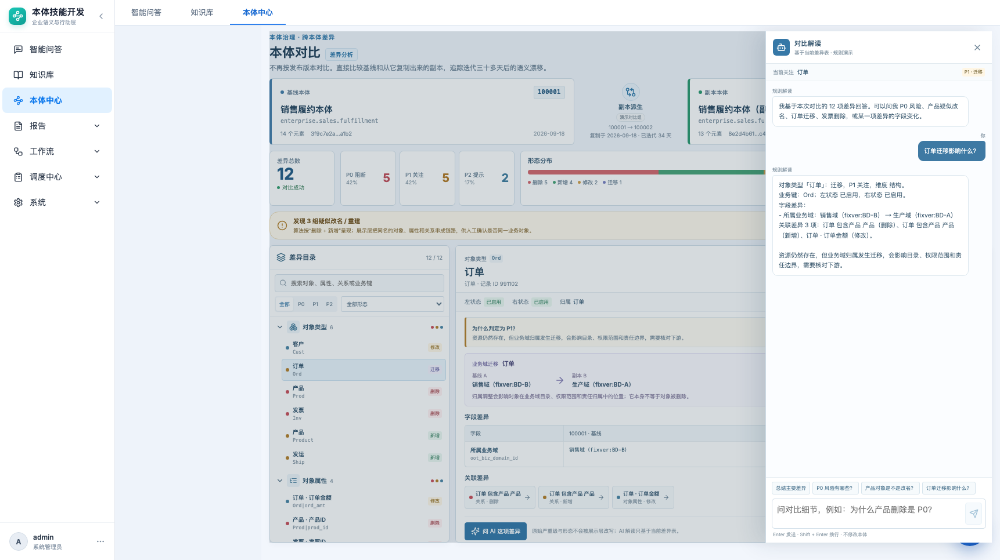

# 本体对比 AI 解读 · 产品需求文档

> 本体中心 → 变更与发布 → 本体对比 → 问 AI

| 项目 | 内容 |
|---|---|
| 功能名称 | 本体对比 AI 解读 |
| 所属模块 | 本体中心 → 变更与发布 → 本体对比 |
| 页面路由 | `#/ontology/governance/compare` |
| 适用对象 | 本体管理员、业务域负责人、评审参与人 |
| 文档状态 | 待评审 |
| 更新日期 | 2026-10-22 |
| 当前实现 | 前端规则解读 `answerCompareQuestion`，数据来自对比 mock |

## 1. 背景与目标

差异表能列出 12 条、50 条甚至更多差异，但评审时最常问的是：

- “P0 到底有哪些？”
- “产品对象为什么是删除？是不是改名？”
- “订单迁移到生产域影响什么？”
- “发票删了以后还有什么依赖？”
- “关系变化里哪一条新增是停用的？”

目标：在**不离开对比页**的情况下，让用户围绕当前差异表继续追问，快速得到有证据、可追溯的解读。

AI 的定位是**解释器**，不是裁判：

- 只解释当前差异表；
- 不修改本体；
- 不重算严重级；
- 不自动合并删除/新增；
- 不推断生产运行影响已发生。

## 2. 范围

### 2.1 本期范围

- 页面右上角“问 AI”入口。
- 单条差异底部“问 AI 这项差异”入口。
- 右侧抽屉式对话，不占常驻列。
- 当前关注资源上下文。
- 预设问题：总结、P0、产品改名、订单迁移。
- 文本输入、Enter 发送、Shift+Enter 换行。
- 规则解读/模型解读标识。
- 回答基于当前 drifts、summary、`domain_names` 和疑似改名链。

### 2.2 非目标

- 自动修复、自动合并、自动回滚。
- 自动修改严重级。
- 查询实例数据或生产监控。
- 多轮跨本体记忆（本期对话只对当前对比有效）。
- 真实模型接入（本期为演示规则；后续可替换）。

## 3. 页面与交互

```text
┌ 对比页 ……………………………………………………… [问 AI] ┐
│                                                              │
│   ┌──────────────────────────────┐   ┌───────────────────┐  │
│   │ 差异目录 / 详情               │   │ 对比解读抽屉       │  │
│   │                              │   │ 当前关注：产品 P0  │  │
│   │ [问 AI 这项差异] ────────────┼──→│ 消息流             │  │
│   │                              │   │ 建议问题           │  │
│   └──────────────────────────────┘   │ 输入框 / 发送      │  │
│                                      └───────────────────┘  │
└──────────────────────────────────────────────────────────────┘
```



### 3.1 打开方式

| 入口 | 行为 |
|---|---|
| 页头“问 AI” | 打开抽屉，当前关注为整体差异 |
| 详情“问 AI 这项差异” | 打开抽屉，当前关注为选中资源，并预填一条问题 |
| 抽屉关闭按钮 / 点击遮罩 | 关闭，保留本轮消息；再次打开继续当前会话 |
| 再次点击页头“问 AI” | 打开同一个会话，不重复创建 |

### 3.2 抽屉结构

- 头部：标题“对比解读”、副标题“基于当前差异表 · 规则演示”、关闭按钮。
- 当前关注条：显示当前资源名、严重级、形态。
- 消息流：用户消息右侧蓝底，助手消息左侧白底；助手消息标注“规则解读”或“AI 解读”。
- 建议问题：4 个横向小按钮。
- 输入区：textarea、发送按钮、Enter/Shift+Enter 提示。
- 底部提示：不修改本体。

### 3.3 对话行为

- 发送后立即追加用户消息，显示“正在整理差异链路…”。
- 规则回答约 260ms 返回（演示节奏），之后恢复输入。
- 关闭抽屉不取消进行中的回答；再次打开能看到结果。
- 切换对比对象（未来）时清空会话，避免上下文串台。
- 当前选中的差异变化时，更新“当前关注”；已发送的消息不重写。

## 4. 可回答的问题

| 意图 | 示例 | 回答内容 |
|---|---|---|
| 总结 | 总结主要差异 | 总数、P0/P1/P2、形态、优先项、疑似改名 |
| P0 | P0 风险有哪些 | P0 列表 + 改名提示 |
| P1 | P1 关注项 | P1 列表 |
| 删除 | 删除了什么 | 删除清单 + 改名链提醒 |
| 新增 | 新增了什么 | 新增清单 |
| 迁移 | 订单迁移影响什么 | 域名变化、字段变化、关联差异 |
| 产品链 | 产品是不是改名 | Prod/Product 对象、属性、关系链 |
| 发票链 | 发票删除影响 | Inv/Inv|inv_id 删除及无对应新增 |
| 关系 | 关系有什么变化 | 关系删除/新增、右状态异常提示 |
| 改名 | 哪些是改名 | 3 组疑似改名/重建及原因 |
| 指定资源 | 为什么产品删除是 P0 | 资源详情 + 严重级解释 |
| 影响 | 下游影响 | 三条核对链路，不下运行结论 |

## 5. 证据与回答边界

每条回答必须来自当前差异表，至少包含：

- 资源类型 + 业务名称/业务键；
- 形态（新增/删除/修改/迁移）；
- 严重级；
- 字段差异（如有）；
- 关联差异（如有）；
- 明确的“需人工确认”提示。

禁止：

- 编造差异表中不存在的资源或字段；
- 把“疑似改名”说成已确认；
- 把 P1 自动说成 P0，或把 P0 自动降级；
- 说“已合并”“已修复”“已回滚”；
- 推断生产实例或运行影响。

### 5.1 当前规则回答 vs 未来模型

| 模式 | 标识 | 行为 |
|---|---|---|
| 规则解读 | “规则解读” | 前端根据关键字和差异表生成确定性回答 |
| 模型解读 | “AI 解读” | 后端将差异证据交给模型，只返回解释文本 |
| 降级 | “规则解读” | 模型不可用/超时/超长时自动回退 |

模型输入只允许包含差异表、summary、疑似改名链和当前关注；不得包含无关实例数据或密钥字段。

## 6. 验收标准

| 编号 | 验收项 |
|---|---|
| A1 | 页头和单条差异两个入口都能打开同一个 AI 抽屉 |
| A2 | 抽屉不占常驻列，关闭后对比页恢复原宽度 |
| A3 | “总结主要差异”回答总数 12、P0/P1/P2 5/5/2 |
| A4 | “P0 风险有哪些”回答 5 条 P0，并提示产品改名链 |
| A5 | “产品对象是不是改名”回答 3 组疑似改名，不声称已确认 |
| A6 | “订单迁移影响什么”回答销售域→生产域及字段变化 |
| A7 | “为什么产品删除是 P0”回答资源详情 + 严重级原因 |
| A8 | 所有回答不出现“已合并/已修复/已回滚” |
| A9 | 1366 / 1722 宽度抽屉不遮挡输入框，发送按钮可点 |
| A10 | 模型不可用时能回退规则回答，并显示对应标识 |

## 7. 待确认问题

1. 对比 AI 是否需要和“本体智能”共用同一套历史会话？
2. 回答是否要支持“引用第几条差异”的可点击编号？
3. 真实模型接入后，是否允许把差异表发给外部模型？需要开关和审计。
4. 用户能否把 AI 回答保存到评审记录/评论？
5. 多分支对比时，AI 如何选择基准（A vs B、A vs C、B vs C）？
