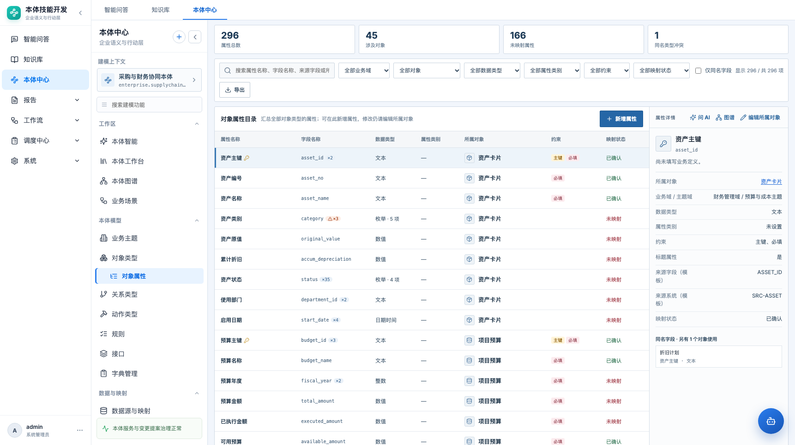
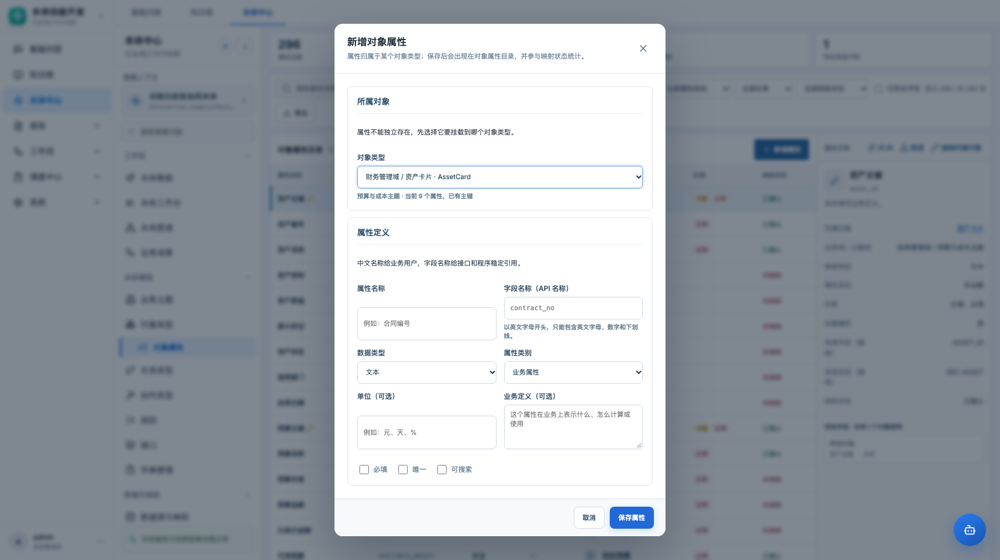

# 对象属性新增 · 产品需求文档

> 本体中心 → 本体模型 → 对象类型 → 对象属性 → 新增属性

| 项目 | 内容 |
|---|---|
| 功能名称 | 对象属性目录新增属性 |
| 所属模块 | 本体中心 → 本体模型 |
| 页面路由 | `#/ontology/model/object-properties` |
| 适用对象 | 本体建模人员、数据治理人员 |
| 文档状态 | 待评审 |
| 更新日期 | 2026-10-22 |
| 关联 PRD | [对象属性目录](../PRD-对象属性.md) |

## 1. 背景与问题

对象属性页原本是**只读汇总目录**：

- 可以横向搜索、筛选、导出属性；
- 可以查看映射状态、同名字段和类型冲突；
- 但新增属性必须点“编辑所属对象”，打开完整对象编辑器，再滚到属性区添加。

对于“只想补一个属性”的高频操作，路径太长，容易误改对象其他字段。

## 2. 方案

在对象属性目录右上角增加“新增属性”按钮，打开一个**只新增一个属性**的弹窗：

- 先选择所属对象类型；
- 再填写属性字段；
- 保存后写回该对象类型，刷新属性目录并定位到新属性；
- 不改变“属性归属于对象类型”的模型约束。

## 3. 页面与入口

### 3.1 入口

- 位置：对象属性目录标题行右侧。
- 样式：主按钮，带 `+` 图标。
- 默认所属对象：
  - 当前有选中属性时，默认该属性所属对象；
  - 没有选中时，默认列表第一个对象。
- 允许用户在弹窗中切换对象。



### 3.2 弹窗结构

```text
新增对象属性
  所属对象
    对象类型 select（业务域 / 对象名 · API 名）
    当前主题域、已有属性数、是否有主键
  属性定义
    属性名称 | 字段名称（API 名称）
    数据类型 | 属性类别
    枚举值（仅 enum）
    单位（可选）
    业务定义（可选）
    [ ] 必填  [ ] 唯一  [ ] 可搜索
  [取消] [保存属性]
```



## 4. 字段规则

| 字段 | 必填 | 规则 |
|---|---|---|
| 所属对象 | 是 | 只能选当前本体对象；显示业务域/主题域辅助识别 |
| 属性名称 | 是 | 中文业务名称；去除首尾空格后不能为空 |
| 字段名称 | 是 | 以英文字母开头，只能包含英文字母、数字、下划线 |
| 数据类型 | 是 | 文本/整数/数值/布尔/日期时间/枚举，默认文本 |
| 属性类别 | 是 | 标识属性/业务属性/状态属性/实时属性/计算属性 |
| 枚举值 | 条件 | 类型为枚举时至少一个；逗号分隔，去空 |
| 单位 | 否 | 文本，如元、天、% |
| 业务定义 | 否 | 多行文本 |
| 必填/唯一/可搜索 | 否 | 布尔标记 |

## 5. 主键规则

- 若所属对象**没有主键**：
  - 新属性自动作为主键；
  - 弹窗展示提示“新属性将作为该对象的主键”；
  - 不展示可取消的主键勾选，避免保存出无主键对象。
- 若所属对象**已有主键**：
  - 新属性不设为主键；
  - 弹窗提示“已有主键”；
  - 不提供“改主键”能力；改主键仍走对象编辑器。
- 一个对象必须且只能有一个主键，保存时由对象更新逻辑再次校验。

## 6. 校验与错误提示

弹窗内使用明确的业务提示，不依赖浏览器原生 required 提示：

| 场景 | 提示 |
|---|---|
| 属性名称为空 | 请填写属性名称。 |
| 字段名格式错误 | 字段名称必须以英文字母开头，只能包含英文字母、数字和下划线。 |
| 字段名重复 | 属性字段名称“xxx”在该对象中已存在。 |
| 枚举值为空 | 枚举属性至少需要一个枚举值。 |
| 所属对象不存在 | 请选择所属对象类型。 |
| 后端保存失败 | 展示后端错误，保留表单内容，不关闭弹窗 |

## 7. 保存逻辑

1. 读取所属对象最新属性列表（以打开弹窗时的对象数据为准）。
2. 组装新属性：
   - `key/name/type/property_category/options/unit/description`
   - `is_primary_key` 按第 5 节规则
   - `is_required/is_unique/is_searchable`
   - 默认状态字段沿用属性默认值。
3. 调用对象更新接口：

```text
PUT /api/object-types/{object_id}
body: 完整对象更新 payload + properties=[...existing, new]
```

4. 成功后：
   - 关闭弹窗；
   - 重新加载对象和映射；
   - 刷新本体统计；
   - 清空筛选；
   - 选中新属性行；
   - Toast：“对象属性已新增到工作状态”。

## 8. 边界与异常

| 场景 | 处理 |
|---|---|
| 当前本体没有对象 | “新增属性”按钮禁用，提示先创建对象类型 |
| 打开弹窗后对象被删除 | 保存时报对象不存在，保留弹窗并提示 |
| 两个人同时给同一对象加属性 | 本期无版本锁；后保存者可能覆盖先保存者的属性列表，需在 PRD 评审中确认是否本期解决 |
| 对象已有非法属性（历史数据） | 保存时由后端校验；前端展示可读错误 |
| 枚举值包含逗号 | 本期不支持转义；提示用英文逗号分隔且值内不要含逗号 |
| 字段名与其他对象重复 | 允许；在目录中显示同名字段角标 |
| 字段名与接口属性冲突 | 由对象保存校验处理；弹窗只负责单属性输入 |

## 9. 非目标

- 批量新增/导入属性。
- 独立于对象的“共享属性”。
- 在弹窗中编辑对象其他字段。
- 直接编辑主键、标题属性、状态属性（仍走对象编辑器）。
- 映射配置（另见数据映射直连 PRD）。

## 10. 验收标准

| 编号 | 验收项 |
|---|---|
| P1 | 对象属性目录右上角有“新增属性”按钮 |
| P2 | 弹窗默认选中当前选中属性所属对象；没有选中时可选对象 |
| P3 | 空名称、字段名格式、重复字段名、空枚举均有明确提示 |
| P4 | 对象无主键时新属性自动成为主键并提示 |
| P5 | 对象已有主键时新属性不抢占主键 |
| P6 | 保存成功后目录出现新属性，并自动选中 |
| P7 | 保存失败时弹窗不关闭，已填内容不丢失 |
| P8 | 属性仍显示在所属对象下，不存在独立属性资源 |
| P9 | 1366 / 1722 宽度弹窗无横向溢出，底部按钮可见 |

## 11. 待确认问题

1. 并发编辑同一对象是否需要本期加乐观锁（`updated_at` 或版本号）？
2. 是否允许在弹窗里直接设置标题属性/状态属性？
3. 新增属性后是否自动跳转到该对象的完整编辑器继续配置？
4. 枚举值是否改为多行/标签输入，避免逗号转义问题？
