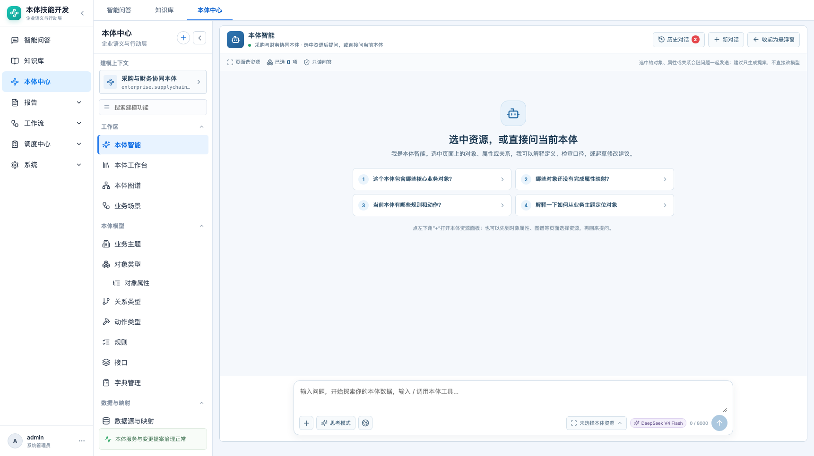

> **已合并至 [05-PRD-本体智能（完整版）](05-PRD-本体智能.md)**；本文保留为历史记录。

# 本体智能对话台 · 产品需求文档

> 本体中心 → 工作区 → 本体智能（路由 `#/ontology/ai`）

| 项目 | 内容 |
|---|---|
| 功能名称 | 本体智能对话台 |
| 所属模块 | 本体中心 → 工作区 |
| 页面路由 | `#/ontology/ai` |
| 适用对象 | 本体管理员、业务用户、建模人员 |
| 文档状态 | 待评审 |
| 更新日期 | 2026-10-22 |
| 相关页面 | `#/ontology/agent`（本体智能体，运行时工具型）；交互操作见 [10-PRD-本体智能交互操作](10-PRD-本体智能交互操作.md) |

## 1. 背景与问题

本体智能原来的页面存在三个问题：

1. 布局拥挤：全局菜单 + 本体菜单 + 当前上下文栏 + 对话页，共四列，1366 屏幕放不下。
2. 资源选择入口在左侧栏，用户需要先离开对话去页面点选资源，再回来。
3. 没有历史对话列表，刷新或离开页面后无法找回上一轮问答。

目标：

- 改成**单列对话台**，只保留“全局菜单 + 对话页”；
- 把资源选择收进对话框；
- 历史对话用抽屉，不再占常驻列；
- 保留页面点选资源的能力。

## 2. 范围与非目标

### 2.1 本期范围

- 单列对话布局。
- 顶部：本体智能标题、当前本体、历史对话、新对话、收起为悬浮窗。
- 对话框：`+`、思考模式、联网检索、本体资源选择、模型、字数、发送。
- 资源面板：已选资源、移除、清空、去页面选择资源。
- 未选择时文案为“未选择本体资源”。
- 页面点选资源模式（收起为悬浮窗 + 点击页面资源）。
- 历史对话抽屉：搜索、按今天/近 7 天/更早分组、加载会话。
- 选中资源后的快捷动作。
- 消息内资源 Chip、工具轨迹、运行模式提示。

### 2.2 非目标

- 真实工具执行、写操作。
- 多智能体路由。
- 跨本体共享会话。
- 资源选择的图谱多选器（本期仍以页面点选 + 资源 Chip 为主）。
- 真正的“网页检索/思考模式”开关效果（本期只记录上下文，模型能力待接）。

## 3. 页面结构

```text
┌ 本体智能                                           [历史对话 2] [新对话] [收起悬浮窗] ┐
│ 页面选资源 · 已选 N 项 · 只读问答                                      │
├──────────────────────────────────────────────────────────────────────┤
│                                                                      │
│   欢迎语 / 消息流 / 工具轨迹                                          │
│                                                                      │
├──────────────────────────────────────────────────────────────────────┤
│ [快捷动作]                                                           │
│ ┌──────────────────────────────────────────────────────────────────┐ │
│ │ 已选资源 Chips                                                   │ │
│ │ 输入问题 …                                                       │ │
│ │ [+] [思考模式] [联网]           [未选择本体资源] [模型] 0/8000 [↑] │ │
│ └──────────────────────────────────────────────────────────────────┘ │
└──────────────────────────────────────────────────────────────────────┘
```



## 4. 对话框

### 4.1 基础行为

- 输入框高度自适应，最多约 150px。
- `Enter` 发送，`Shift + Enter` 换行；输入法组合态不发送。
- 空内容时发送按钮禁用。
- 字数上限 8000，显示 `已输入 / 8000`。
- busy 时发送禁用，消息流显示“正在读取选中资源与本体上下文…”。
- 失败时追加错误消息，保留用户输入或已选资源。

### 4.2 思考模式 / 联网检索

- 两个开关只影响本轮上下文，不改变模型选择。
- 开启后按钮高亮，发送的 `context.thinking_mode / web_search` 为 true。
- 消息下方显示“思考模式 / 联网检索”标签。
- 本期不承诺实际联网或更深推理；PRD 状态标注为“演示开关”。

### 4.3 模型与字数

- 模型显示当前实际模型（原型为 `DeepSeek V4 Flash`）。
- 字数计数实时更新，超过 8000 截断。
- 模型切换不在本期范围。

## 5. 资源选择

### 5.1 入口

- 点击 `+` 或“未选择本体资源”打开资源面板。
- 未选择时显示“未选择本体资源”；已选显示“已选 N 项本体资源”。
- 选择入口在对话框内，不在页面左侧另开一列。

### 5.2 资源面板

- 头部：本体资源、已选数量、关闭。
- 已选列表：类型标签、名称、所属对象、移除。
- 底部：清空、去页面选择资源。
- 未选择时显示空态和说明。


### 5.3 去页面选择资源

- 点击后收起为悬浮窗，进入页面选择模式。
- 用户在对象属性、图谱等页面点击带 `data-ai-resource` 的资源。
- 选中项实时累加，顶部选择条显示数量和“完成选择”。
- 完成后可以最大化回到对话页，资源以 Chip 形式回到输入框。
- 资源随问题发送；历史会话加载时恢复该轮资源。

### 5.4 资源 Chip

- 显示类型图标、名称、移除按钮。
- 最多支持 20 项；超过提示。
- 发送后保留选中资源（便于继续追问），用户可手动清空。

## 6. 历史对话

- 顶部“历史对话”按钮显示数量。
- 点击打开左侧抽屉，不占常驻列。
- 搜索标题。
- 分组：今天 / 近 7 天 / 更早。
- 每条显示标题、相对时间、消息数。
- 点击加载：恢复消息、该轮资源 Chip、会话 ID。
- “新对话”清空当前消息和资源，生成新会话 ID。
- 历史按当前本体隔离；不混入“本体智能体”运行时会话。


## 7. 快捷动作与消息

- 选中资源后，输入框上方出现快捷动作：
  - 对象：解释定义 / 查完整性 / 起草修改
  - 属性：解释口径 / 查映射 / 起草修改
  - 关系：解释关系 / 查孤儿 / 起草修改
  - 多选：逐个解释 / 检查一致性 / 起草修改
- 用户消息显示资源 Chip、思考/联网标签。
- 助手消息显示文本、工具轨迹、运行模式。
- 动作提案只提示“已生成，未执行”。

## 8. 数据与接口

- 会话发送：`POST /api/ontologies/{id}/agent/chat`
  - `context.mode = assistant`
  - `context.conversation_id`
  - `context.selection`（type/id/label/parent/detail）
  - `context.thinking_mode / web_search`
- 历史：`GET /api/ontologies/{id}/agent/history?limit=100`
  - 按 `mode=assistant` 过滤。
  - 返回会话标题、消息、消息数、资源、运行模式。
- 当前原型后端已落 `conversation_id/context`；模型仍可能走演示降级。

## 9. 验收标准

| 编号 | 验收项 |
|---|---|
| G1 | 页面只有全局菜单 + 对话台，不再出现常驻的当前上下文栏和历史列 |
| G2 | 未选择资源时文案为“未选择本体资源” |
| G3 | 资源面板可在对话框内打开，显示已选、移除、清空、去页面选择 |
| G4 | 页面选择模式能收起为悬浮窗并完成资源回填 |
| G5 | 发送时资源 Chip 随问题进入上下文 |
| G6 | 历史抽屉不占常驻列，能加载消息和资源 |
| G7 | 新对话清空消息/资源并生成新会话 |
| G8 | 思考模式、联网、字数、发送状态正确 |
| G9 | 1366 / 1722 宽度输入框和发送按钮不被遮挡 |
| G10 | 与“本体智能体”历史互不混淆 |

## 10. 待确认问题

1. 资源面板是否需要支持“直接在本体树中多选”，而不必去页面点选？
2. 历史会话是否需要服务端分页和标题自动生成？
3. 发送后是否保留资源选择（当前保留），还是每轮清空？
4. 思考模式/联网检索何时接真实能力？
5. 历史会话是否支持删除、重命名、收藏？
