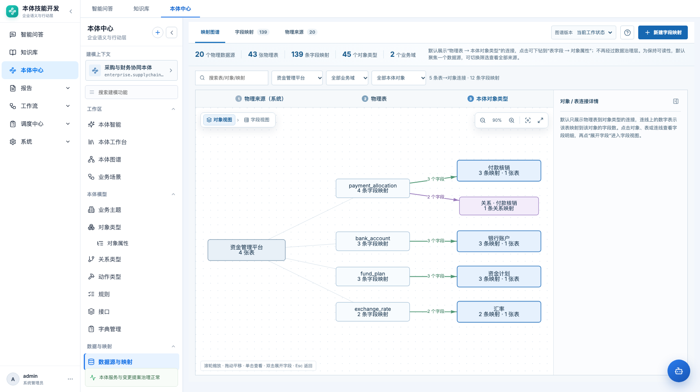
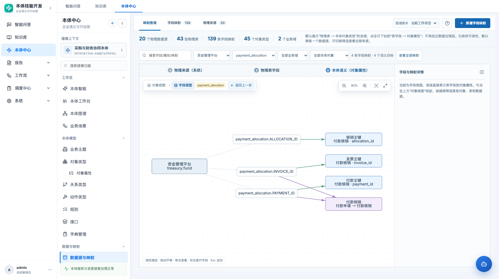

# 数据映射直连 · 产品需求文档

> 本体中心 → 数据与映射 → 数据源与映射（路由 `#/ontology/data/connections`）

| 项目 | 内容 |
|---|---|
| 功能名称 | 数据映射直连 |
| 所属模块 | 本体中心 → 数据与映射 |
| 页面路由 | `#/ontology/data/connections` |
| 适用对象 | 数据治理人员、本体建模人员、数据开发 |
| 文档状态 | 待评审 |
| 更新日期 | 2026-10-22 |
| 关联页面 | 对象属性、数据源、本体图谱 |

## 1. 背景与问题

旧映射链路是：

```text
物理源表字段 → 数据治理资产 → 对象属性
```

治理资产作为中间层带来三个问题：

- 建映射要先建治理资产，步骤多；
- 图表上多一层节点，物理表和对象属性之间看不清；
- 用户实际关心的是“这个物理字段到底对应哪个对象属性”，而不是资产登记。

本期把治理层从映射链路中拿掉，改为：

```text
物理源表字段 → 对象属性 / 关系
```

治理资产仍可作为独立治理对象存在，但不再作为映射必经节点。

## 2. 范围与非目标

### 2.1 本期范围

- 映射页改为“映射图谱 / 字段映射 / 物理来源”三个页签。
- 新建映射直接选择：数据源、物理表、源字段、目标对象、目标属性/关系。
- 映射图谱两级：
  - 对象视图：物理表 → 对象类型；
  - 字段视图：物理字段 → 对象属性。
- 默认聚焦一个可读数据源，避免 139 条映射全部铺开。
- 图谱内面包屑、返回上一步、双击展开、Esc 返回、缩放/适配/全屏。
- 右侧映射详情可收起/展开。
- 物理来源结构快照：数据源、表、字段的可浏览目录。
- 旧治理层映射兼容：读取时展开到物理字段，不渲染治理节点。
- 版本/工作状态选择移到右上工具区，历史版本只读。

### 2.2 非目标

- 真实数据库连接、元数据同步、映射执行。
- 数据质量规则执行。
- 映射审批工作流（本期沿用工作状态）。
- 删除治理资产资源本身。

## 3. 页面结构

```text
┌ 数据源与映射                                     [版本] [新建映射] ┐
│ [映射图谱] [字段映射] [物理来源]                                  │
├ 左侧：来源/对象筛选      中间：图谱画布              右侧：映射详情 │
│                         面包屑 / 缩放 / 全屏                         │
└────────────────────────────────────────────────────────────────────┘
```





## 4. 映射图谱

### 4.1 对象视图（默认）

- 节点：
  - 物理表节点：数据源 + 表名；
  - 对象类型节点：对象名称 + 业务域/主题域。
- 边：表 → 对象，表示该表至少有一个字段映射到该对象。
- 默认只展示聚焦数据源及其对象；数据量大时按来源/业务域筛选。
- 点击表或对象，右侧显示映射明细和字段覆盖情况。

### 4.2 字段视图

- 从对象视图双击表/对象或点击“下钻”进入。
- 节点：
  - 物理字段节点：`表.字段`；
  - 对象属性节点：`对象 · 属性`；
  - 关系节点：关系名称 + 两端对象。
- 边：字段 → 属性 / 关系。
- 面包屑：`对象视图 › 字段视图 · 当前数据源`。
- “返回上一步”回到对象视图并保留筛选。
- Esc 返回上一级。
- 字段视图可继续双击对象属性查看详情。
- 只渲染直连边；旧治理映射读取时展开为物理字段边，不出现治理节点。

### 4.3 画布控件

- 浮动条：缩小、缩放比例、放大、适配全图、全屏。
- 全屏时保留筛选、面包屑、详情收起/展开。
- 切换视图或筛选后自动 fit，保留用户拖拽布局（按本体缓存）。
- 节点/边点击优先选中节点；点击边时若已有节点选中，不误选边。

## 5. 字段映射

### 5.1 新建映射

字段：

| 字段 | 必填 | 说明 |
|---|---|---|
| 数据源 | 是 | 当前本体已登记来源 |
| 物理表 | 是 | 来自来源结构快照 |
| 源字段 | 是 | 表字段；关系映射可填多个字段 |
| 目标对象 | 是 | 当前本体对象 |
| 目标属性 | 属性映射必填 | 对象的属性 |
| 目标关系 | 关系映射必填 | 关系类型 |
| 映射名称/编码 | 是 | 自动建议，可改 |
| 转换说明 | 否 | 文本 |
| 状态 | 是 | 待确认/已确认 |

规则：

- 选择目标对象/关系时，不得清空已填的数据源、表、字段。
- 属性映射只能选目标对象的属性；关系映射可选择关系两端字段。
- 源字段必须在所选表的字段快照中存在。
- 保存前校验目标对象/属性/关系仍在当前本体存在。
- 旧治理映射编辑时提示“历史治理层映射”，保存后转为直连。

### 5.2 映射列表

- 支持按数据源、对象、属性、状态筛选。
- 显示源字段、目标对象/属性、状态、更新时间。
- 已确认映射可查看详情；待确认映射可编辑确认。

## 6. 物理来源

- 左侧来源列表：20 个模拟数据源。
- 中间表目录：43 张物理表。
- 右侧字段列表：字段名、类型、主键、可空、注释。
- 操作：
  - 从字段直接“新建映射”；
  - 从表查看已映射对象/属性；
  - 查看字段映射覆盖状态。
- 来源结构快照只读；修改结构需走数据源同步（本期不实现真实同步）。

## 7. 版本/工作状态

- 版本选择在页面右上角，不再占独立整行。
- 支持“工作状态”和只读历史快照。
- 历史快照下禁止新建/编辑映射，只能查看。
- 版本选择不影响当前筛选和图谱布局缓存。

## 8. 数据契约

直连映射核心字段：

```json
{
  "mapping_type": "property",
  "binding_mode": "direct",
  "source_code": "SRC-TREASURY",
  "source_table": "payment_allocation",
  "source_field": "PAYMENT_ID",
  "target_object_type": "PaymentRequest",
  "target_property": "paymentId",
  "status": "confirmed"
}
```

- `binding_mode=direct` 表示物理字段直达。
- `mapping_type=relation` 时使用 `target_relation`。
- 兼容旧记录：有 `governance_asset_code/governance_field` 的记录读取时展开到物理字段，但新写入不再创建治理节点。
- 来源结构快照独立存储，映射只引用 `source_code/table/field` 字符串。

## 9. 模拟数据

- 采购与财务协同本体：45 对象类型、20 数据源、43 张表、139 条映射。
- 覆盖采购、财务、主数据、合同履约、预算成本、资金风控等主题。
- 其中包含直连属性映射、关系映射和少量历史治理映射，用于验证兼容展开。

## 10. 验收标准

| 编号 | 验收项 |
|---|---|
| M1 | 映射页不再出现治理资产作为必经节点 |
| M2 | 新建属性映射可直接绑定源字段到对象属性 |
| M3 | 选择目标对象/关系时不清空已填来源 |
| M4 | 对象视图默认聚焦一个来源，避免全量 139 条铺开 |
| M5 | 字段视图显示表字段 → 对象属性边，面包屑/返回/双击/Esc 可用 |
| M6 | 缩放、适配、全屏、详情收起/展开可用 |
| M7 | 旧治理映射读取时展开到物理字段，图上无治理节点 |
| M8 | 物理来源页可浏览 20 个来源、43 张表和字段结构 |
| M9 | 历史版本只读，不能新建/编辑映射 |
| M10 | 1366 / 1722 宽度无横向溢出 |

## 11. 待确认问题

1. 关系映射的源字段多选上限和主键/外键配对规则？
2. 治理资产是否保留独立菜单？如果保留，如何解释与映射不再强绑定？
3. 真实数据源接入后，字段快照如何增量同步、如何处理字段删除？
4. 映射状态是否需要审批而不是简单“待确认/已确认”？
5. 139 条映射的图谱性能是否需要服务端分页/聚合？
