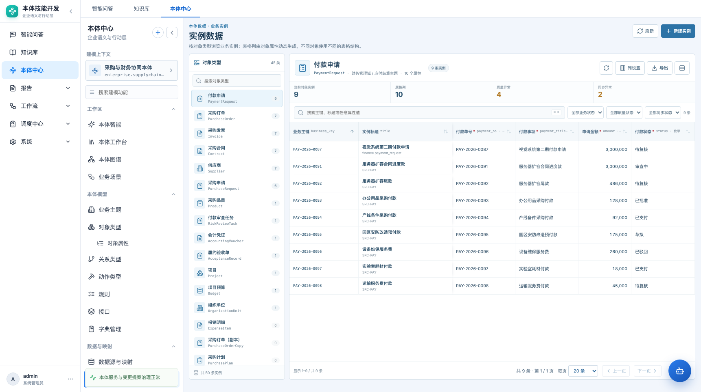
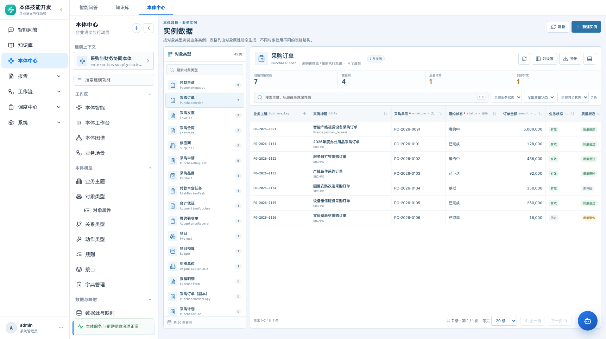
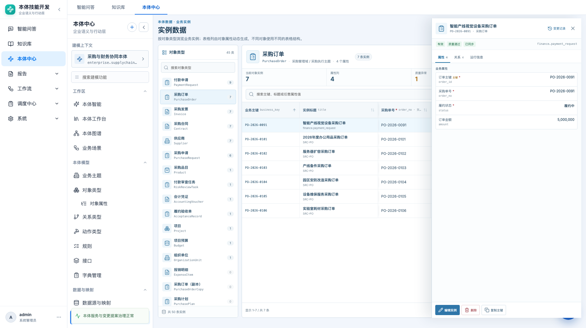
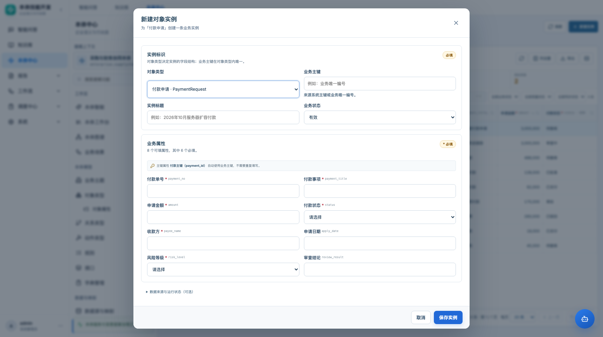

# 实例数据浏览器 · 产品需求文档

> **状态说明（2026-10-23 补充）**：本文只覆盖 Palantir Object Explorer 的 **Results View（结果表）** 层，不等于完整的实例显示模型。Palantir 的核心是 **Object Explorer + Object View**，完整方案见 [对象探索与对象视图 PRD](08-PRD-对象探索与对象视图.md) 与 [Palantir 调研](../实例显示-Palantir调研与重构方案.md)。


> 本体中心 → 数据与映射 → 实例数据（路由 `#/ontology/data/instances`）

| 项目 | 内容 |
|---|---|
| 功能名称 | 实例数据浏览器 |
| 所属模块 | 本体中心 → 数据与映射 |
| 页面路由 | `#/ontology/data/instances?type={objectTypeId}` |
| 适用对象 | 数据治理人员、建模人员、业务评审人 |
| 文档状态 | 待评审 |
| 更新日期 | 2026-10-23 |
| 原型 | `frontend/src/pages/InstanceData.jsx`、`InstanceData.css` |

## 1. 背景与问题

不同对象类型的实例结构完全不同：

- 付款申请有 10 个属性；
- 供应商只有 3 个属性；
- 合同、发票、采购订单的字段集合和类型各不相同。

原页面把全部对象实例混在一个列表里，右侧固定详情面板，表格能力弱：

- 无法按对象类型生成独立的列；
- 不同属性的实例无法横向比较；
- 搜索、筛选、排序、列配置、导出不足；
- 详情占据常驻列，表格宽度被压缩。

目标：把实例页做成**按对象类型切换的动态数据表**，类似数据库管理工具/Excel：

```text
左侧对象类型 → 右侧该类型的动态表格 → 点击行打开详情抽屉
```

## 2. 核心设计

1. **对象类型优先**：不再默认展示“全部对象混合列表”，先选对象类型。
2. **列由属性动态生成**：每个对象类型一套表头；属性数量、类型、顺序不同。
3. **通用表格骨架**：业务主键、实例标题、业务属性、系统状态列。
4. **详情用抽屉**：点击行打开右侧抽屉，表格仍保留大部分可见区域。
5. **列可配置**：按对象类型记住显示列，下次进入恢复。
6. **主键不重复**：业务主键列承载对象主键；主键属性默认不在表格/表单重复出现。

## 3. 页面结构

```text
┌ 实例数据                                     [刷新] [新建实例] ┐
├──────────────┬──────────────────────────────────────────────────┤
│ 对象类型      │ 付款申请  PaymentRequest  9 条 · 10 个属性       │
│ 搜索          │ [实例数] [属性列] [质量异常] [同步异常]          │
│ 付款申请 9    │ 搜索 │业务状态│质量状态│同步状态│ 列设置│导出│密度 │
│ 采购订单 7    │ ┌──────────────────────────────────────────────┐ │
│ 采购发票 7    │ │ 业务主键 │ 实例标题 │ 付款单号 │ 金额 │ 状态… │ │
│ 采购合同 7    │ │ ...                                          │ │
│ 供应商 7      │ └──────────────────────────────────────────────┘ │
│ ...           │ 显示 1–9 / 共 9 条              [分页]          │
└──────────────┴──────────────────────────────────────────────────┘
                                  点击行 → 右侧详情抽屉
```



不同对象类型会生成完全不同的列：付款申请 10 个属性，采购订单只有 4 个属性。



## 4. 详细需求

### 4.1 对象类型栏

- 展示全部对象类型，包括 0 条实例的类型。
- 显示对象图标、显示名称、API 名称、实例数。
- 支持搜索；有数据的类型排在前面。
- 当前类型高亮；切换类型时重置搜索、筛选、排序、分页。
- 底部显示当前本体实例总数。
- 当前类型写入 URL `?type=`，刷新可恢复；浏览器回退同步待补。

### 4.2 类型头部

- 对象图标、显示名称、API 名称、业务域/主题域、属性数量、实例数。
- 操作：刷新、列设置、导出、行密度。

### 4.3 统计条

- 当前对象实例数。
- 属性列数。
- 质量异常数（warning/failed）。
- 同步异常数（pending/syncing/failed/stale）。

### 4.4 表格

#### 列结构

| 区域 | 列 |
|---|---|
| 固定左侧 | 业务主键（sticky）、实例标题（sticky） |
| 业务属性 | 对象属性按定义顺序，一属性一列 |
| 系统信息 | 业务状态、质量状态、同步状态、来源系统、更新时间 |

- 对象类型切换时完整重建列。
- 主键属性、`source_system` 属性默认不显示，避免和“业务主键”“来源系统”系统列重复；可在列设置中打开。
- 列宽按类型设置：金额 130、日期时间 160、普通 155。
- 表格横向滚动；前两列固定。
- 行高支持紧凑 / 舒适两档。

#### 单元格渲染

| 类型 | 渲染 |
|---|---|
| 文本 | 截断 + hover title；空值“—” |
| 整数 | 原样显示（年份不显示千分位） |
| 数值 | 千分位、右对齐 |
| 布尔 | 是 / 否 |
| 枚举 | 文本/标签 |
| 日期时间 | 格式化；空值“—” |
| 对象/数组 | JSON 字符串 |

#### 排序

- 点击列头切换升序/降序。
- 默认按业务主键升序。
- 空值排最后。
- 字符串使用中文 Collator，数字/日期按类型比较。
- 当前排序列显示箭头；其余列显示弱化排序图标。

#### 搜索与筛选

- 搜索范围：业务主键、标题、来源系统、任意属性值。
- 快捷筛选：业务状态、质量状态、同步状态。
- 有筛选时显示“清空筛选”和“n / 全部 m”。
- 搜索框显示 `⌘K`，支持快捷键聚焦。
- 筛选变化回到第 1 页。

#### 空态

- 类型无实例：提示“这个对象类型还没有实例”，提供“新建实例”。
- 有实例但筛选无结果：提示调整筛选，提供“清空筛选”。

### 4.5 行点击与详情抽屉

- 单击行打开右侧详情抽屉。
- 表格保留在左侧，不整页跳转。
- 抽屉宽度 440px；小屏全屏。
- 头部：对象图标、标题、业务主键、对象类型、变更记录、关闭。
- 状态条：业务状态、质量状态、同步状态、来源系统。
- 三个页签：
  1. **属性**：按属性类别分组显示全部属性、主键/必填标记、字段名；空值显示“—”。
  2. **关系**：出向/反向关系列表，点击跳到关联实例。
  3. **运行信息**：业务主键、来源系统、源系统主键、最近同步、创建/更新时间、同步错误。
- 底部操作：编辑实例、删除、复制主键。



### 4.6 新建/编辑实例

- 新建时默认当前对象类型；可切换类型，切换后属性字段重置。
- 编辑时对象类型锁定。
- 表单分三块：
  - 实例标识：对象类型、业务主键、实例标题、业务状态。
  - 业务属性：按对象定义动态生成；枚举/布尔/数值控件；必填标记。
  - 数据来源与运行状态（折叠）：同步状态、质量、来源系统、源主键、同步错误。
- **主键规则**：主键属性不在表单中重复填写，保存时自动使用业务主键；若编辑已有实例，保留原主键值。
- **来源系统属性**：默认由运行信息中的来源系统自动带入，不在业务属性区重复。
- 校验：
  - 业务主键、标题必填；
  - 可见的必填属性必须填写；
  - 后端校验重复主键、未知属性、类型错误。
- 保存成功：关闭弹窗、刷新列表、选中新实例、刷新本体统计。



### 4.7 列设置

- 按对象类型保存到 `localStorage`。
- 业务属性、系统信息分组勾选。
- 主键/标题列固定，不可隐藏。
- 支持“恢复默认”。
- 隐藏当前排序列时，排序自动回到业务主键。

### 4.8 导出

- 导出当前筛选后的全部行，不只当前页。
- 列为当前可见列。
- CSV 带 BOM，便于 Excel 打开中文。
- 文件名：`{对象类型}-实例-{日期}.csv`。

## 5. 数据与接口

现有数据模型：

```text
object_instances
  id, ontology_id, object_type_id, business_key, title,
  properties JSON, record_status, quality_status, sync_status,
  source_system, source_pk, last_synced_at, sync_error, metadata,
  created_at, updated_at
```

- `properties` 是 JSON，天然支持不同对象不同字段。
- 列表：`GET /api/ontologies/{id}/instances`
- 详情：`GET /api/instances/{id}`
- 新建/更新/删除：现有 POST/PUT/DELETE。
- 当前前端一次加载全部实例，再按类型/筛选/分页在客户端处理。

### 5.1 生产化边界

本期适合单本体几万条以内的演示/轻量使用。正式上线前建议：

1. 服务端分页：`page/page_size/object_type_id/q/sort`，避免全量加载。
2. 服务端排序：按属性排序使用 `json_extract` 或属性索引。
3. 大表虚拟滚动：单页 100+ 行时减少 DOM。
4. 列宽拖拽/列顺序持久化。
5. 导入 CSV/Excel 与批量校验。
6. 权限：按对象类型控制读/写/导出。
7. 数据脱敏：敏感属性列默认掩码。

## 6. 验收标准

| 编号 | 验收项 |
|---|---|
| I1 | 默认选中实例数最多的对象类型，并生成该类型的列 |
| I2 | 切换到供应商/采购订单等类型时，列数量、类型、顺序变化 |
| I3 | 业务主键和实例标题列横向滚动时固定 |
| I4 | 主键属性、来源系统属性默认不重复显示，列设置可打开 |
| I5 | 点击列头可排序；搜索、状态筛选、质量/同步筛选生效 |
| I6 | 点击行打开详情抽屉；属性/关系/运行信息三个页签可用 |
| I7 | 新建实例可动态生成字段；主键自动使用业务主键 |
| I8 | 编辑、删除、复制主键、变更记录入口可用 |
| I9 | 列设置按对象类型持久化；恢复默认可用 |
| I10 | 导出当前筛选结果 CSV，中文不乱码 |
| I11 | 1366 / 1722 宽度可用；表格横向滚动，无页面横向溢出 |
| I12 | 新建实例后列表、统计和本体计数刷新 |

## 7. 非目标

- 完整数据库管理器的 SQL 查询、视图、索引管理。
- 实例关系的图形化编辑（本期只读跳转）。
- 批量导入、批量删除。
- 多对象类型联合查询/跨对象透视表。
- 实时同步任务。
- 字段级权限和掩码配置。

## 8. 待确认问题

1. 业务主键与对象主键属性是否始终一致？若不一致，是否允许编辑时分开维护？
2. 实例量级目标是多少？1 万 / 10 万 / 100 万，决定服务端分页与索引策略。
3. 是否需要导入模板和批量校验？如果需要，本期还是下一期？
4. 哪些属性需要默认脱敏？脱敏规则由谁维护？
5. 行点击打开详情，还是双击？当前采用单击。
6. 是否需要在表格内直接编辑单元格（Excel 式）？当前通过编辑弹窗。
