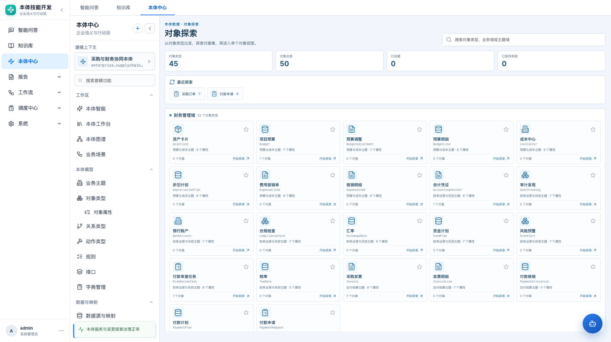
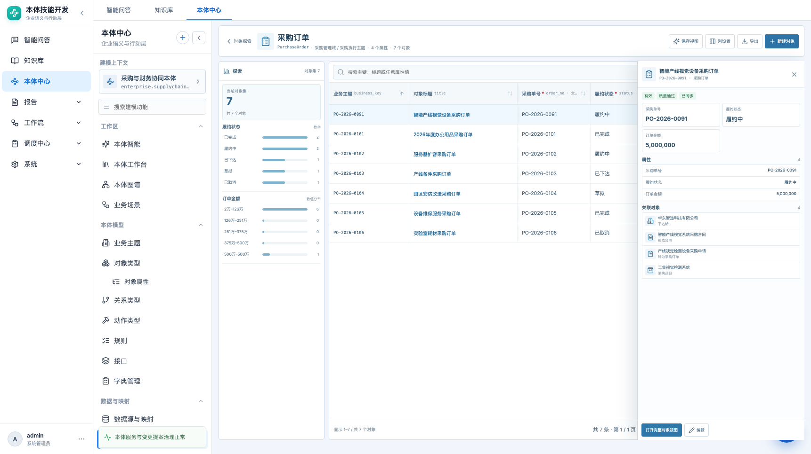
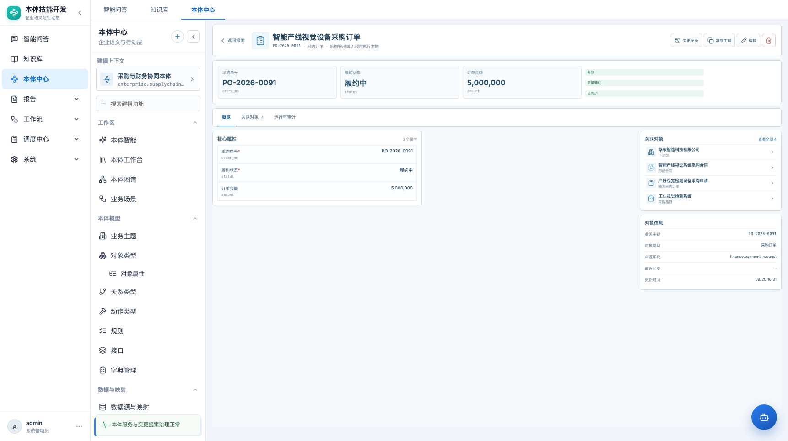

# 对象探索与对象视图 · 产品需求文档

> 本体中心 → 数据与映射 → 对象探索（路由 `#/ontology/data/instances`）

| 项目 | 内容 |
|---|---|
| 功能名称 | 对象探索与对象视图 |
| 所属模块 | 本体中心 → 数据与映射 |
| 页面路由 | `#/ontology/data/instances?type={objectTypeId}&object={objectId}` |
| 适用对象 | 数据治理人员、建模人员、业务评审人 |
| 文档状态 | 待评审 |
| 更新日期 | 2026-10-23 |
| 替代说明 | 替代仅表格化的“实例数据”页；原 07 PRD 只保留 Results View 部分 |
| 原型 | `frontend/src/pages/ObjectExplorer.jsx`、`ObjectExplorer.css` |

## 1. 背景与修正

Palantir 的实例显示不是“单对象类型静态表”，而是：

```text
Object Explorer 首页
  → Exploration 对象集 + 图表筛选
    → Results View 结果表
      → Selection Preview
      → Object View 完整对象视图
```

上一版只实现了 Results View，且把 Object View 压缩成属性抽屉。本期按 Palantir 的三层模型重做：

- 首页：对象类型分组、搜索、收藏、最近探索、已保存探索。
- 探索：对象集、图表筛选、结果表、右侧选择预览。
- 对象视图：显著属性、普通属性、关联对象、运行与审计。

## 2. 信息架构

```text
对象探索首页
├─ 全局搜索
├─ 最近探索 / 已保存探索
├─ 收藏的对象类型
└─ 业务域分组 → 对象类型卡片

对象探索（选中类型）
├─ 探索栏：对象集统计 + 枚举分布 + 数值分布
├─ Results 表：动态列 / 排序 / 筛选 / 列配置 / 导出
└─ Selection Preview：显著属性 / 普通属性 / 关联对象 / 打开完整视图

对象视图
├─ 标题栏：返回探索 / 标题 / 业务主键 / 类型 / 变更记录 / 操作
├─ 显著属性卡片
├─ Tabs：概览 / 关联对象 / 运行与审计
├─ 概览：核心/普通属性 + 关联对象 + 对象信息
└─ 关联对象：按 link type 分组，可继续跳转
```

## 3. 详细需求

### 3.1 对象探索首页

- 展示全部可访问对象类型，按 `business_domain_name` 分组。
- 每个对象类型卡片显示：图标、显示名、API 名、主题域、属性数、对象数、收藏星标、开始探索。
- 支持搜索：对象类型、API 名、业务域、主题域。
- 收藏：星标切换，持久化到本地；收藏区置顶。
- 最近探索：按访问时间倒序，最多 6 个，可快速回到探索。
- 已保存探索：展示名称、对象类型、保存时间；点击恢复筛选、排序、列配置。
- 对象类型数量为 0 时仍可进入探索并创建对象。



### 3.2 探索页头部

- 返回对象探索。
- 对象类型图标、显示名、API 名、业务域/主题域、属性数、对象数。
- 操作：保存视图、列设置、导出、新建对象。

### 3.3 探索栏

- 当前对象集统计：当前筛选后的对象数 / 全量对象数。
- 枚举分布（Listogram）：
  - 取对象类型前两个枚举属性；
  - 每项显示值、数量、比例条；
  - 点击值过滤对象集，再次点击取消；
  - 同时只能有一个枚举过滤。
- 数值分布（Histogram）：
  - 取第一个 decimal 属性；
  - 4～5 个区间；
  - 点击区间过滤，再次点击取消。
- 清除全部筛选。

### 3.4 Results 表

- 列结构：
  - 固定：业务主键、对象标题；
  - 业务属性：排除 hidden（如主键属性、source_system 重复属性）；
  - 系统列：业务状态、质量、同步、来源、更新时间。
- 列配置：
  - 按对象类型持久化；
  - 可打开 hidden 属性；
  - 隐藏当前排序列时排序回到业务主键。
- 排序：点击列头；当前列显示方向；空值排最后。
- 搜索：主键、标题、来源系统、任意属性值。
- 快速筛选：业务状态、质量、同步。
- 行交互：
  - 点击行：选中并打开右侧 Selection Preview；
  - 点击标题：进入完整 Object View；
  - 复制主键：行内按钮。
- 分页：默认 20，支持 20/50/100/200/300。
- 导出当前筛选结果 CSV。

### 3.5 Selection Preview

- 从右侧滑出，不占常驻列；不遮挡左侧图表导航。
- 头部：图标、标题、业务主键、对象类型、关闭。
- 状态徽标：业务状态、质量、同步。
- 显著属性卡片（最多 4）。
- 普通属性列表（最多 7 个）。
- 关联对象（最多 4 个）。
- 底部：打开完整对象视图、编辑。
- 关闭后保留表格筛选和页签。



### 3.6 Object View 对象视图

- 独立页面（URL `&object=`），不是抽屉；可从预览或标题进入。
- 头部：
  - 返回探索；
  - 对象图标、标题、业务主键、类型、业务域/主题域；
  - 变更记录、复制主键、编辑、删除。
- 显著属性卡片：
  - 最多 4 个；
  - 规则：标题属性、状态、金额、风险、关键日期；
  - 显示属性名、值、字段名；
  - 右侧状态区显示业务/质量/同步。
- Tabs：
  - **概览**：核心/普通属性分组 + 关联对象 + 对象信息；
  - **关联对象**：按关系分组，显示方向、关系名、目标类型，可跳转；
  - **运行与审计**：来源系统、源主键、最近同步、创建/更新时间、同步错误。
- 标准视图（Standard Object View）先做自动生成；Configured Object View 后续。



### 3.7 属性显示级别

Phase 1 用规则派生，不新增后端字段：

| 级别 | 规则 | 用途 |
|---|---|---|
| hidden | 主键属性、source_system 重复属性 | 表格默认不显示；列设置可打开；表单不重复填写 |
| prominent | title_property、status、amount、risk_level、关键日期 | 对象视图卡片、选择预览 |
| normal | 其余属性 | Results 列、对象视图属性分组 |

Phase 2 建议把显示级别写入属性元数据，由对象类型管理员配置。

### 3.8 收藏、最近与保存探索

- 收藏：`localStorage`，按本体隔离。
- 最近探索：访问对象类型时写入，最多 6 个。
- 保存探索：
  - 保存对象类型、搜索词、状态/质量/同步筛选、图表筛选、数值区间、排序、可见列；
  - 名称通过输入框确认；
  - 首页展示，点击恢复；
  - 当前为浏览器本地，后续服务端化。

## 4. 数据与接口

复用现有接口：

```text
GET  /api/ontologies/{id}/object-types
GET  /api/ontologies/{id}/instances
GET  /api/instances/{id}
POST /api/ontologies/{id}/instances
PUT  /api/instances/{id}
DELETE /api/instances/{id}
```

- `object_instances.properties` 为 JSON，支持不同对象类型的不同字段。
- 当前一次加载全部对象，前端做筛选/聚合/分页。
- 正式上线前需要：
  - 服务端分页、排序、筛选；
  - 服务端聚合接口（Listogram/Histogram）；
  - 保存探索服务端化；
  - 权限与隐藏属性；
  - Actions 与批量操作接口。

## 5. 验收标准

| 编号 | 验收项 |
|---|---|
| O1 | 首页按业务域分组展示对象类型，支持搜索、收藏、最近探索 |
| O2 | 点击对象类型进入探索；不同对象类型生成不同列 |
| O3 | 探索栏展示枚举分布和数值分布；点击可过滤对象集 |
| O4 | Results 表支持列配置、排序、搜索、状态/质量/同步筛选、分页、CSV 导出 |
| O5 | 点击行打开 Selection Preview；点击标题进入完整 Object View |
| O6 | Object View 展示显著属性、普通属性、关联对象、运行信息 |
| O7 | 显著属性按规则生成；主键属性和 source_system 不重复 |
| O8 | 关联对象可点击继续跳转 |
| O9 | 收藏/最近探索/保存探索在刷新后保留 |
| O10 | 新建/编辑/删除对象可用；主键自动使用业务主键 |
| O11 | 1366 / 1722 宽度可用；无页面横向溢出 |
| O12 | 变更记录历史定位可打开对应 Object View |

## 6. 非目标

- Configured Object View / Workshop tabs / Applications sidebar。
- Compare objects / Compare object sets。
- Pivot 到关联对象类型。
- 批量 Actions、inline edit。
- 服务端保存探索与权限体系。
- 真实对象集 API / 大规模实例虚拟滚动。

## 7. 后续阶段

- Phase 2：Compare、Pivot、批量 Actions、服务端保存探索、图表更多类型。
- Phase 3：Configured Object View、Workshop tabs、Applications Sidebar、权限/评论/审计。
