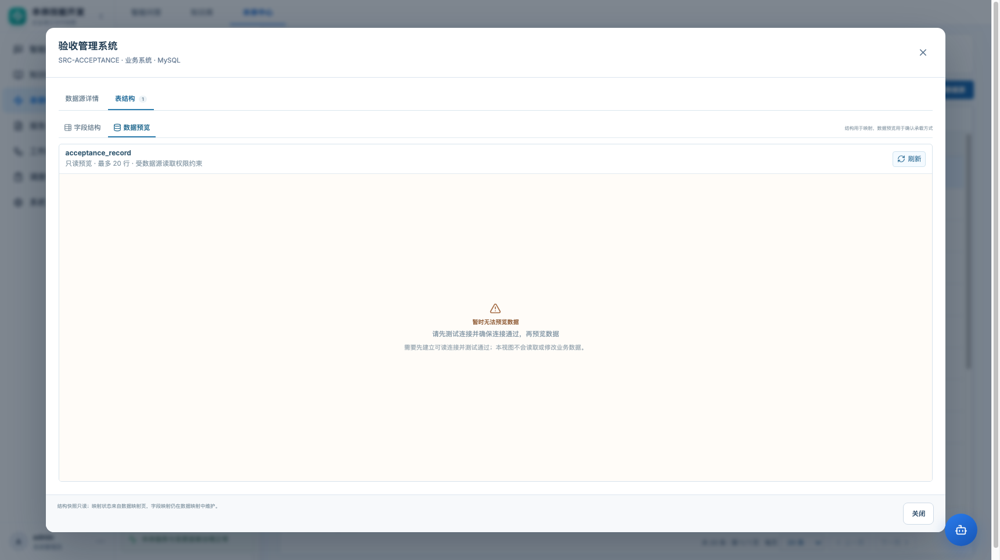
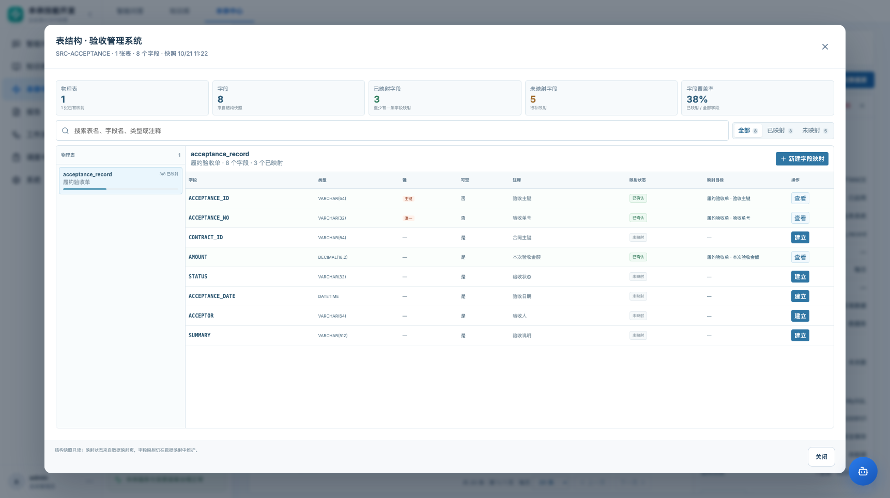
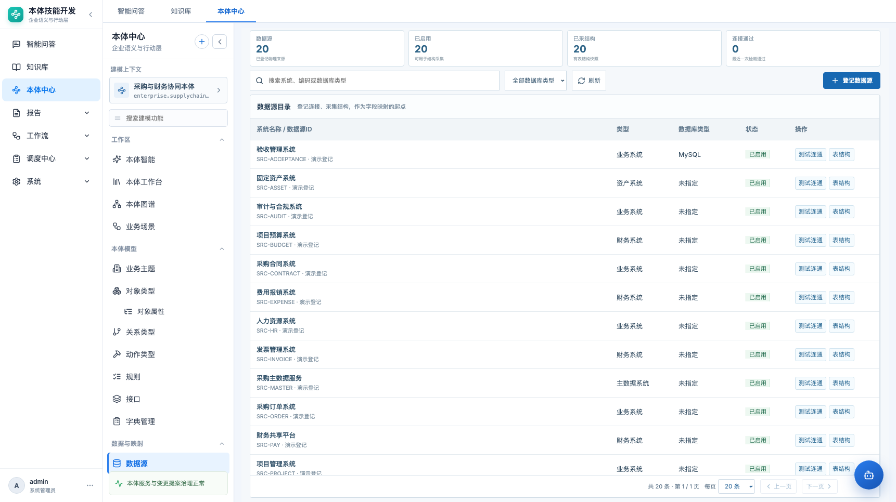
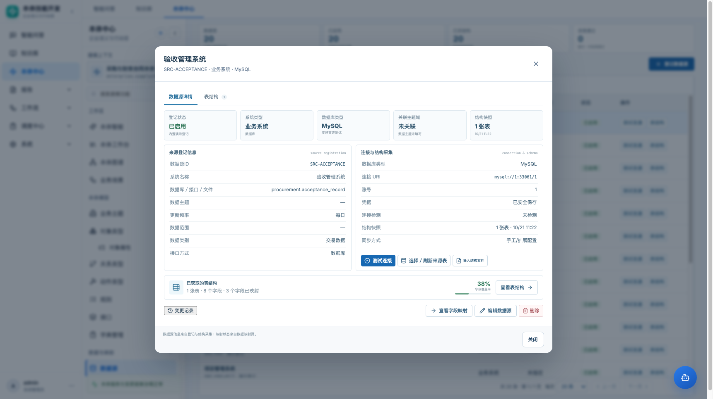
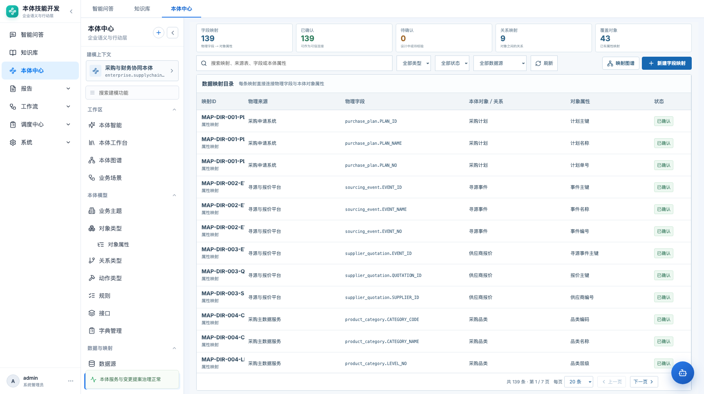
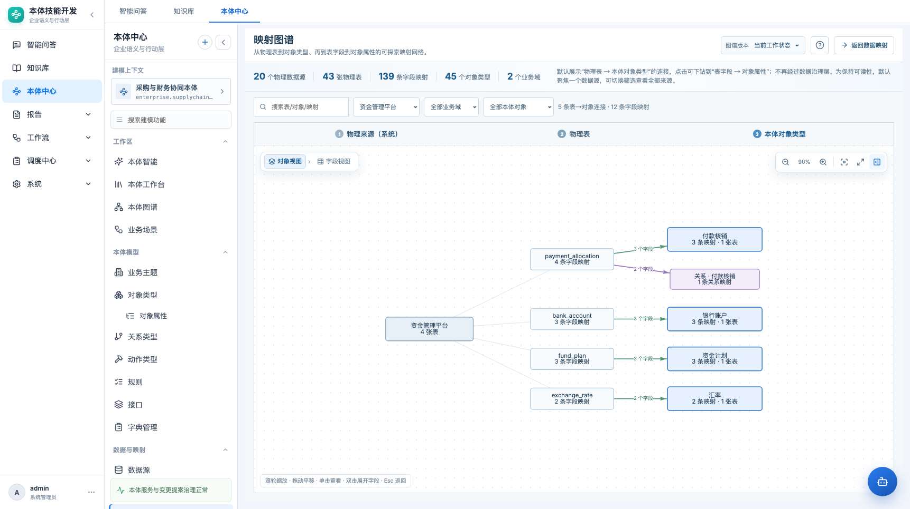
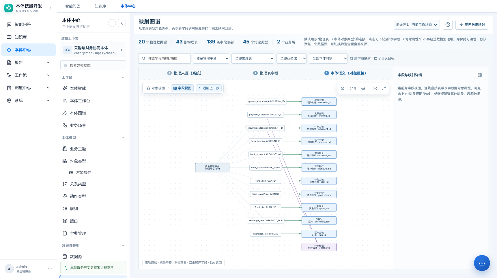

# 数据源、数据映射与映射图谱 · 产品需求文档

> 本体中心 → 数据与映射  
> 路由：`#/ontology/data/sources`、`#/ontology/data/mappings`、`#/ontology/data/mapping-graph`

| 项目 | 内容 |
|---|---|
| 功能名称 | 数据源、数据映射、映射图谱 |
| 所属模块 | 本体中心 → 数据与映射 |
| 文档状态 | 待评审 |
| 更新日期 | 2026-10-23 |
| 原型 | `frontend/src/pages/DataMappingStudio.jsx`、`MappingLineageGraph.jsx` |

## 1. 背景与问题

原实现把“数据源”和“数据映射”放在同一个 `数据源与映射` 菜单里，用页内 Tab 切换：

- 数据源登记、表结构采集、字段映射、映射图谱混在一个页面；
- 页面职责不清，菜单无法直接定位到具体任务；
- 数据映射缺少整体视图：不知道有多少映射、多少已确认、覆盖多少对象；
- 映射列表没有状态/来源筛选，状态列容易被挤到横向滚动区域外；
- 映射图谱只是页内 Tab，不能作为独立入口，也无法直接分享/收藏。

新的 IA 把三个任务拆成独立菜单、独立路由、独立页面：

```text
数据与映射
├─ 数据源      #/ontology/data/sources
├─ 数据映射    #/ontology/data/mappings
└─ 映射图谱    #/ontology/data/mapping-graph
```

旧路由 `/ontology/data/connections` 保留兼容，重定向到数据源。

## 2. 目标与非目标

### 目标

1. 数据源、数据映射各自成为可独立进入的工作页。
2. 数据映射页提供覆盖率/状态概览、组合筛选、紧凑列表和详情。
3. 映射图谱成为独立页面，支持“对象视图 → 字段视图”的下钻探索。
4. 数据源、数据映射、映射图谱之间可以互相跳转，并支持从对象类型/字段进入。
5. 保持现有数据模型与 API，不引入新的同步执行逻辑。

### 非目标

- 真实数据同步、定时任务、增量同步；
- 字段级血缘、影响分析、数据质量执行；
- 映射自动推荐/AI 生成（后续）；
- 映射批量编辑、批量确认、批量删除（后续）；
- 多数据源联合查询。

## 3. 信息架构

```text
数据源
├─ 数据源概览：总数 / 已启用 / 已采结构 / 连接通过
├─ 数据源目录：搜索 + 数据库类型筛选
└─ 数据源详情：登记信息 / 连接 / 结构采集 / 结构摘要 / 表结构浏览器 / 查看字段映射

数据映射
├─ 映射概览：字段映射 / 已确认 / 待确认 / 关系映射 / 覆盖对象
├─ 筛选：搜索 / 映射类型 / 映射状态 / 数据源
├─ 紧凑映射列表
└─ 映射详情：物理来源 / 物理字段 / 本体语义 / 映射配置 / 校验

映射图谱
├─ 概览：数据源 / 物理表 / 字段映射 / 对象类型 / 业务域
├─ 筛选：搜索 / 数据源 / 物理表 / 业务域 / 本体对象
├─ 对象视图：数据源 → 物理表 → 本体对象
├─ 字段视图：数据源 → 物理表字段 → 对象属性
└─ 右侧详情：节点/边/映射明细
```

## 4. 数据源页面

### 4.1 概览

- 数据源总数。
- 已启用数据源数。
- 已采结构数据源数（有表结构快照）。
- 连接检测通过数。

### 4.2 数据源目录

- 页面不保留占位的大标题栏；登记入口收进工具栏。
- 搜索：系统名称、编码、数据库类型、物理对象。
- 筛选：数据库类型（MySQL/PostgreSQL/Oracle/SQL Server/达梦/未指定）。
- 列表只保留 4 个信息列 + 操作列：
  - 系统名称 / 数据源ID（含系统类型副标题）
  - 类型
  - 数据库类型
  - 状态
  - 操作：测试连通 / 表结构
- 点击行打开**数据源详情弹窗**，不再使用右侧常驻详情栏。
- 弹窗两个页签：
  1. **数据源详情**：来源登记、连接与结构采集、结构摘要、变更记录、编辑/删除/查看字段映射；
  2. **表结构**：结构指标、字段表、映射状态与目标属性。
- 行点击默认打开“数据源详情”；操作列“表结构”直接打开同一弹窗的“表结构”页签。
- 页面级操作：登记数据源（工具栏）。

### 4.3 数据源详情弹窗

- 来源登记信息。
- 本体分类关联。
- 连接与结构采集：
  - 驱动类型、连接 URI、账号、凭据状态、连接检测、结构快照；
  - 测试连接；
  - 选择/刷新来源表；
  - 导入 CSV/JSON/SQL 数据字典。
- 详情页签内展示结构摘要卡：表数量、字段数量、已映射字段数、覆盖率；点击“查看表结构”切到第二个页签。
- 表结构页签使用 90vw × 90vh 大弹窗；详情页签使用紧凑 960px 弹窗，避免详情内容留白。
- 不再保留右侧 350px 数据源详情栏。
- 底部操作：**查看字段映射** → 跳转数据映射页并按当前数据源过滤。

### 4.3.1 连接配置最小集


数据源的连接配置只保留四个字段：

| 字段 | 含义 | 说明 |
|---|---|---|
| 驱动类型 | 数据库驱动 | MySQL / PostgreSQL / Oracle / SQL Server / 达梦 |
| 连接 URI | 物理连接目标 | 格式 `mysql://host:port/database`，不包含账号密码 |
| 账号 | 数据库账号 | 与 URI 分开保存 |
| 密码 | 数据库密码 | 加密保存，不在详情、列表、日志或导出中回显 |

规则：

- 不再单独维护主机、端口、数据库名三个字段；这三项由连接 URI 解析得到。
- 账号、密码不得写入 URI；URI 中出现 userinfo 时保存失败并提示使用独立字段。
- 端口、数据库名缺失或端口非法时，在保存/测试连接时给出明确校验。
- 旧数据源保留兼容：已有 host/port/database 的历史记录在编辑时自动拼出连接 URI，保存后以 URI 为准。
- 密码只在新建或重置时写入；编辑时留空表示不修改。
- 连接检测、结构快照、数据预览都使用解析后的同一连接身份；驱动/URI/账号变化后，旧的连接检测状态失效。

### 4.4 表结构浏览器（大弹窗）

数据源详情中的“已获取的表结构”承担的是**结构与映射状态的联合视图**，不是单纯的数据字典树。

#### 布局

```text
┌ 表结构 · 验收管理系统                         SRC-ACCEPTANCE · 1 张表 · 8 个字段 ┐
│ 数据源详情 | 表结构                                                         │
│ [字段结构] [数据预览]                    [搜索] [全部 8] [已映射 3] [未映射 5] │
│ ┌ 物理表 ───────────┬ 字段明细 ─────────────────────────────────────────┐ │
│ │ ⊞ acceptance_record│ acceptance_record  8 个字段 · 3 个已映射           │ │
│ │                    │ 字段 | 类型 | 键 | 可空 | 注释 | 状态 | 目标 | 操作 │ │
│ │                    │ ACCEPTANCE_ID ... 已确认  履约验收单·验收主键  查看 │ │
│ │                    │ CONTRACT_ID ... 未映射  —                 建立 │ │
│ └────────────────────┴──────────────────────────────────────────────────┘ │
│ 结构快照只读；映射状态来自数据映射页。                                  [关闭] │
└───────────────────────────────────────────────────────────────────────────┘
```

表结构区不再重复放大数字统计卡；统计信息收敛到筛选标签和字段区标题。左侧物理表树只显示表名，选中当前表；即使只有一张表也保留左右结构，左侧显示唯一表名，避免结构视图变成无导航的裸表。

#### 字段与操作

- 左侧物理表：表名、注释、已映射字段/总字段、覆盖率进度条。
- 单表和多表数据源都保留左侧表树；单表时左侧只显示唯一表名，不显示中文注释、映射数量或进度条。
- 右侧字段表：
  - 字段名、数据类型、主键/唯一、可空、注释；
  - 映射状态（已确认/设计中/待确认/已停用/未映射）；
  - 映射目标（对象 · 属性，或关系）；
  - 多条映射时显示映射条数。
- 字段操作：
  - 已映射：**查看** → 跳转数据映射页并选中对应映射记录；
  - 未映射：**建立** → 跳转数据映射页并打开新建映射，带入 source/table/field；
  - 表级 **新建字段映射**：带入 source/table，不带 field。
- 筛选：
  - 搜索表名、字段名、类型、注释；
  - 全部 / 已映射 / 未映射。
- 弹窗尺寸：
  - 桌面使用 extra-wide（最大 1240px）；
  - 1366 宽度仍保持左右分栏；
  - 小屏表列表变为上方可滚动列表。

#### 数据预览

表结构右上方提供二级视图：

- **字段结构**：字段、类型、键、可空、注释、映射状态、映射目标、查看/建立。
- **数据预览**：只读展示当前表前 20 行，用于确认字段类型、空值、枚举与业务数据承载方式。

设计边界：

- 数据预览最多 20 行，不提供全量浏览、筛选、导出或编辑。
- 全量数据浏览属于独立数据查询/浏览页，不塞进结构弹窗。
- 数据预览必须建立在可读连接、连接测试通过和数据读取权限的前提上；未连接、无权限或非 MySQL 来源显示明确空态，不伪造数据。
- 数据预览属于源表业务数据，不得因为能看结构就默认能看数据。
- 预览请求只读，不写回源库，不改变映射。
- 结构快照与实时数据分开：字段结构来自快照，数据预览来自当前连接。



#### 数据流转

```text
数据源结构快照（只读）
  → 表 / 字段
  → 按 source_code + table + field 关联 data_mappings
  → 生成字段映射状态（已映射/未映射、目标对象属性、状态）
  → 用户点击“查看”/“建立”
  → 数据映射页（选中映射 / 新建映射）
```

- 不新增“字段映射状态表”；状态是数据映射的**派生视图**，避免两处状态不一致。
- 映射新增/修改后，回到数据源重新打开结构浏览器即可看到最新状态。
- 结构快照只读；结构采集、导入、连接检测仍在数据源详情中完成。
- 大弹窗不直接修改表结构，也不直接执行同步。








### 4.5 共享数据源与映射边界

数据源和映射必须是两个不同层级：

```text
数据源（可共享）
  └─ 表 / 字段 / 结构快照 / 数据权限

本体 A 的映射 ──→ 同一字段
本体 B 的映射 ──→ 同一字段
```

- **数据源可以共享**：同一个物理源可以被多个本体引用。
- **映射必须按本体隔离**：一个字段在本体 A 映射到“验收单·验收主键”，不代表本体 B 也这样映射。
- **目标对象/属性只在当前本体解析**：表结构页的“映射目标”只能显示当前本体的对象、属性和映射状态。
- **不得展示其他本体的映射目标名、对象名、属性名、负责人或用户数据。**
- 字段在“当前本体未映射”时，应显示为“未映射（当前本体）”，不能让人误解为全局未映射。
- 如果产品需要展示“被其他本体使用”，只能显示经过授权的**聚合数量**，不能展开目标对象、属性或用户。

#### 数据预览权限

数据预览看到的是源表业务行，和结构元数据不是一个权限：

- 能看结构 ≠ 能看数据行。
- 数据预览必须校验当前账号对当前数据源的**读取数据权限**，以及行级/字段级脱敏策略。
- 没有数据权限时，只显示表结构，不显示数据预览 Tab 或显示无权限空态。
- 数据预览只读、不可导出、不可写回；查询和导出属于独立的数据浏览能力。
- 当前原型是单管理员演示环境，尚未实现多租户 ACL；正式共享前必须补数据源授权和行级权限。

#### 共享模型的现状

当前数据库的 `enterprise_data_sources` 仍带 `ontology_id`，本质是“每个本体各自登记一份来源”；真正的共享模型需要迁移为：

- 全局数据源注册表；
- 数据源与本体之间的访问授权关系；
- 结构快照归属数据源而不是某个本体；
- 映射继续归属本体；
- 查询/预览按当前本体 + 当前账号双重授权。

**当前原型通过“当前本体映射过滤 + 当前本体标签”避免跨本体目标泄漏；真正的共享数据源访问控制仍是后续架构项。**

## 5. 数据映射页面优化

### 5.1 映射概览

页面顶部展示 5 个指标：

| 指标 | 口径 |
|---|---|
| 字段映射 | 全部映射记录 |
| 已确认 | `design_status = 已确认` 或 `status = active` |
| 待确认 | 设计中/待校验（不含已停用） |
| 关系映射 | `mapping_type = relation` |
| 覆盖对象 | 已有属性映射的不同对象类型数 |

### 5.2 筛选

- 关键词：映射ID、名称、来源、表、字段、对象、属性、关系。
- 映射类型：属性映射 / 关系映射。
- 映射状态：已确认 / 设计中 / 待确认 / 已停用。
- 数据源：按物理来源过滤；从数据源详情跳转时自动带入。

### 5.3 紧凑列表

为让状态在常态宽度下可见，列表压缩为 6 列：

```text
映射ID + 映射类型
物理来源
物理字段（表.字段）
本体对象/关系
对象属性
状态
```

- 映射方式、主键/关联键、转换规则等放到右侧详情。
- 行选中高亮。
- 分页保留。
- 状态使用颜色标签：已确认绿色、待确认黄色、已停用红色。

### 5.4 映射详情

- 物理来源：映射ID、映射类型、来源系统、物理来源、物理表、物理字段、主键/关联键。
- 本体语义：对象/关系、对象属性、归属域。
- 映射配置：映射方式、转换规则、字典、更新方式、质量规则。
- 操作：编辑、删除、变更记录、校验。
- 校验结果展示错误/警告数量与明细。

### 5.5 新建/编辑字段映射

- 物理来源：数据源、表、字段、主键/关联键。
- 本体目标：对象类型、属性，或关系类型。
- 映射配置：映射方式、转换规则、字典、更新方式、质量规则。
- 从对象类型进入时带入目标对象；从字段进入时带入来源、表、字段。
- 保存后回到当前映射列表并选中该记录。



## 6. 映射图谱页面

### 6.1 页面定位

映射图谱是**只读探索视图**，不直接修改映射。数据修改回到数据映射页。

### 6.2 概览与筛选

- 概览：数据源数、物理表数、字段映射数、对象类型数、业务域数。
- 筛选：
  - 搜索表/对象/映射；
  - 按物理数据源；
  - 按物理表（字段视图）；
  - 按业务域；
  - 按本体对象/关系。
- “查看全部映射”清除筛选。

### 6.3 对象视图

```text
物理来源（系统） → 物理表 → 本体对象类型
```

- 连线表示表到对象的映射；
- 连线数字表示该表映射到该对象的字段数；
- 关系映射用独立节点/连线表示；
- 点击节点或连线在右侧看明细；
- 双击表/对象/连线展开字段视图；
- 适合回答“哪些表供了哪些对象”。

### 6.4 字段视图

```text
物理来源 → 物理表字段 → 本体对象属性
```

- 连线直接表示物理字段到对象属性；
- 关系映射显示为关系目标；
- 右侧详情显示字段、属性、映射方式、转换规则、状态；
- 支持从对象视图下钻，也支持直接切字段视图；
- 适合回答“这个字段到底映射到哪个属性”。

### 6.5 图交互

- 滚轮缩放、拖拽平移、适配全图、全屏；
- 单击节点/连线查看详情；
- 双击展开字段；
- Esc 退出全屏/返回；
- 右侧详情可收起/展开；
- 顶部显示层级图例：物理来源 / 物理表（字段） / 本体语义。

### 6.6 版本

- 图谱版本选择：“当前工作状态”或已发布版本。
- 已发布版本为只读快照，页面显示只读提示。
- 当前工作状态可展开交互。





## 7. 跨页面链路

| 起点 | 目标 | 行为 |
|---|---|---|
| 数据源详情 | 数据映射 | 按当前 `source` 过滤映射列表 |
| 数据源字段 | 数据映射 | 打开新建映射，带入 source/table/field |
| 数据映射 | 映射图谱 | 打开图谱，可按当前映射来源/对象进一步筛选 |
| 映射图谱 | 数据映射 | 返回数据映射 |
| 对象类型 | 数据映射 | 带入目标对象，打开新建属性映射 |
| 变更记录 | 数据源/数据映射 | 跳到对应独立页面并选中资源 |
| 旧 `/data/connections` | 数据源 | 重定向兼容 |

## 8. 数据与接口

复用现有接口：

```text
GET  /api/ontologies/{id}/enterprise/data-sources
POST /api/ontologies/{id}/enterprise/data-sources
PUT  /api/ontologies/{id}/enterprise/data-sources/{id}
GET  /api/ontologies/{id}/enterprise/data-sources/{id}/schema
POST /api/ontologies/{id}/enterprise/data-sources/{id}/test-connection
POST /api/ontologies/{id}/enterprise/data-sources/{id}/capture-schema
POST /api/ontologies/{id}/enterprise/data-sources/{id}/import-schema

GET  /api/ontologies/{id}/enterprise/data-mappings
POST /api/ontologies/{id}/enterprise/data-mappings
PUT  /api/ontologies/{id}/enterprise/data-mappings/{id}
POST /api/ontologies/{id}/enterprise/data-mappings/{id}/validate

GET  /api/ontologies/{id}/releases/{releaseId}/snapshot
```

图谱数据不新增表，直接由数据源、表结构、映射、对象类型、关系类型派生。

## 9. 验收标准

| 编号 | 验收项 |
|---|---|
| M1 | 菜单拆为数据源、数据映射、映射图谱三个独立入口 |
| M2 | 旧 `/ontology/data/connections` 可重定向到数据源 |
| M3 | 数据源页展示概览、目录、详情、结构采集与字段操作 |
| M4 | 数据映射页展示 5 个概览指标 |
| M5 | 数据映射支持关键词/类型/状态/数据源筛选 |
| M6 | 映射列表在常态宽度下可见状态列 |
| M7 | 从数据源“查看字段映射”跳转后按来源过滤 |
| M8 | 从数据源字段进入新建映射时带入来源/表/字段 |
| M9 | 映射图谱有独立页面和菜单，支持对象视图/字段视图切换 |
| M10 | 图谱支持数据源/表/业务域/对象筛选、缩放、拖动、全屏、详情 |
| M11 | 已发布版本只读 |
| M12 | 变更记录可定位到数据源/数据映射 |
| M13 | 1366 / 1722 宽度无页面横向溢出 |
| M14 | 数据源列表保留系统名称/ID、类型、数据库类型、状态四列，并提供操作列 |
| M15 | 操作列支持测试连通；仅 MySQL 可测试，其余提示暂不支持 |
| M16 | 操作列可打开 90vw × 90vh 表结构浏览器 |
| M17 | 数据源/数据映射右侧详情默认收起，点击行展开，详情头部可收起 |
| M18 | 数据源/数据映射页面不保留大标题栏，登记/新建入口收进工具栏 |
| M19 | 点击“展开完整结构”打开大弹窗，左侧表列表、右侧字段明细 |
| M20 | 字段显示映射状态、目标对象属性，支持全部/已映射/未映射筛选 |
| M21 | 未映射字段“建立”带入来源/表/字段打开新建映射 |
| M22 | 已映射字段“查看”跳到数据映射并选中对应映射 |
| M23 | 单表/多表都保留左右结构；左侧只显示物理表名 |
| M24 | 点击数据源行打开详情弹窗，不再显示右侧详情栏 |
| M25 | 详情弹窗有“数据源详情 / 表结构”两个页签；行点击默认详情，操作列表结构默认表结构 |
| M26 | 详情弹窗可完成测试连接、选择来源表、导入结构、查看字段映射、编辑、删除 |
| M27 | 关闭弹窗后列表恢复全宽并清除选中态 |
| M28 | 表结构左栏只显示物理表名，不显示中文注释、映射数量和进度条 |
| M29 | 表结构区不重复展示独立大数字统计卡 |
| M30 | 表结构支持字段结构 / 数据预览二级切换 |
| M31 | 数据预览最多显示 20 行，只读、不分页、不导出；未连接时显示明确空态 |
| M32 | 表结构映射目标只显示当前本体，不展示其他本体的对象/属性/用户 |
| M33 | 当前本体未映射时明确标注，不把其他本体映射误显示为当前映射 |
| M34 | 数据预览有独立的数据读取权限校验，结构权限不能替代 |
| M35 | 共享数据源模型迁移前列出全局源、授权关系、快照归属和映射隔离边界 |
| M36 | 连接配置只展示驱动类型、连接 URI、账号、密码四个字段 |
| M37 | 连接 URI 不包含账号密码；旧 host/port/database 自动兼容为 URI |

## 10. 后续阶段

- 映射批量确认/批量校验；
- 覆盖率按对象类型下钻；
- 映射推荐（根据字段名/类型/历史映射）；
- 字段级血缘与影响分析；
- 真实同步执行与运行监控；
- 映射图谱导出图片/分享链接。
