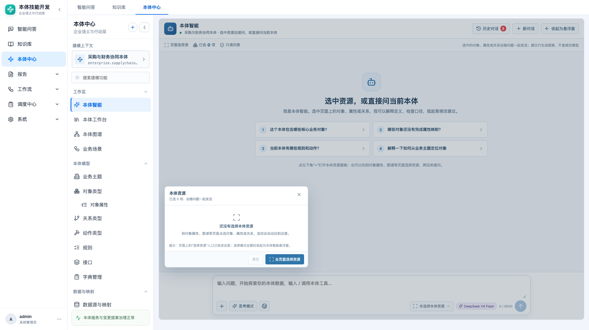
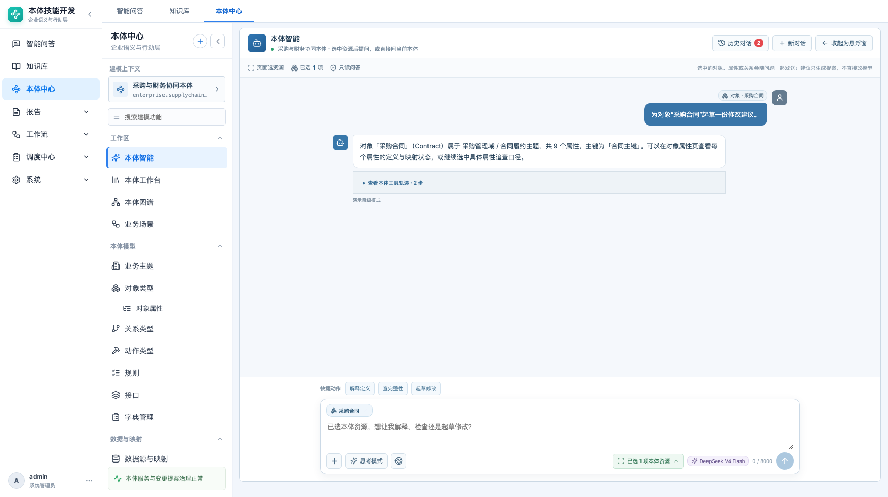
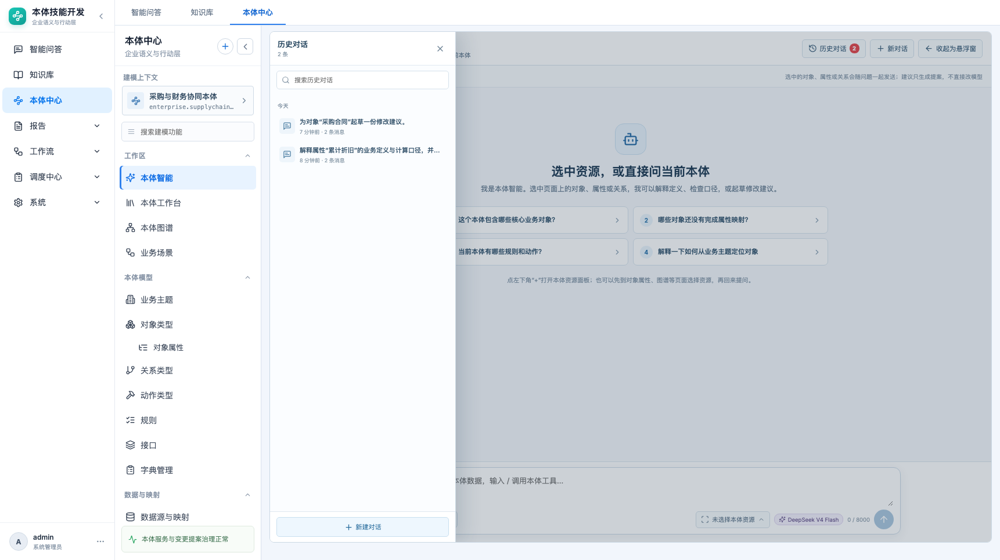
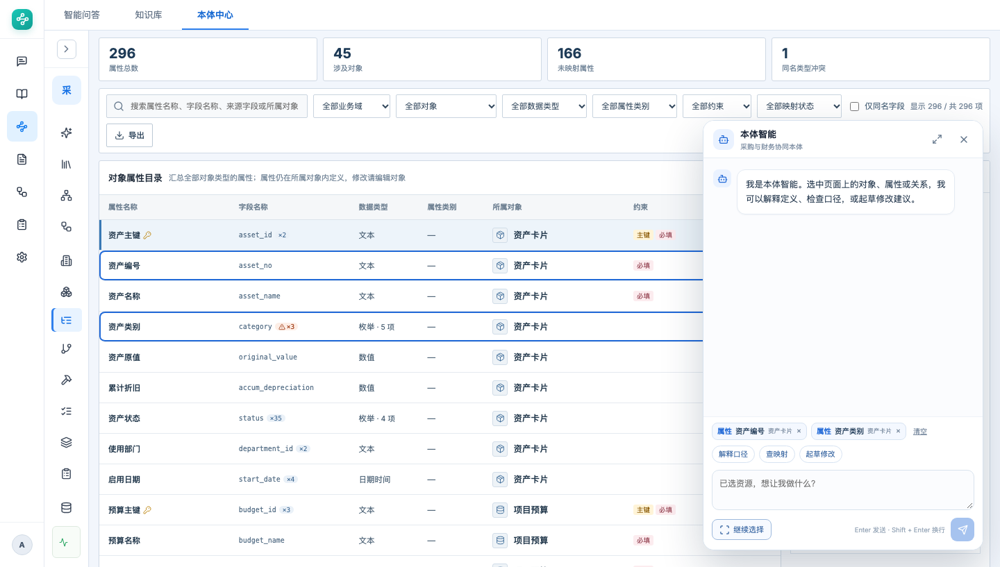
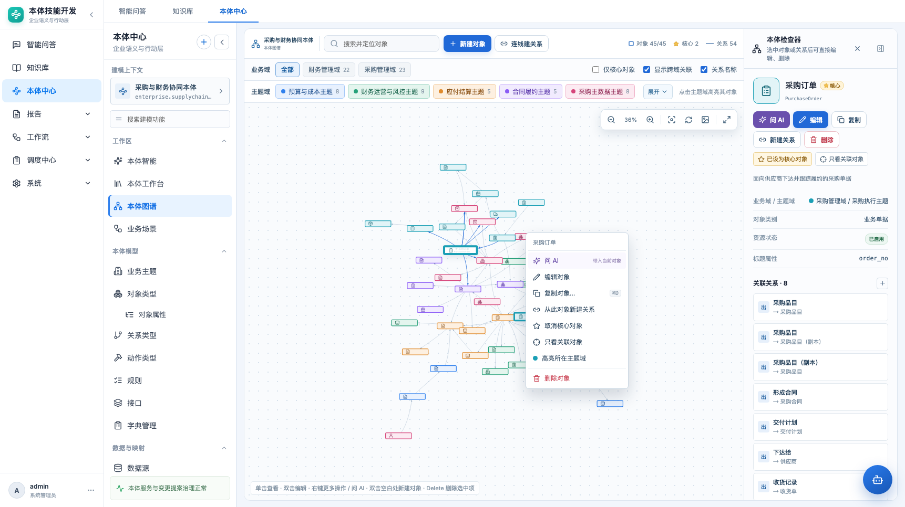
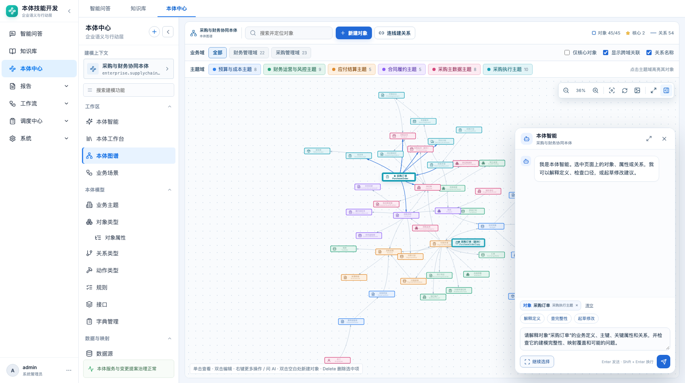

> **已合并至 [05-PRD-本体智能（完整版）](05-PRD-本体智能.md)**；本文保留为历史记录。

# 本体智能交互操作 · 产品需求文档

> 本体中心 → 工作区 → 本体智能（`#/ontology/ai`、悬浮窗）  
> 本文定义“怎么操作、操作后发生什么、失败怎么办”；页面布局以 [05-PRD-本体智能对话台](05-PRD-本体智能对话台.md) 为准。

| 项目 | 内容 |
|---|---|
| 功能名称 | 本体智能交互操作 |
| 所属模块 | 本体中心 → 工作区 → 本体智能 |
| 入口 | `/ontology/ai`、全局悬浮窗、页面资源点选模式 |
| 文档状态 | 待评审 |
| 更新日期 | 2026-10-23 |
| 关联页面 | 对象属性、对象类型、本体图谱、数据映射等带 `data-ai-resource` 的页面 |
| 非关联 | 本体智能体运行时（`#/ontology/agent`）的执行操作另行定义 |

## 1. 背景

当前“本体智能”已经具备：

- 单列对话台；
- 页面点选对象/属性/关系，最多 20 项；
- 资源 Chip、移除/清空；
- 按资源类型生成快捷动作；
- 思考模式、联网检索开关；
- 工具轨迹；
- 历史对话；
- 收起为悬浮窗。

但“交互操作”还没有完整定义：

1. 生成中不能停止；失败后不能一键重试。
2. 回复只能阅读，不能复制、重新生成、继续追问。
3. 后端已经返回 `action_proposal`，前端只显示“已生成动作提案，未执行”，没有确认/拒绝/查看影响。
4. 资源选择、发送、历史加载之间的状态边界没有明确规则。
5. 写操作的安全边界、确认方式、失败反馈和审计没有定义。
6. 键盘、焦点、Esc、移动端等交互细节未收口。

本文把本体智能从“问答页面”定义为**受控的本体操作台**：

```text
选上下文 → 提问 → 看依据/工具轨迹 → 看回答或提案
                                      ├─ 只读回答：复制 / 继续问 / 重新生成
                                      └─ 写提案：查看影响 → 确认 / 拒绝 → 执行结果
```

## 2. 目标与非目标

### 2.1 目标

- 所有交互有明确状态、可取消、可恢复、可追溯。
- 读操作默认直接执行；写操作必须二次确认。
- 资源选择、对话、提案、执行结果在同一上下文内连续。
- 用户始终知道：AI 看了什么、做了什么、改了什么、有没有真正执行。
- 1366 / 1722 宽度可用；键盘和焦点可用。

### 2.2 非目标

- 自主多智能体协作。
- 无确认直接写生产系统。
- 隐藏工具调用或伪造执行结果。
- 训练/微调模型。
- 跨本体共享会话。
- 复杂审批流（多级审批、会签）——后续。

## 3. 交互状态模型

```text
idle
  ├─ 选择资源 → picking ──完成/ Esc──→ idle（资源已保留）
  └─ 输入问题 → sending
                  ├─ 成功 → answered
                  │           ├─ 只读回答 → 复制 / 继续问 / 重新生成
                  │           └─ 写提案 → proposal
                  │                         ├─ 确认 → confirming → executed
                  │                         └─ 拒绝 → rejected
                  ├─ 失败 → error → 重试 / 修改问题
                  └─ 用户停止 → stopped → 可重新发送

proposal
  ├─ 查看影响 → 提案详情（不执行）
  ├─ 确认执行 → 二次确认 → executed / failed
  └─ 拒绝 → rejected（保留对话）
```

### 3.1 状态定义

| 状态 | 用户可做什么 | 系统反馈 |
|---|---|---|
| idle | 选资源、输入、快捷动作、历史 | 输入框可用 |
| picking | 点页面资源、完成、Esc | 悬浮条“选择模式” |
| sending | 停止、等待 | “正在读取选中资源与本体上下文…” |
| answered | 复制、继续问、重新生成、打开资源 | 回答 + 工具轨迹 |
| proposal | 查看影响、确认、拒绝 | 提案卡 + 风险提示 |
| confirming | 取消、确认 | 二次确认弹窗 |
| executed | 查看结果、打开审计、继续问 | 成功/失败 + 运行 ID |
| error | 重试、修改问题 | 错误信息 + 保留输入 |
| stopped | 重新发送、修改 | “已停止生成” |

## 4. 上下文选择操作

### 4.1 入口

- 对话框左下 `+`。
- “未选择本体资源 / 已选 N 项本体资源”按钮。
- 页面资源上的“交给本体智能”入口（如果页面提供）。
- 悬浮窗的“选择资源”。

### 4.2 页面选择模式

- 点击“去页面选择资源”后：
  - 对话页收起为悬浮窗；
  - 页面进入选择模式；
  - 顶部悬浮条显示“选择模式：点击页面上的对象、属性或关系”；
  - 带 `data-ai-resource` 的资源可点击选中/取消；
  - 悬浮条显示已选数量、完成选择。
- 按 `Esc` 或点“完成选择”退出，回到对话页。
- 选择模式不阻塞页面滚动/查看，但拦截资源的默认点击行为，避免跳转。
- 最多 20 项；超过时提示“一次最多选择 20 项”。
- 已选资源在页面上的视觉状态必须与 Chip 同步：选中高亮、取消恢复。

### 4.3 资源 Chip

- 显示类型、名称、所属对象（如有）、移除按钮。
- 发送后保留，便于继续追问；用户可手动清空。
- 切换本体、新建对话、加载历史时：
  - 切换本体：清空资源和对话；
  - 新建对话：清空资源和对话；
  - 加载历史：恢复该会话最后一轮用户消息携带的资源；
  - 收起/展开：保留资源。
- 资源顺序按选择顺序；重复资源去重。



### 4.4 资源范围

支持：对象类型、属性、关系类型、动作、规则、映射、实例、页面。

- 资源对象至少包含：`type/id/label/parent/detail`；
- 发送时带上 `scope.route` 和 `scope.ontology`；
- 不把整页 DOM 或未选中的敏感数据发给模型。

## 5. 提问与发送

### 5.1 输入

- 多行输入，高度自适应，最大约 150px。
- `Enter` 发送，`Shift + Enter` 换行。
- 输入法组合态（`isComposing`）按 Enter 不发送。
- 空内容/仅空格时发送按钮禁用。
- 最大 8000 字，超出截断并显示计数。
- 发送中禁止重复发送；发送按钮变为停止按钮（目标交互）。

### 5.2 发送

- 发送时把当前资源、思考模式、联网开关、会话 ID、页面路由写入 `context`。
- 用户消息立即上屏，显示资源 Chip、思考/联网标签。
- 发送失败：
  - 追加错误消息；
  - 保留用户刚才的输入和资源；
  - 提供“重试”；
  - 不把失败消息计入历史成功回合。
- 停止生成：
  - 前端取消当前请求（`AbortController`）；
  - 保留已收到的内容或标记“已停止”；
  - 不产生半截提案；
  - 可重新发送。

### 5.3 思考模式 / 联网检索

- 两个开关只影响下一轮请求，不改变历史消息。
- 开启后按钮高亮；消息标签显示“思考模式 / 联网检索”。
- 原型阶段明确标注“演示开关”，不承诺真实联网或更深推理。

### 5.4 模型与字数

- 展示当前模型名称（原型 `DeepSeek V4 Flash`）。
- 模型切换不在本期。
- 字数计数实时更新；到达上限后不可继续输入。

## 6. 快捷动作

选中资源后，输入框上方出现快捷动作。动作只填入并发送问题，不直接改模型。

| 资源 | 快捷动作 |
|---|---|
| 单个对象 | 解释定义 / 查完整性 / 起草修改 |
| 单个属性 | 解释口径 / 查映射 / 起草修改 |
| 单个关系 | 解释关系 / 查孤儿 / 起草修改 |
| 多个资源 | 逐个解释 / 检查一致性 / 起草修改 |

规则：

- 快捷动作使用当前资源生成明确 Prompt；
- 点击后直接发送，进入 `sending`；
- busy 时禁用；
- 无选中资源时不展示；
- 动作按钮最多 3 个，避免挤压输入区。



## 7. 回答、依据与工具轨迹

### 7.1 只读回答

- 回答必须区分：
  - 事实（来自本体数据）；
  - 推断（明确标注“推断”）；
  - 建议（明确标注“建议”）。
- 回答下方显示：
  - 工具轨迹折叠条：“查看本体工具轨迹 · N 步”；
  - 运行模式：“DeepSeek 实际运行”或“演示降级模式”；
  - 本轮使用的资源 Chip（在用户消息中）。
- 工具轨迹：
  - 展示工具名、步骤结果、成功/失败；
  - 不展示模型隐藏推理过程；
  - 不展示密钥、连接串、敏感字段值。
- 资源跳转：
  - 回答中的对象/属性/关系可点击到对应页面；
  - 使用资源 ID 路由，不拼接自由文本。

### 7.2 回答操作

每条助手回答提供：

- 复制回答；
- 重新生成（使用同一轮上下文，追加新版本）；
- 继续追问（输入框聚焦，保留资源）；
- 打开引用资源；
- 反馈（有用/无用）——后续。

重新生成规则：

- 不覆盖原回答，追加“重新生成”版本；
- 保留原回答可对比；
- 使用同一轮资源和问题；
- 若原回答带提案，重新生成后旧提案需标记失效。

## 8. 写操作与提案确认

### 8.1 原则

- **默认只读**：解释、检查、查映射、查孤儿不执行写操作。
- **写操作必须二次确认**：任何创建/修改/删除/执行动作都先生成提案。
- **确认前不写入**：不得调用业务写接口、不得修改本体工作状态。
- **确认后可审计**：记录操作人、时间、资源、参数、结果、运行 ID。
- **失败可回滚/可重试**：至少展示失败原因和下一步。

### 8.2 提案卡

当后端返回 `action_proposal` 时，消息内显示提案卡，而不是一行小字。

提案卡字段：

```text
动作名称
目标对象 / 目标系统
风险等级：低 / 中 / 高
影响范围：N 个对象 / N 条关系 / 字段变更
参数摘要
是否可逆
[查看影响] [确认执行] [拒绝]
```

- “确认执行”打开二次确认弹窗，不直接执行。
- “拒绝”把提案标记为已拒绝，保留对话。
- “查看影响”打开右侧影响面板/抽屉，展示受影响资源清单，不执行。
- 高风险动作使用红色风险条，要求输入确认文本或勾选“我了解不可逆影响”（具体等级待定）。

### 8.3 二次确认弹窗

- 标题：确认执行“{动作}”？
- 目标：对象/关系/系统。
- 参数：只读展示，允许返回修改。
- 影响：数量、范围、不可逆提示。
- 权限：当前用户是否有执行权限；无权限时禁用确认。
- 按钮：取消 / 确认执行。
- 确认后进入 `executing`，显示进度和可取消状态（如果后端支持）。

### 8.4 执行结果

- 成功：
  - 显示“已执行”；
  - 运行 ID、执行时间、操作人；
  - 受影响资源链接；
  - 可“查看审计记录”；
  - 可继续追问。
- 失败：
  - 显示失败原因（权限/参数/系统错误）；
  - 标记“未完成/部分完成”；
  - 提供重试/联系管理员；
  - 不显示成功样式。
- 当前原型：
  - 后端已有 `action_proposal` 和 `confirm_action` 字段；
  - 前端目前固定 `confirm_action: false`，只展示“已生成动作提案，未执行”；
  - 本期交互 PRD 定义确认链路，前端落地列为 P1。

## 9. 历史对话与会话操作

### 9.1 历史

- 顶部“历史对话 N”打开抽屉。
- 搜索标题/首条消息。
- 分组：今天 / 近 7 天 / 更早。
- 显示标题、相对时间、消息数。
- 点击加载消息、资源、会话 ID。
- 当前会话高亮。
- 历史按当前本体隔离，只加载 `mode=assistant`。

### 9.2 新对话

- 清空消息、输入、资源、思考/联网开关；
- 生成新会话 ID；
- 不删除历史。



### 9.3 会话操作（后续）

- 重命名、删除、收藏、分享；
- 服务端分页；
- 会话标题自动生成；
- 会话内搜索。

## 10. 悬浮窗与跨页面

### 10.1 收起/展开

- 对话页可“收起为悬浮窗”；
- 悬浮窗保留消息、资源、输入草稿、会话 ID；
- 点击悬浮窗重新展开，不丢上下文；
- 页面切换不重置会话（除非切换本体）。

### 10.2 页面点选

- 页面资源通过 `data-ai-resource` 标记；
- 选择模式点击切换选中；
- 页面选中状态与 Chip 双向同步；
- 完成选择后回到对话页/悬浮窗。



### 10.3 从资源打开 AI

- 对象/属性/关系页面可提供“交给本体智能”；
- 打开时预选该资源并聚焦输入框；
- 可带预置 Prompt（解释/查映射/起草修改）。

## 11. 键盘、焦点与无障碍

| 操作 | 行为 |
|---|---|
| Enter | 发送（非组合态） |
| Shift + Enter | 换行 |
| Esc | 关闭资源面板/历史抽屉；退出选择模式 |
| Tab | 焦点顺序：资源 → 输入 → 工具 → 发送 |
| 发送后 | 焦点回到输入框 |
| 错误 | 焦点到错误消息/重试按钮 |
| 读屏 | 按钮有 aria-label；消息区 aria-live=polite |
| 选择模式 | 悬浮条说明 + 资源可聚焦 |

- 对比度满足正文可读。
- 不用颜色作为唯一状态提示；状态必须有文本。
- 1366 / 1722 宽度下输入框、发送按钮、资源 Chip 不被遮挡。

## 12. 异常与边界

| 场景 | 处理 |
|---|---|
| 未选本体 | 提示“请先选择一个本体” |
| 未选资源 | 允许直接问当前本体 |
| 超过 20 个资源 | 提示上限，不新增 |
| 空输入 | 发送禁用 |
| 超长输入 | 截断到 8000，显示计数 |
| 网络失败 | 错误消息 + 重试 + 保留输入 |
| 模型降级 | 显示“演示降级模式” |
| 工具失败 | 轨迹标记失败，不伪造成功 |
| 无权限写 | 提案卡禁用确认，说明原因 |
| 提案过期 | 标记失效，需重新生成 |
| 页面刷新 | 当前会话本地丢失；历史可恢复已落库会话 |

## 13. 数据与接口

### 13.1 发送

```http
POST /api/ontologies/{ontologyId}/agent/chat
```

```json
{
  "message": "解释属性“合同金额”的计算口径",
  "confirm_action": false,
  "context": {
    "mode": "assistant",
    "conversation_id": "uuid",
    "thinking_mode": false,
    "web_search": false,
    "selection": [
      { "type": "attribute", "id": "attr-id", "label": "合同金额", "parent": "采购合同", "detail": "decimal" }
    ],
    "scope": { "route": "/ontology/model/object-properties", "ontology": "采购与财务协同本体" }
  }
}
```

返回：

```json
{
  "answer": "...",
  "trace": [{ "tool": "ontology.property", "label": "读取属性", "status": "ok", "result": "..." }],
  "action_proposal": null,
  "run_mode": "deepseek"
}
```

- `confirm_action=true` 只允许在提案确认后发送；当前前端未开放。
- `action_proposal` 结构至少包含：`action_id/action/target/confirmation_required/status/note`。

### 13.2 历史

```http
GET /api/ontologies/{ontologyId}/agent/history?limit=100
```

- 只加载 `mode=assistant`；
- 返回 `id/title/messages/message_count/updated_at`；
- 消息中保留 resources、trace、proposal、run_mode。

### 13.3 后续接口

- 会话重命名/删除；
- 提案影响预览；
- 提案确认/拒绝独立接口；
- 执行状态订阅/轮询；
- 反馈接口。

## 14. 验收标准

| 编号 | 验收项 |
|---|---|
| A1 | 可从对话台、资源面板、页面点选三种入口选择资源，最多 20 项 |
| A2 | 选中/取消资源时页面高亮与 Chip 同步 |
| A3 | 切换本体/新对话清空资源；加载历史恢复最后一轮资源 |
| A4 | Enter 发送、Shift+Enter 换行、组合态不发送、空内容禁用 |
| A5 | 发送中可停止；失败保留输入和资源并可重试 |
| A6 | 选中资源后出现正确的类型化快捷动作，点击可直接发送 |
| A7 | 回答展示工具轨迹、运行模式、引用资源，且不伪造执行 |
| A8 | 回答支持复制/重新生成/继续追问/打开资源 |
| A9 | 写提案显示动作、目标、风险、影响和确认/拒绝 |
| A10 | 确认执行前不产生写操作；确认后显示成功/失败和审计入口 |
| A11 | 无权限时提案不可确认并说明原因 |
| A12 | 历史抽屉可搜索、分组、加载消息和资源；新对话不删历史 |
| A13 | 收起悬浮窗再展开不丢消息/资源/输入草稿 |
| A14 | Esc、Tab、焦点回流、aria-label 可用 |
| A15 | 1366 / 1722 宽度输入区和发送按钮不被遮挡 |

## 15. 当前实现与落地阶段

| 能力 | 当前原型 | 本期 PRD |
|---|---|---|
| 资源选择/Chip/清空 | 已实现 | 保持 |
| 快捷动作 | 已实现 | 保持 |
| 只读问答/工具轨迹 | 已实现 | 保持 |
| 思考/联网开关 | 已实现（演示） | 明确标注 |
| 历史/新对话/悬浮窗 | 已实现 | 补齐状态规则 |
| 停止/重试/复制/重新生成 | 未实现 | P0 |
| 提案卡/影响预览/确认/拒绝 | 未实现（仅提示未执行） | P1 |
| 执行结果/审计链接 | 未实现 | P1 |
| 会话重命名/删除/分享 | 未实现 | P2 |

## 16. 待确认问题

1. 写操作确认后是否需要输入确认文本，还是仅二次弹窗？
2. 提案确认后是走同一个 `/agent/chat` 的 `confirm_action=true`，还是独立提案接口？
3. 哪些动作允许“部分执行/批量执行”？
4. 提案影响预览展示到什么粒度：资源清单/字段 diff/实例数量？
5. 重新生成是否保留旧回答，还是替换？
6. 历史会话是否需要服务端分页、重命名、删除？
7. 悬浮窗是否需要拖拽/贴边/移动端底部抽屉？


## 17. 本体图谱中的 AI 交互

本体图谱是对象和关系最集中的页面，AI 入口不能只放在顶部搜索或独立对话页。

### 17.1 入口

| 入口 | 资源 | 行为 |
|---|---|---|
| 右键对象节点 → 问 AI | `object_type` | 选中对象，打开右下角本体智能，带入对象和预置问题 |
| 右键关系连线 → 问 AI | `link_type` | 选中关系，打开本体智能，带入关系两端和预置问题 |
| 右键画布空白 → 问 AI | `page` | 以当前图谱为上下文，检查孤立对象、缺失关系和跨域异常 |
| 对象检查器 → 问 AI | `object_type` | 同右键对象 |
| 关系检查器 → 问 AI | `link_type` | 同右键关系 |

### 17.2 交互规则

- 右键时先选中节点/关系，再弹出上下文菜单。
- “问 AI”放在菜单第一项，使用紫色 AI 标识，并显示“带入当前对象/关系/图谱”的小提示。
- 点击后：
  1. 关闭右键菜单；
  2. 打开右下角本体智能浮窗（不是跳转独立页面）；
  3. 用当前资源**替换**浮窗中的资源上下文；
  4. 保留当前对话消息，不自动发送；
  5. 输入框预填针对该资源的 Prompt；
  6. 显示对应快捷动作（解释定义 / 查完整性 / 起草修改；关系为解释关系 / 查孤儿 / 起草修改）。
- 用户可以直接发送预置问题，也可以修改后发送，或点击快捷动作。
- 如果浮窗当前是“页面选择模式”，先退出选择模式，再带入资源。
- 浮窗已打开时再次问 AI，只替换资源上下文，不新开会话、不丢已有消息。

### 17.3 资源 Prompt

对象：

```text
请解释对象“{display_name}”的业务定义、主键、关键属性和关系，
并检查它的建模完整性、映射覆盖和可能的问题。
```

关系：

```text
请解释关系“{display_name}”的业务含义、方向、基数和适用场景，
并检查两端的对象口径、命名和映射覆盖是否存在问题。
```

图谱：

```text
请检查当前本体图谱的对象、关系和主题域分布，
指出孤立对象、缺失关系、跨域异常和可能的建模问题。
```

### 17.4 为什么这样设计

- 右键是图谱里最自然的“对某个节点做事”的入口，不打断画布浏览。
- AI 浮窗保留在图谱右侧，不跳页，符合“边看图边问”的连续操作。
- 先带入资源、不自动发送：避免用户还没确认上下文就产生模型调用。
- 右键、检查器、画布三个入口共用同一套资源载荷和 Prompt，避免不同入口回答不一致。
- 替换当前上下文而不是追加：保证“问 AI”明确针对当前节点/关系，不让旧资源污染新问题。





### 17.5 验收项

| 编号 | 验收项 |
|---|---|
| A16 | 右键对象节点显示“问 AI”，点击后打开右下角助手并带入对象 |
| A17 | 右键关系连线显示“问 AI”，点击后带入关系及两端信息 |
| A18 | 右键画布空白可让 AI 检查当前图谱 |
| A19 | 对象/关系检查器中的“问 AI”与右键行为一致 |
| A20 | 打开助手后保留原对话，资源 Chip 正确，输入框预置对应 Prompt |
| A21 | 不自动发送；用户可编辑、点快捷动作或直接发送 |
| A22 | 助手已打开时再次问 AI 只替换上下文，不新开会话、不丢消息 |
| A23 | 右键菜单关闭、浮窗不遮挡关键操作；1366 / 1722 可用 |
