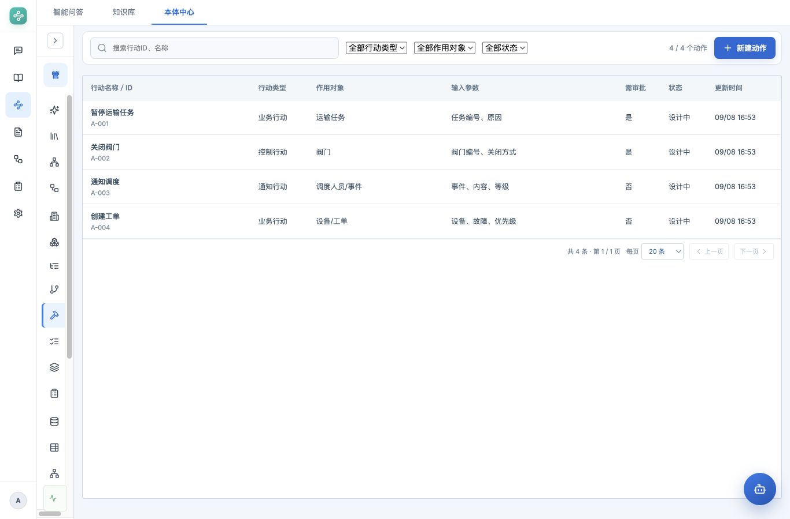
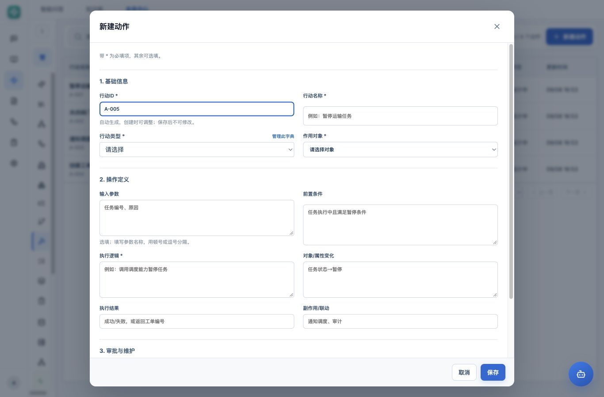

# 动作管理 v1.0 · 产品需求文档

| 项目 | 内容 |
|---|---|
| 路由 | `#/ontology/model/actions` |
| 模块 | 本体中心 → 本体模型 → 动作类型 |
| 版本 | v1.0 业务字段版，2026-10-29 |
| 状态 | 原型已实现 |
| 本次修订 | 默认只显示列表；详情按需展开关闭；创建严格按 13 列顺序分为基础信息、操作定义、审批与维护三组 |

## 1. 范围

围绕实际整理的四条动作，管理业务操作说明、输入参数、前置条件、预期变化与联动，支持新建、查询、编辑及受保护删除。

本版保存定义，不修改实例、不执行公式或接口，也不启动执行审批。页面默认以业务字段呈现，API 名称、参数英文标识、参数类型、填写形式、结果结构等技术项不再要求用户填写。

## 2. 业务依据

| 行动ID | 行动名称 | 行动类型 | 作用对象 | 输入参数 | 前置条件 | 执行逻辑 | 对象/属性变化 | 执行结果 | 副作用/联动 | 需审批 | 责任人 | 状态 |
|---|---|---|---|---|---|---|---|---|---|---|---|---|
| A-001 | 暂停运输任务 | 业务行动 | 运输任务 | 任务编号、原因 | 任务执行中且满足暂停条件 | 调用调度能力暂停任务 | 任务状态→暂停 | 成功/失败 | 通知调度、审计 | 是 | 示例负责人 | 设计中 |
| A-002 | 关闭阀门 | 控制行动 | 阀门 | 阀门编号、关闭方式 | 满足安全控制条件 | 调用控制系统执行关闭 | 阀门状态→关闭 | 成功/失败 | 回写状态、审计 | 是 | 示例负责人 | 设计中 |
| A-003 | 通知调度 | 通知行动 | 调度人员/事件 | 事件、内容、等级 | 产生需要人工关注的事件 | 发送通知 | 通知状态→已发送 | 成功/失败 | 审计记录 | 否 | 示例负责人 | 设计中 |
| A-004 | 创建工单 | 业务行动 | 设备/工单 | 设备、故障、优先级 | 异常需要维护处置 | 调用工单系统创建 | 生成工单对象 | 工单编号 | 关联告警、通知责任人 | 否 | 示例负责人 | 设计中 |

管道运输运营本体已有这四条动作，直接读取，不重复造数、不覆盖用户修改。“阀门”“调度人员/事件”“设备/工单”等原始业务称谓与底层对象类型引用分别保留。

## 3. 目录与详情

页面去掉顶部“定义对象的业务操作”介绍卡片，只保留筛选工具栏和动作列表。

### 3.1 列表

列为：行动名称/ID、行动类型、作用对象、输入参数、需审批、状态、更新时间。默认按行动ID自然顺序排列，无编号记录置后，再按名称排列。

- 关键字匹配行动ID、名称，兼容按内部 API 名称查找。
- 类型按字典 code 筛选、中文展示，兼容历史中文值。
- 对象按实际对象类型筛选；状态为设计中/已确认；条件之间为 AND。
- 支持清空条件、分页和每页条数；更改条件回第一页。
- 作用对象显示业务称谓，长参数文本有完整提示。
- 新建按钮直接打开简化表单，不再经过资源类型/建模方式选择。

### 3.2 详情展开与关闭

| 场景 | 行为 |
|---|---|
| 普通进入页面、刷新、切换本体 | 只显示列表，详情关闭，不默认选中第一条 |
| 点击列表记录 | 展开右侧详情，显示该条记录 |
| 点击另一条记录 | 在同一面板切换内容 |
| 点击详情右上角 × | 收起面板，列表恢复全宽，保留选中高亮 |
| 关闭后再次点击原记录 | 重新展开 |
| 筛选后当前记录不再匹配 | 关闭详情并清除选择，不自动展示其他记录 |
| 新建或编辑保存 | 更新列表并定位记录，不强制弹开已关闭的详情 |
| 从变更记录显式定位某个动作 | 展开对应记录，属于有明确目标的例外 |

详情按基础信息、操作说明、审批与维护分组，对应上述 13 列。头部保留编辑、删除、变更记录及关闭按钮。“更多记录信息”默认折叠，放关联对象类型、内部 API 名称、创建修改人和时间。

## 4. 创建与编辑

### 4.1 分组、顺序及控件

严格按用户提供的 13 列顺序配置。只做连续分组，三组默认全部展开；不再将前置条件等字段移到折叠区。两列布局按从左到右、从上到下读取，窄屏按同一顺序单列展示。

| 分组 | 顺序 | 字段 | 必填 | 控件与规则 |
|---|---|---|---|---|
| 基础信息 | 1 | 行动ID | 是，自动填充 | 文本输入；自动生成 A-xxx，创建可改，已有编号编辑只读 |
| 基础信息 | 2 | 行动名称 | 是 | 文本输入，最长 100 字 |
| 基础信息 | 3 | 行动类型 | 是 | 字典下拉：业务行动/控制行动/通知行动/计算行动/人工行动/其他；存 code |
| 基础信息 | 4 | 作用对象 | 是 | 当前本体对象下拉，含已有业务称谓，不增加第 14 个“作用对象说明”字段 |
| 操作定义 | 5 | 输入参数 | 否 | 多行文本；参数名称用顿号、逗号、分号或换行分隔；无参数可空 |
| 操作定义 | 6 | 前置条件 | 否 | 多行文本，500 字；无条件限制可空 |
| 操作定义 | 7 | 执行逻辑 | 是 | 多行文本，说明如何处理，可填写文字、公式或 API 调用描述 |
| 操作定义 | 8 | 对象/属性变化 | 否 | 多行文本，255 字；无对象变更可空 |
| 操作定义 | 9 | 执行结果 | 否 | 文本输入，255 字，例如成功/失败、工单编号 |
| 操作定义 | 10 | 副作用/联动 | 否 | 文本输入，255 字；无联动可空 |
| 审批与维护 | 11 | 需审批 | 是，有默认值 | 是/否下拉，默认否；仅登记要求，不启动审批 |
| 审批与维护 | 12 | 责任人 | 是 | 文本输入，默认示例负责人，最长 50 字；当前无人员目录，不做人员下拉 |
| 审批与维护 | 13 | 状态 | 是，有默认值 | 下拉：设计中/已确认，默认设计中；存 draft/validated |

用户不需要手填英文参数名、参数类型、API 名称或 JSON。默认值字段仍标 *，但无需重复选择；不要求把全部 13 项都手工填写。

### 4.2 作用对象与业务称谓

下拉按真实对象 ID 绑定，同时复用当前动作目录已有的称谓：例如“阀门（设备）”“调度人员/事件（告警）”“设备/工单（工单）”。选择后同时保存对象 ID 和业务称谓，不按文字猜测外键；切换对象清除原称谓，已有记录编辑时保留其原称谓。

新建不提供任意文字填写为未定义对象的入口。对象类型及新的角色建模在对应目录维护，不增加动作表单字段。

### 4.3 保存和关闭

底部只保留“取消、保存”，移除“检查填写”按钮。校验在保存时进行，错误在表单顶部汇总展示，保留填写内容。

未保存的修改关闭时需确认；点击遮罩不关闭；保存时禁用输入和关闭。保存成功关闭弹窗并更新列表，提示“动作已保存”。

## 5. 自动处理与兼容

1. 新建内部 API 名称由行动ID生成，例如 A-005 → action_a_005；用户无需输入。编号或内部名称冲突时提示调整编号，不覆盖旧记录。
2. 新建技术定义使用 invoke、text、v1.0 默认值，仅用于兼容现有契约，不据此推断实际对象效果。
3. 参数名称自动形成字符串参数定义。新参数 key 使用不重复的 paramN，既有同名参数保留原 key、类型、必填、默认值、来源及其他元数据。
4. 参数文本未变时，更新请求不提交 parameters，防止覆盖旧结构；文本重排时按名称匹配已有参数。新名称不复用已删除参数的稳定标识。
5. 重复参数名称阻止保存；参数名称修改不推断为旧参数改名，而作为新参数处理。旧公式/API 映射不会被自动改写，使用者应另行核对。
6. 简化编辑不提交或重建 definition_config、result_schema、preconditions、side_effects、description、action_type 等未展示技术字段，后端保留旧数据。
7. 旧业务说明、公式、API、结果结构与来源原文继续存储和导出。本轮界面收敛，不执行删除数据库字段或抹去技术配置的迁移。
8. 本体切换关闭详情和弹窗，清空筛选；过期异步请求不能覆盖新本体数据。

## 6. 校验与删除

保留现有后端校验：同本体行动ID/名称/API 名称唯一、对象属于当前本体、有效字典、并发时间戳、固定标识不可改及长度限制。

输入参数、前置条件、对象/属性变化、执行结果和副作用/联动允许为空；行动ID、名称、类型、对象、执行逻辑、需审批、责任人、状态必填，其中 ID、需审批、责任人、状态已有默认值。

删除需确认；active 动作不可直接删除；被场景、执行映射、权限策略显式引用的动作阻止删除并返回引用信息；不级联删消费者。调用与运行权限仍属于后续真实执行范围。

## 7. 正式表映射

| 正式字段 | 原型字段 |
|---|---|
| oact_act_id / oact_act_name / oact_act_type | external_id / display_name / action_category |
| oact_tgt_obj | target_object_type_id，业务称谓为 target_role |
| oact_input_params | parameters；原始文字 input_parameters_text |
| oact_pre_cond / oact_exec_logic | precondition_text / execution_logic |
| oact_obj_attr_chg / oact_exec_result / oact_side_effect | object_effect / result_text / side_effects_text |
| oact_need_appr / oact_owner / oact_status | approval_required / owner / design_status |
| oact_api_name / oact_action_type / oact_result_schema / oact_ver | 自动处理或保留旧值，不在默认表单要求填写 |
| oact_extend_params | 业务原文、技术配置及兼容元数据 |

原型继续使用 actions + metadata、UUID，不重建库。正式库仍需行动ID、名称、API 名称与本体的三个联合唯一索引。对象/属性变化是说明文字，取消其指向属性表的外键标注。

复用现有 GET/POST `/api/ontologies/{id}/actions`、GET/PUT/DELETE `/api/actions/{id}`；更新携带 expected_updated_at。

## 8. 本轮验证

- 浏览器：顶部介绍已消失；默认详情计数为 0；点击记录为 1；点击 × 后为 0，再点击可重新打开。
- 浏览器：管道运输本体的四条动作按原始业务称谓和参数展示；新建直接打开表单，自动生成 A-005，13 项按指定顺序分为三组并全部展开。
- 前端 76 项测试通过，生产构建通过；浏览器核对表单恰有 13 个配置控件，顺序、必填标记与输入/下拉类型一致。
- 后端动作契约 8 项回归通过；前端生产构建通过。
- 使用提供的四条动作核对现有数据，不额外重复创建或覆盖它们。
