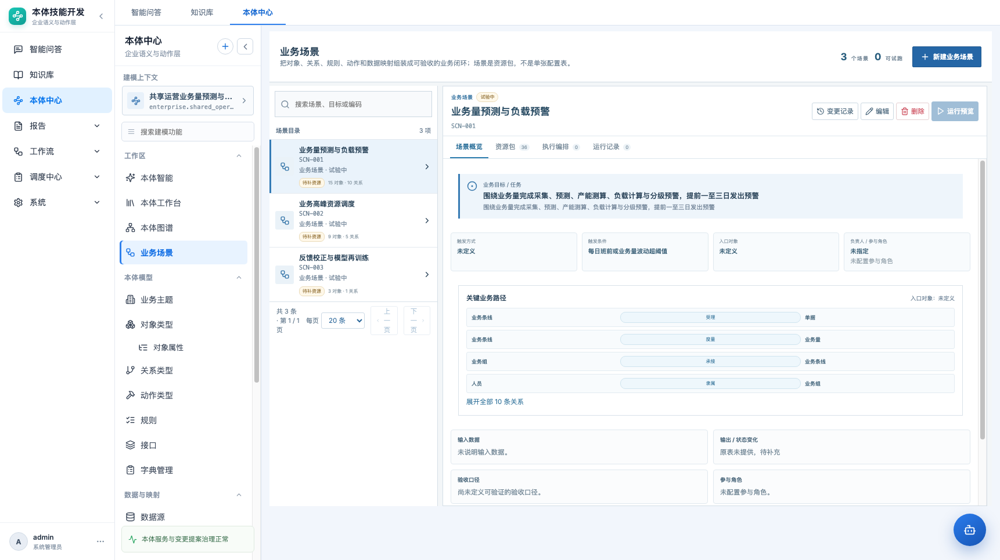
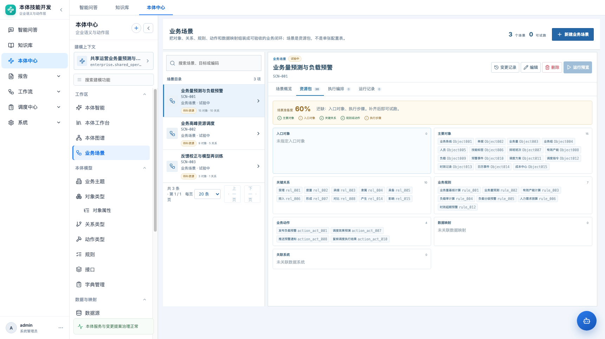
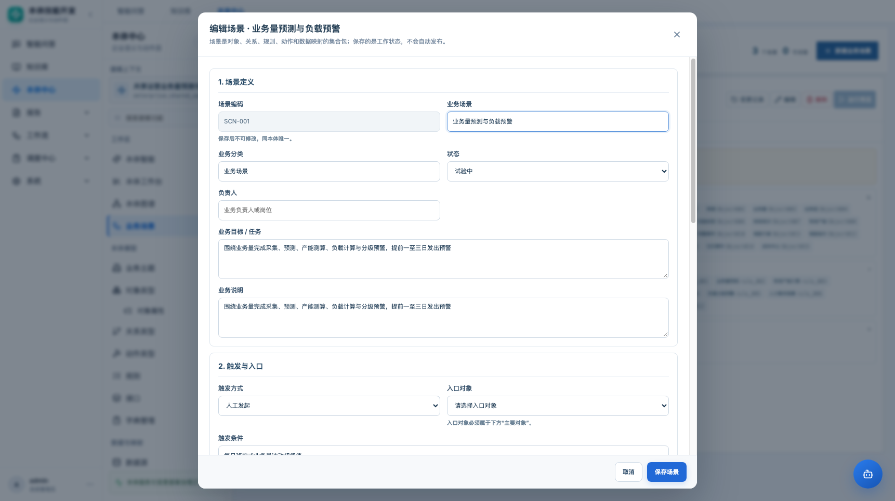

# 业务场景模块 · 产品需求文档

| 项目 | 内容 |
|---|---|
| 路由 | `#/ontology/scenarios` |
| 模块 | 本体中心 → 本体工作台 → 业务场景 |
| 版本 | v1.0，2026-11-02 |
| 状态 | 原型已重构 |
| 本版重点 | 场景是本体资源包，不是单张配置表；资源显示与存储字段分离 |

## 1. 结论先行

业务场景不是新的建模对象，也不是一张把字段填满的表。

业务场景是**当前本体中已存在资源的可执行集合包**：

```text
业务场景
├─ 业务目标与触发
├─ 入口对象
├─ 主要对象
├─ 关键关系
├─ 业务规则
├─ 业务动作
├─ 数据映射 / 关联系统
├─ 输入 / 输出 / 验收口径
├─ 参与角色与负责人
└─ 结构化执行步骤
```

它把对象、关系、规则、动作、映射和系统组织成一个可以讲解、检查、试跑、验收的业务闭环。

## 2. 为什么重构

旧页面更像“场景配置表 + 右侧运行面板”：

- 列表、详情、运行记录三列并存，正文被压缩；
- 字段以任务表单方式平铺，场景的“资源包”关系不直观；
- 原始逗号分隔字段和结构化步骤混在一起；
- 入口对象没有形成独立概念，入口与主要对象可能不一致；
- 关联系统是自由文本，和已登记数据源脱节；
- 没有准备度：用户不知道还缺什么才能运行；
- 运行预览固定在右侧，不构成完整的场景生命周期；
- 大量字段全部展示，缺少“存储但不显示”的边界。

## 3. 产品定位

### 3.1 业务场景是什么

- **资源包**：引用当前本体已存在的对象、关系、规则、动作、映射和系统。
- **业务闭环**：有触发、有入口、有输入、有规则判断、有动作、有输出。
- **可验收单元**：有验收口径，能判断是否完成。
- **可试跑编排**：结构化步骤可以生成流程预览，但不调用真实业务系统。
- **下游消费者**：依赖本体建模结果，不反向修改对象、关系、规则或动作。

### 3.2 业务场景不是什么

- 不是新的对象类型；
- 不是数据映射；
- 不是发布版本；
- 不是真实执行记录；
- 不是一组自由文本步骤；
- 不是可以绕过资源校验的“流程配置”。

## 4. 创建时机：是不是本体建好后才创建

结论：**推荐在本体具备最小可编排资源后创建；但允许先保存设计稿。**

### 4.1 建议顺序

```text
对象类型
  ↓
关系类型
  ↓
业务规则 / 动作
  ↓
数据源 / 数据映射
  ↓
业务场景（资源包 + 执行编排）
  ↓
试跑 / 验收
```

### 4.2 最小可创建条件

允许创建“设计中”的场景，只需要：

- 至少一个对象类型；
- 场景名称、编码、业务目标、触发条件；
- 可以只保存场景语义，不配置执行步骤。

### 4.3 可试跑条件

必须具备：

- 入口对象；
- 入口对象属于主要对象；
- 至少一条关键关系（建议）；
- 结构化步骤包含入口对象定位；
- 结构化步骤包含验证或状态变化；
- 引用的对象/关系/规则/动作/映射都存在且属于当前本体；
- 选中的映射对应数据源也已加入关联系统。

**“状态=已发布”不等于“可试跑”。** 可试跑是派生准备度，不写回状态字段。

## 5. 信息架构

```text
业务场景
├─ 顶部：场景总数 / 可试跑数 / 新建
├─ 左侧：场景目录（搜索、状态、准备度、资源数量）
└─ 右侧：场景工作区
   ├─ 场景概览
   ├─ 资源包
   ├─ 执行编排
   └─ 运行记录
```

### 5.1 场景目录

每项显示：

- 场景名称；
- 场景编码；
- 业务分类；
- 状态；
- 派生准备度：`可试跑` / `待补资源`；
- 主要对象数、关键关系数。

不显示：

- 原始 JSON；
- 数据库自增 ID；
- 所属本体 ID；
- 创建/修改人字段。

### 5.2 场景概览

显示：

- 业务目标 / 任务；
- 业务说明；
- 触发方式、触发条件；
- 入口对象；
- 负责人、参与角色；
- 关键业务路径（关系两端 + 关系名称）；
- 输入数据；
- 输出 / 状态变化；
- 验收口径；
- 资源包摘要与准备度。

关键路径按“起点 → 关系 → 终点”展示，不再把所有对象串成一条伪路径。超过 4 条关系时折叠。

### 5.3 资源包

卡片化展示七类资源：

1. 入口对象；
2. 主要对象；
3. 关键关系；
4. 业务规则；
5. 业务动作；
6. 数据映射；
7. 关联系统。

每类显示资源名称和编码；空资源显示“未选择”，不伪造默认值。

准备度卡显示：

- 0–100% 派生分数；
- 已满足/未满足项；
- 还缺什么；
- 满足时提示“可生成流程预览”。

### 5.4 执行编排

- 只读展示结构化步骤；
- 步骤类型、引用资源、失败策略、审批要求；
- 编辑入口回到场景编辑弹窗；
- 没有结构化步骤时显示空态；
- 运行预览按钮在没有步骤时禁用。

### 5.5 运行记录

- 左侧运行记录列表；
- 右侧流程预览详情；
- 显示生成时间、规则步骤数、拟执行动作；
- 明确标注“未实际执行 / 未调用业务系统”；
- 运行记录不冒充生产执行审计。

## 6. 字段显示规划

| V3 字段 | 原型 payload 键 | UI 位置 | 显示 | 说明 |
|---|---|---|---|---|
| `obs_code` | `code` | 标题、编辑只读 | 是 | 保存后不可改 |
| `obs_name` | `name` | 标题、编辑 | 是 | 同本体唯一 |
| `obs_category` | `category` | 标题、列表 | 是 | 业务分类 |
| `obs_status` | `status` | 状态标签 | 是 | 设计中/试验中/已发布/已废弃 |
| `obs_owner` | `owner` | 概览、编辑 | 是 | 负责人 |
| `obs_desc` | `description` | 概览、编辑 | 是 | 业务说明 |
| `obs_biz_goal` | `business_goal` | 概览、编辑 | 是 | 业务目标/任务 |
| `obs_trigger_cond` | `trigger_condition` | 概览、编辑 | 是 | 触发条件 |
| `obs_trigger_type` | `trigger_type` | 概览、编辑 | 是 | manual/event/scheduled/api |
| `obs_entry_object` | `entry_object` | 概览、资源包、编辑 | 是 | 必须属于主要对象 |
| `obs_main_objs` | `related_objects` | 资源包、编辑 | 是 | 渲染为对象名称 |
| `obs_key_rels` | `related_links` | 资源包、关键路径、编辑 | 是 | 只允许两端对象都在主要对象中 |
| `obs_biz_rls` | `related_rules` | 资源包、编辑 | 是 | 渲染为规则名称 |
| `obs_biz_acts` | `related_actions` | 资源包、编辑 | 是 | 渲染为动作名称 |
| `obs_input_data` | `input_data` | 概览、编辑 | 是 | 自由文本 |
| `obs_related_sys` | `source_codes` | 资源包、编辑 | 是 | 渲染为数据源名称，不显示原始 code 为主 |
| `obs_output_chg` | `output_change` | 概览、编辑 | 是 | 必填 |
| `obs_acceptance` | `acceptance_criteria` | 概览、编辑 | 是 | 多行验收口径 |
| `obs_participants` | `participants` | 概览、编辑 | 是 | 参与角色 |
| `obs_related_maps` | `related_mappings` | 资源包、编辑 | 是 | 渲染为映射名称 |
| `obs_steps` | `steps` | 执行编排 | 是 | JSON 存储，前端只渲染结构化步骤 |
| `obs_ontology_id` | `ontology_id` | — | 否 | 当前上下文隐式确定 |
| `obs_created_by/at` | 资源元数据 | — | 否 | 不占业务详情 |
| `obs_updated_by/at` | 资源元数据 | 变更记录 | 部分 | 通过变更记录入口查看 |
| `obs_extend_params` | `extend_params` | — | 否 | 预留扩展，不进入主表单 |
| `template_external_id/sheet/row/raw` | 同名字段 | — | 否 | 导入追溯字段，不在业务表单展示 |
| `key_path` | 同名字段 | — | 否 | 旧字段；路径由对象/关系实时推导 |
| `connected_systems` | 同名字段 | — | 否 | 旧自由文本；以 `source_codes` 为准 |
| `input_data_items` | 同名字段 | — | 否 | 旧数组；以 `input_data` 文本为准 |
| `design_status` | 同名字段 | — | 否 | 旧建模状态，与业务状态分离 |

## 7. 编辑交互

编辑弹窗分四段：

### 7.1 场景定义

- 场景编码：新建可填，保存后只读；
- 业务场景、业务分类、状态、负责人；
- 业务目标 / 任务；
- 业务说明。

### 7.2 触发与入口

- 触发方式；
- 触发条件；
- 入口对象：只能从已选主要对象中选择；
- 参与角色；
- 输入数据。

### 7.3 本体资源包

- 主要对象：多选卡片；
- 关键关系：只显示两端对象都在主要对象中的关系；
- 业务规则、业务动作：多选；
- 关联数据映射：选择后自动加入映射对应的数据源；
- 关联系统：可手工调整；
- 输出 / 状态变化：必填；
- 验收口径：每行一条；
- 智能建议：根据场景名称/目标/说明/触发条件匹配已有对象和关系，结果需人工确认。

**约束：**

- 改变主要对象时，清除不再成立的关系；
- 改变资源时，清除步骤并要求重新生成，避免步骤引用失效资源；
- 入口对象必须在主要对象中；
- 场景保存不创建或修改对象、关系、规则、动作、映射。

### 7.4 执行编排

- 根据资源生成步骤；
- 添加、删除、上移、下移；
- 引用资源必须来自前面已选资源；
- 动作可标记人工确认；
- 没有步骤也可保存设计稿，但不能运行预览。

## 8. AI 识别资源包

### 8.1 产品判断

AI 适合做**候选资源包**，不适合直接写场景。

### 8.2 推荐输入

- 场景名称；
- 业务目标 / 任务；
- 业务说明；
- 触发条件；
- 当前本体的对象、关系、规则、动作、映射、系统索引。

### 8.3 推荐输出

每项资源给出：

- 资源类型、名称、编码；
- 推荐理由；
- 置信度；
- 证据（引用业务目标中的短语、关系端点、映射目标等）。

### 8.4 交互

```text
智能识别资源包
  → 生成候选清单
  → 用户逐项勾选 / 取消
  → 应用到当前场景草稿
  → 用户确认保存
```

- 不自动保存；
- 不自动生成执行步骤；
- 不修改本体资源；
- 低置信度资源默认不选；
- 用户取消后不保留隐式状态。

### 8.5 原型现状

当前原型提供**文本匹配版智能建议**：按场景文本匹配对象名称，再补齐对象之间的候选关系，并提示“请人工确认”。真实 AI 推荐仍需接入资源索引和证据服务；接口定义不在本 PRD 展开。

## 9. 运行预览

- 只有结构化步骤才可运行；
- 运行预览生成本地轨迹，不调用规则引擎或业务系统；
- 预览结果明确标注“未实际执行”；
- 运行记录只证明编排可生成，不证明生产结果；
- 运行成功与否不修改场景状态。

## 10. 状态与准备度

### 10.1 业务状态

| 状态 | 中文 | 说明 |
|---|---|---|
| `draft` | 设计中 | 可保存设计稿 |
| `experimental` | 试验中 | 兼容历史试验场景 |
| `active` | 已发布 | 业务上已生效 |
| `deprecated` | 已废弃 | 不再使用 |

### 10.2 准备度（派生）

```text
主要对象       有对象
入口对象       入口属于主要对象
关键关系       至少一条
规则或动作     至少一项
执行步骤       至少一个结构化步骤
```

- 准备度不写数据库；
- 准备度不等于发布状态；
- `可试跑` 只要求入口对象 + 结构化步骤；
- 缺少资源时明确显示“待补：…”。

## 11. 验收

| 编号 | 验收项 |
|---|---|
| S01 | 页面为两列：场景目录 + 场景工作区，不再有固定右侧运行栏 |
| S02 | 场景详情有概览、资源包、执行编排、运行记录四个 Tab |
| S03 | 场景概览显示目标、触发、入口、负责人/参与角色、输入/输出、验收口径 |
| S04 | 关键路径按“起点 → 关系 → 终点”展示，不把所有对象串成伪路径 |
| S05 | 资源包按入口对象、主要对象、关键关系、规则、动作、映射、系统分组 |
| S06 | 资源名显示名称，编码仅作辅助；不显示原始 JSON、ID、扩展字段 |
| S07 | 入口对象只能从主要对象中选择，保存时校验 |
| S08 | 关键关系选项只包含主要对象两端的关系 |
| S09 | 选择数据映射自动补入对应数据源 |
| S10 | 改变资源后旧步骤失效，需重新生成，防止引用悬空 |
| S11 | 没有步骤时运行预览禁用；有步骤时可生成流程轨迹 |
| S12 | 运行记录明确标注“未实际执行” |
| S13 | 状态只显示业务状态，准备度单独显示 |
| S14 | 无对象时允许保存设计稿，并提示先补对象/关系/动作 |
| S15 | 1366 / 1722 宽度无页面横向溢出 |

## 12. 原型截图







## 13. 当前限制

- 智能建议是文本匹配，不是真实语义模型；
- 运行预览仍为本地轨迹，不是生产执行；
- 场景发布仍未接入本体发布审核流；
- 资源包没有做跨本体引用校验（场景只取当前本体资源）；
- 历史 `experimental`、`connected_systems`、`input_data_items` 等字段保留兼容，不进入主界面。
