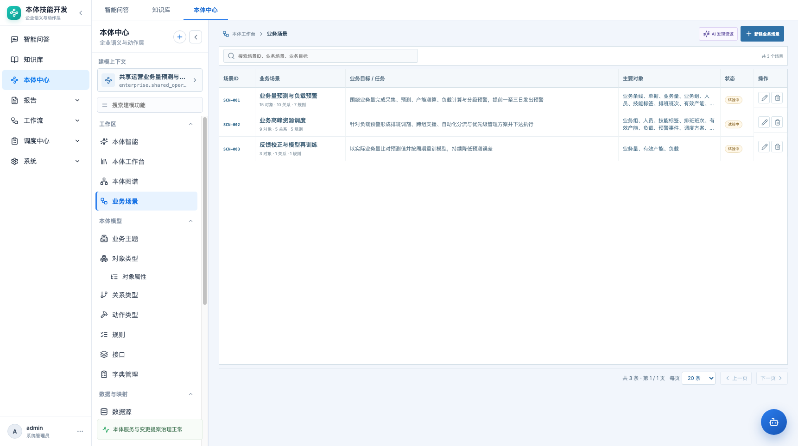
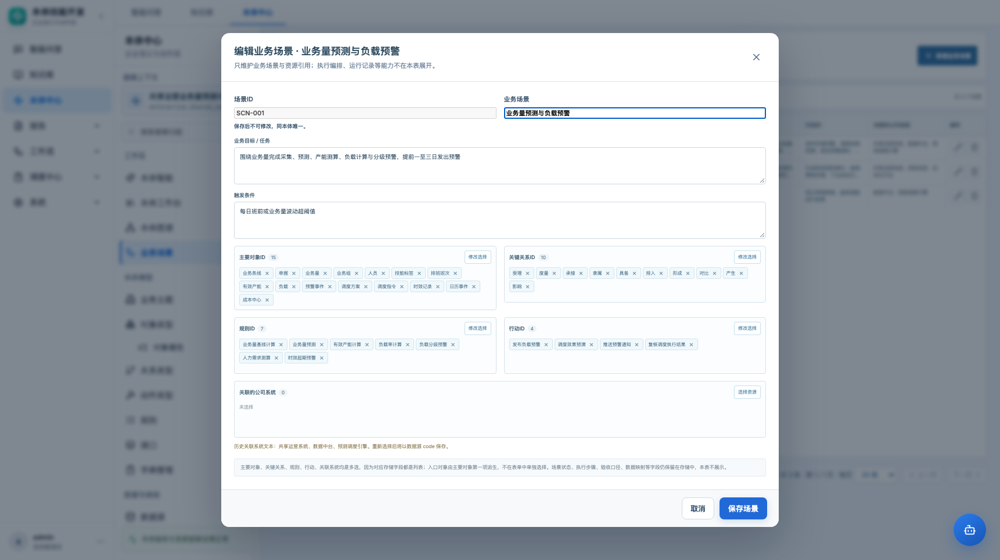
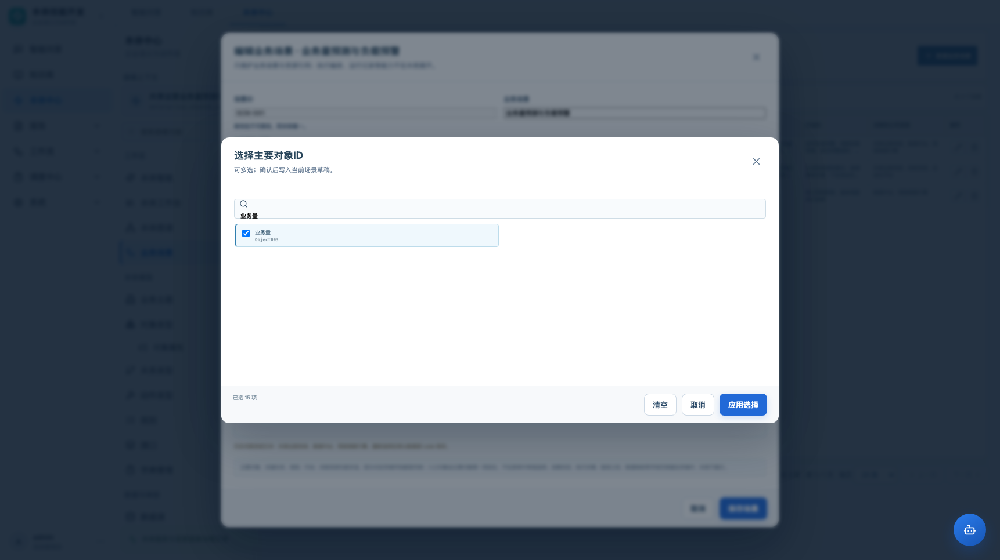

# 业务场景模块 · 产品需求文档（简化版）

| 项目 | 内容 |
|---|---|
| 路由 | `#/ontology/scenarios` |
| 模块 | 本体中心 → 本体工作台 → 业务场景 |
| 版本 | v1.1，2026-11-02 |
| 状态 | 原型已简化重构 |
| 本版原则 | 场景先做简单登记表，不把执行编排塞进主界面 |

## 1. 本版结论

业务场景先回归一张清楚的登记表：

```text
场景ID | 业务场景 | 业务目标/任务 | 触发条件
主要对象 | 关键关系 | 规则 | 行动 | 关联公司系统
```

列表直接展示这些字段；点击行打开编辑弹窗，只维护这些字段。

场景的“资源包”定位仍然成立：

- 主要对象、关系、规则、行动、系统都是当前本体已有资源；
- 场景只引用，不修改这些资源；
- 状态、执行步骤、验收口径、数据映射等字段仍可存储，但不在本表展示。

**不再在主界面展示：** 资源包 Tab、准备度、运行记录、执行编排、AI 推荐面板。

## 2. 创建时机

推荐顺序仍然是：

```text
对象类型 → 关系类型 → 规则 / 动作 → 数据源 / 数据映射 → 业务场景
```

- 不强制本体全部完成才能创建；可以先登记场景。
- 但“主要对象”必须来自当前本体。
- 新增场景默认保存为“设计中”，允许没有执行步骤。
- 场景的详细执行能力后续单独设计，不阻塞这张登记表。

## 3. 页面结构

```text
业务场景
├─ 页面标题 + 新建
├─ 搜索 + 场景数量
├─ 表格式场景列表
│  ├─ 场景ID
│  ├─ 业务场景
│  ├─ 业务目标 / 任务
│  ├─ 触发条件
│  ├─ 主要对象ID
│  ├─ 关键关系ID
│  ├─ 规则ID
│  ├─ 行动ID
│  ├─ 关联的公司系统
│  └─ 操作（编辑 / 删除）
└─ 分页
```

- 点击行进入编辑弹窗。
- 行内操作按钮阻止行点击冒泡。
- 表格在窄屏横向滚动；不拆成多层面板。
- 没有右侧详情栏、详情 Tab 或运行面板。

## 4. 字段显示规划

### 主表显示

| 字段 | 存储键 | 显示方式 |
|---|---|---|
| 场景ID | `code` | 文本/代码 |
| 业务场景 | `name` | 名称，下面小字显示状态 |
| 业务目标 / 任务 | `business_goal` | 两行截断，悬浮显示全文 |
| 触发条件 | `trigger_condition` / `trigger` | 两行截断 |
| 主要对象ID | `related_objects` | 对象名称列表 |
| 关键关系ID | `related_links` | 关系名称列表 |
| 规则ID | `related_rules` | 规则名称列表 |
| 行动ID | `related_actions` | 动作名称列表 |
| 关联的公司系统 | `source_codes` | 数据源名称列表；历史场景回退 `connected_systems` 文本 |

### 编辑弹窗显示

- 场景ID（新建可填，保存后只读）
- 业务场景
- 业务目标 / 任务
- 触发条件
- 主要对象（多选弹窗）
- 关键关系（多选弹窗）
- 规则（多选弹窗）
- 行动（多选弹窗）
- 关联的公司系统（多选弹窗）

资源不通过高高的原生多选下拉框维护。点击“选择资源/修改选择”打开选择弹窗，支持搜索、勾选、清空、取消和应用。

### 存储但不显示

| 字段 | 处理 |
|---|---|
| `status` | 主表名称下的小状态；不在弹窗中编辑 |
| `category` / `owner` / `description` | 保留原值，不在简化表展示 |
| `entry_object` | 保存时自动取主要对象第一项；不单独展示 |
| `output_change` / `acceptance_criteria` / `input_data` | 保留原值，不在简化表展示 |
| `participants` / `related_mappings` | 保留原值，不在简化表展示 |
| `steps` | 保留原值；资源变化时清空，避免引用悬空 |
| `trigger_type` | 默认人工发起，保留原值 |
| `template_*` / `design_status` | 导入追溯字段，不展示 |
| `obs_ontology_id` / 审计字段 | 上下文或变更记录，不占主表 |

## 5. 交互规则

### 5.1 新建

- 场景ID必填，同本体唯一，保存后不可改。
- 业务场景、业务目标、触发条件必填。
- 主要对象至少选择一个。
- 关系、规则、行动、系统可选。
- 保存后回到表格，默认状态为“设计中”。
- 不自动生成执行步骤，不自动运行。

### 5.2 编辑

- 点击行或编辑按钮打开弹窗。
- 场景ID只读。
- 修改主要对象/关系/规则/行动/系统后，原隐藏执行步骤失效并被清空，防止步骤引用已移除资源。
- 其他隐藏字段保留原值。
- 删除需要二次确认。

### 5.3 单选 / 多选判断

按表结构，五类资源都是列表字段，因此统一为多选：

| 字段 | 选择方式 | 原因 |
|---|---|---|
| 主要对象 | 多选 | `obs_main_objs` 存对象列表 |
| 关键关系 | 多选 | `obs_key_rels` 存关系列表 |
| 规则 | 多选 | `obs_biz_rls` 存规则列表 |
| 行动 | 多选 | `obs_biz_acts` 存行动列表 |
| 关联公司系统 | 多选 | `obs_related_sys` 存系统列表 |
| 入口对象（隐藏） | 单选派生 | 入口只能是主要对象中的一个，保存时取第一项 |

### 5.4 资源显示

- 表格显示资源名称，悬浮显示完整列表。
- 系统列优先显示已登记数据源名称；历史场景没有 `source_codes` 时回退显示 `connected_systems` 文本。
- 空资源显示“—”，不显示原始 JSON、UUID、逗号字符串。

## 6. 与旧设计的关系

本版主动收缩：

| 旧设计 | 本版 |
|---|---|
| 左侧目录 + 详情工作区 + 右侧运行栏 | 单张表 |
| 概览 / 资源包 / 执行编排 / 运行记录 四 Tab | 表格 + 编辑弹窗 |
| 准备度、可试跑 | 暂不展示 |
| AI 推荐资源包 | 暂不进入主界面 |
| 运行预览 | 暂不进入主界面 |
| 资源卡片 | 表格列 |

这不是否定资源包语义，而是把**场景登记**和**执行编排**拆开：先让业务场景能快速录入、查看和维护，再单独设计执行能力。

## 7. 验收

| 编号 | 验收项 |
|---|---|
| S01 | 页面为单张表，不出现左侧目录、详情 Tab 或右侧运行栏 |
| S02 | 表头包含场景ID、业务场景、业务目标、触发条件、主要对象、关键关系、规则、行动、关联公司系统、操作 |
| S03 | 点击行打开编辑弹窗，场景ID在编辑时只读 |
| S04 | 新建必须填写场景ID、名称、业务目标、触发条件，并至少选择一个主要对象 |
| S05 | 主要对象/关系/规则/行动/系统均来自当前本体资源 |
| S06 | 系统列显示数据源名称；历史文本可回退展示 |
| S07 | 资源变化时旧步骤被清空，避免引用悬空 |
| S08 | 状态、验收、执行步骤、映射等字段可保留，但不在主表展示 |
| S09 | 删除有确认，删除后刷新列表 |
| S10 | 1366 宽度出现表格横向滚动，不造成页面横向溢出 |
| S11 | 五类资源均通过弹窗选择，支持搜索和多选，不使用高多选下拉框 |
| S12 | 入口对象不单独做单选控件，由主要对象第一项派生 |

## 8. 截图







## 9. 限制

- 当前表格显示资源名称，不生成 `OBJ-001` 形式的新编号；历史 Excel 中的编号是外部模板编号。
- 场景状态、执行步骤、验收口径、数据映射不在本版主界面维护。
- AI 资源推荐、运行预览、准备度拆分到后续能力，不与本登记表耦合。
