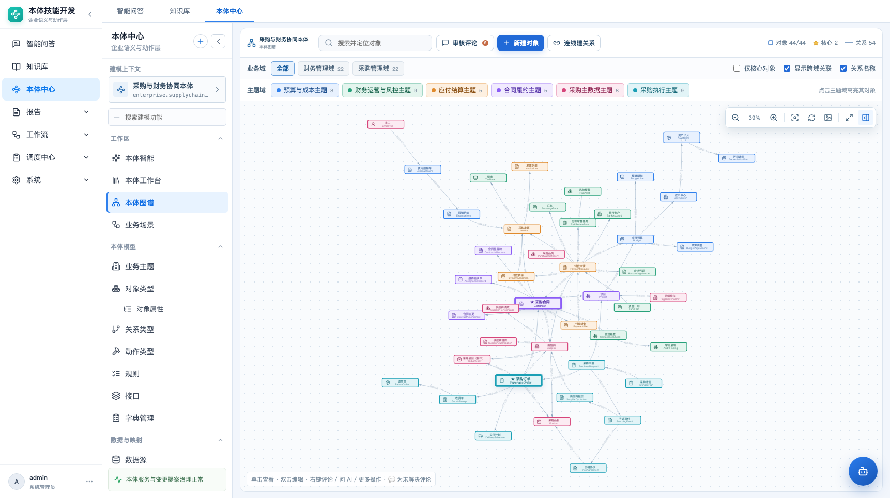
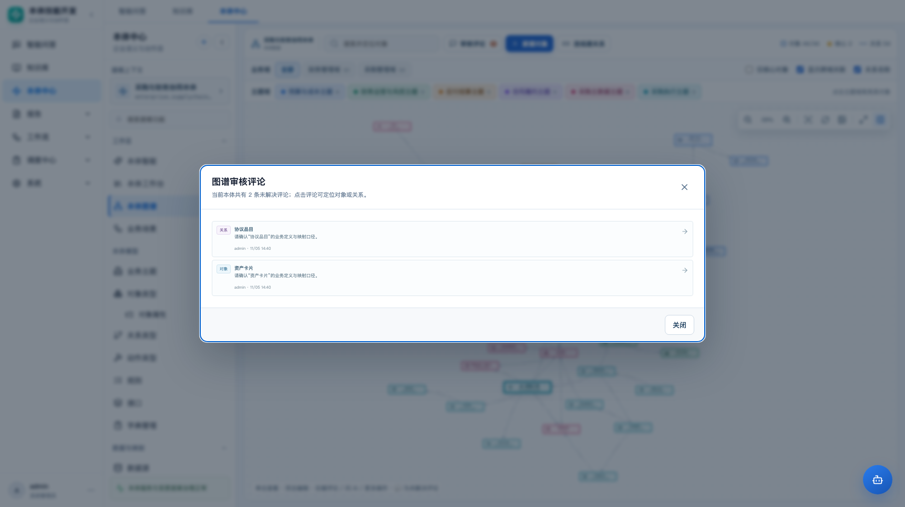
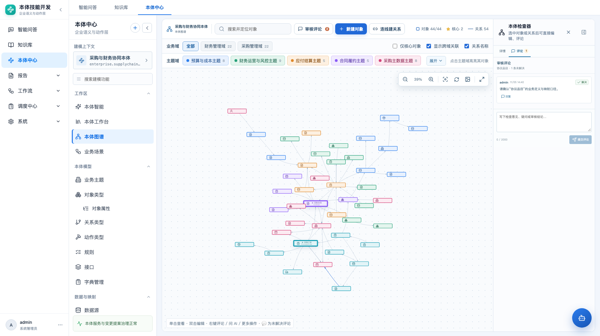

# 本体图谱评论与人工审核 · 产品需求文档

| 项目 | 内容 |
|---|---|
| 路由 | `#/ontology/graph` |
| 模块 | 本体中心 → 本体图谱 |
| 版本 | v1.0，2026-11-05 |
| 状态 | 原型已实现 |
| 本版范围 | 对对象/关系右键插入评论、回复、解决/重新打开、图谱审核列表 |

## 1. 目标

把图谱从“只能看和改模型”扩展为“可以在模型上做人工检查和审核”：

- 对某个对象或关系直接写检查意见；
- 每条评论锚定具体资源，不脱离上下文；
- 支持回复、解决、重新打开；
- 图上能看到未解决评论数量；
- 有审核列表，能集中处理未解决项；
- 评论不修改本体模型，不进入版本快照，不冒充变更记录。

## 2. 非目标

- 不做飞书式任意文本选区评论；
- 不对单个属性/字段做评论（后续可扩展到属性锚点）；
- 不做 @ 提醒、消息通知、审批流；
- 不做评论删除/编辑（本版）；
- 不把评论写进 change_log 或发布快照；
- 不替代发布审核流程。

## 3. 入口与交互

### 3.1 右键添加评论

对象右键菜单：

```text
问 AI
添加评论 / 查看评论 n
编辑对象
...
```

关系右键菜单同样有“添加评论 / 查看评论 n”。

点击后：

- 选中该对象/关系；
- 打开右侧检查器；
- 自动切到“评论”Tab；
- 聚焦评论输入框。

### 3.2 检查器双 Tab

选中对象或关系后，右侧检查器显示：

```text
[详情] [评论 n]
```

- 详情：原有对象/关系属性与操作；
- 评论：该资源下的评论线程、回复、解决/重新打开、新增评论。

### 3.3 评论线程

- 第一条评论是主贴；
- 回复挂在主贴下，不继续嵌套；
- 主贴可“解决”或“重新打开”；
- 解决后默认折叠，可点“显示已解决 n”查看；
- 作者、时间、内容全部保留；
- 提交后列表即时刷新。

### 3.4 审核评论列表

工具栏新增：

```text
[审核评论 n]
```

- `n` 为当前本体未解决主贴数量；
- 点击打开审核列表；
- 每条显示资源类型、资源名称、评论摘要、作者、时间；
- 点击评论定位对应对象/关系，并打开评论 Tab；
- 目标资源已删除时提示，不打开错误资源。

### 3.5 图上的评论标记

- 有未解决评论的对象节点，标签追加 `💬 n`；
- 有未解决评论的关系，在关系名称后追加 `💬 n`（关系名称开启时）；
- 节点/关系解决后标记消失；
- 图下方提示说明 `💬` 代表未解决评论。

## 4. 数据模型

新增表 `graph_comments`：

| 字段 | 说明 |
|---|---|
| `id` | 评论 ID，UUID |
| `ontology_id` | 所属本体 |
| `target_type` | `object_type` / `link_type` |
| `target_id` | 对象/关系 ID |
| `target_label` | 创建时资源名称快照 |
| `parent_id` | 回复的主贴 ID；主贴为空 |
| `body` | 评论正文，≤2000 字 |
| `author` | 评论人 |
| `status` | `open` / `resolved` |
| `created_at` / `updated_at` | 时间 |
| `resolved_at` / `resolved_by` | 解决时间/人 |

约束：

- 目标和父评论必须属于同一本体；
- 回复必须与主贴同目标；
- 只有主贴可解决/重新打开；
- 评论不入模型版本、不入发布快照。

## 5. 权限与安全（原型边界）

当前原型为单管理员演示：

- 所有评论作者为 `admin`；
- 前端无多角色控制；
- 正式接入必须校验当前用户对当前本体的读权限、评论权限和解决权限；
- 服务端不能信任前端传入的 author，应取当前登录用户；
- 评论内容可能包含敏感信息，需保留/审计策略；
- 资源删除后评论保留为历史记录；审核列表对已删除目标只提示，不打开错误详情。

## 6. 验收

| 编号 | 验收项 |
|---|---|
| GC01 | 对象右键有“添加评论/查看评论”，关系右键同样有 |
| GC02 | 右键评论后选中资源、打开检查器、切到评论 Tab |
| GC03 | 检查器有详情/评论双 Tab，评论 Tab 显示未解决数 |
| GC04 | 新增评论后立即出现在线程中，作者/时间正确 |
| GC05 | 可回复主贴，回复归属正确，不能跨资源回复 |
| GC06 | 可解决/重新打开，解决后默认隐藏、可展开查看 |
| GC07 | 未解决主贴数量显示在“审核评论”按钮和节点/关系标记 |
| GC08 | 审核列表可定位对象/关系；目标删除时不打开错误资源 |
| GC09 | 评论区空态、提交中、提交失败可恢复 |
| GC10 | 评论不进入 change_log/发布快照，不修改模型字段 |
| GC11 | 1366 / 1722 宽度下检查器评论区可滚动、输入框可用 |

## 7. 验收数据

- 目标对象：`资产卡片`（`AssetCard`）；
- 目标关系：`协议品目`（关系）；
- 至少 2 条未解决主贴、1 条回复、1 条已解决评论；
- 验证解决后审核计数减 1、节点/关系标记消失；
- 验证重新打开后计数恢复。

## 8. 截图







## 9. 后续扩展

- 属性级评论锚点；
- @成员与通知；
- 评论编辑/删除与审计；
- 评论解决权限；
- 审核人分配、到期提醒；
- 发布评审时汇总未解决评论；
- 评论与变更记录/版本的关联。
