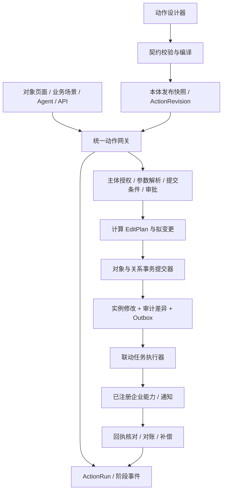

# 动作模块：Palantir 调研与系统设计

调研日期：2026-10-29。范围：`/ontology/model/actions` 及其与对象实例、规则、能力映射、权限、发布、Agent 的衔接。

文档状态：建议设计，待产品与研发评审。本次交付调研和设计，未实现下述新能力，也未修改业务代码或数据库。现状结论来自当前工作区静态代码核查，不代表生产环境运行验证。

## 1. 建议先确定的产品方向

将当前“行动信息登记表”升级为**动作类型设计器 + 统一执行网关 + 执行记录**。动作以“分派工单”“提交复核”等业务目标命名，一次提交可以修改多个对象及关系。配置者定义契约，业务人员在对象上填写动作表单，应用和 Agent 复用同一套后端校验与执行逻辑。

第一阶段优先做完整的本地业务闭环：结构化参数 → 提交条件 → 对象变更 → 预演 → 发布 → 在实例上执行 → 审计。外部系统调用接在同一执行网关下，分后续阶段落地。只重做页面表单、继续把逻辑保存在自然语言里，不能解决“不可用”。

三个边界必须明确：

1. **定义与执行分开**：Action Type 是可版本化的操作契约，Action Run 是某次带具体参数的执行。
2. **本体事务与外部调用分开**：本体内多对象修改可以原子提交；外部调用需要幂等、结果核对、重试及补偿。
3. **业务类别与实现方式分开**：“业务行动/控制行动”是分类；声明式编辑、函数实现、外部能力是执行机制；“新增/修改/删除”是具体效果。

## 2. Palantir 官方设计给出的依据

以下为官方公开产品文档的归纳，不推断其内部服务或数据库实现。每项末尾附原始来源；第 4 节以后均为结合本项目的设计建议。

| 维度 | 官方文档表达的设计 | 本项目应借鉴的部分 |
|---|---|---|
| 动作语义 | 动作类型定义一组对象、属性、关系编辑，以及相关副作用；具体动作承载一次业务提交。[Overview](https://www.palantir.com/docs/foundry/action-types) | 将动作作为独立业务命令建模，允许多种编辑组成一个操作 |
| 创建过程 | 创建向导从目标对象、操作和属性映射开始，随后进入完整编辑器，系统可据规则生成参数。[Getting started](https://www.palantir.com/docs/foundry/action-types/getting-started) | 从“要改变什么”引导配置，减少先填写技术元数据的负担 |
| 参数 | 参数连接动作规则与消费应用，可引用对象，配置可见、可编辑状态，并被条件和其他配置引用。[Parameters](https://www.palantir.com/docs/foundry/action-types/parameter-overview) | 参数是类型化契约，业务表单只是契约的一种呈现 |
| 编辑规则 | Rules 描述参数怎样变成编辑。支持对象增删改及关系操作；函数规则存在时不能再配置其他编辑规则。外键关系通过对象外键修改，多对多才直接增删关系。[Rules](https://www.palantir.com/docs/foundry/action-types/rules) | 建立结构化效果列表；复杂函数与简单编辑模式互斥；关系编辑遵守自己的存储模型 |
| 提交条件 | 条件可组合嵌套，使用用户、参数、对象及执行上下文，配置失败提示；不同于修改动作定义的权限。[Submission criteria](https://www.palantir.com/docs/foundry/action-types/submission-criteria) | 独立的后端条件引擎，提供业务可读的拒绝原因 |
| 复杂实现 | Function-backed actions 用于关联对象联动、复杂计算和多类型创建等简单规则难以表达的操作。[Function-backed actions](https://www.palantir.com/docs/foundry/action-types/function-actions-overview) | 保留注册函数扩展点，不把所有业务逻辑塞进表单或自然语言 |
| 事务边界 | 本体编辑作为一个原子批次提交；原子性不覆盖通知、Webhook 或函数内外部调用。[Consistency and isolation](https://www.palantir.com/docs/foundry/action-types/consistency-guarantees) | 明确局部事务边界，不能宣称跨系统 ACID |
| 外部写回 | Writeback webhook 在对象修改前执行，失败则不继续；Side effect webhook 在对象修改后执行。前者仍可能出现外部成功、本体失败。[Webhooks](https://www.palantir.com/docs/foundry/action-types/webhooks) | 明确“先外部后回写”和“提交后通知”两种语义 |
| 安全 | 查看配置、编辑配置、提交动作是不同权限。可通过动作限制写入路径，通知接收者也需有相关数据权限。[Permissions](https://www.palantir.com/docs/foundry/action-types/permissions) | 后端集中授权，同时治理直接编辑实例的旁路 |
| 预演 | Test run 展示拟编辑、执行细节与副作用预览，不落本体编辑。但为计算结果所需的函数及部分外部调用仍可能执行，需要确认。[Test run](https://www.palantir.com/docs/foundry/action-types/test-run) | 做变更前后对比；我们首版预演明确禁止真实外部写入 |
| 记录 | Action log 表达成功提交的业务决策；完整编辑历史、失败指标、告警属于其他能力。[Action log](https://www.palantir.com/docs/foundry/action-types/action-log) | 分开定义变更日志、执行记录、实例编辑历史的职责 |
| 撤销 | Revert 受对象后续修改等条件限制，只撤销本体编辑，不撤回已发生的通知和 Webhook。[Revert](https://www.palantir.com/docs/foundry/action-types/action-reverts) | 本地逆向变更与外部补偿分别设计，不承诺万能撤销 |

补充：官方的 [Read and write authorizations](https://www.palantir.com/docs/foundry/action-types/read-write-authorizations) 当前标为 Beta，是对数据读写安全边界的额外限制，不替代主体权限或提交条件。我们首版先实现明确的对象、属性、关系、动作授权，不照搬其复杂标记体系。

上述证据支持产品原则，不意味着我们应复制全部 Foundry 能力。例如接口动作、媒体上传、大对象集批量运行以及完整 SDK 可后置。

## 3. 我们现状缺在哪里

### 3.1 当前代码证据

| 位置 | 已有能力 | 实际缺口 |
|---|---|---|
| `frontend/src/pages/Actions.jsx` | 列表、检索、13 个模板字段、详情和编辑弹窗 | 输入参数靠分隔符拆分；新增默认为 string；作用对象按名称匹配；前置条件、效果、副作用主要为文本；没有预演和执行入口 |
| 同上 `save()` | 尝试保留原有参数元信息 | 参数按位置和名称保留，改名/重排可能重建 key；多条旧条件可能被压成一条文字表达式；不适合作为稳定契约编辑器 |
| `frontend/src/components/ActionParameterEditor.jsx` | 已有参数来源、类型、默认值、敏感标记等结构化编辑基础 | 当前 Actions 页面未使用；仍缺对象引用类型、集合、条件联动和服务端来源校验 |
| `backend/models.py::ActionBase` | 目标对象、参数、preconditions、审批布尔值、文本效果、result_schema | 参数复用 PropertyDef，混入对象属性专有概念；没有真正的效果 DSL、实现绑定、执行策略与审批规则 |
| `backend/repository.py::save_action` | 校验参数 key、枚举、同本体目标引用、API 名称冲突；保存并记录变更 | 没有编译条件和效果，也不执行实例变更；`active` 只限制部分修改，不等于运行就绪 |
| `backend/main.py` 的 actions 路由 | 动作定义 CRUD | 缺少预演、执行、运行查询、确认及审批 API |
| `backend/enterprise.py` / `EnterpriseResources.jsx` | 能力、动作执行映射、权限策略的资源登记 | 多种历史 payload 口径并存，映射字段仍含文本；缺实际受治理的能力执行器 |
| `backend/enterprise.py::agent_chat` | 动作建议、确认演示 | 关键词可回退到首个动作，确认后为 `executed_demo`；没有对象写入链路，不能升级为生产选型逻辑 |
| `backend/enterprise.py::_scenario_steps` | 结构化场景步骤预览 | 返回 preview/awaiting_confirmation；`run_scenario` 的 completed 表示预览生成完成，不能代表动作已执行 |
| `backend/repository.py::validate_ontology` | 动作目标检查、modify 无参数警告 | 尚不能证明动作可执行；新效果、授权、映射都需要加入质检和发布门禁 |
| `backend/governance_insights.py` | 已有语义快照、指纹及治理资源清单 | 动作字段白名单未完整覆盖新契约；未来新增字段若未接入，会影响差异比较和质检失效判定 |
| `backend/repository.py::save_object_instance` | 属性校验、唯一性、事务、expected_updated_at 冲突校验基础 | 单实例函数自行开连接并提交，不能直接循环调用来实现多对象原子动作；操作者仍存在 manual-admin 写法 |

这是“有建模元数据，但没有动作运行时”的缺口。已有本体发布/评审/质检框架可复用，但不能据此认定动作具备运行时版本隔离和执行权限。

### 3.2 应保留的资产

保留动作稳定 ID/API 名称、外部编码、导入原文及谱系；保留能力和执行映射的独立资源概念；保留现有工作状态→质检→评审→发布治理。遵守现有 v1.9 决策：业务用户通过控件编辑，不手写 JSON；不重新引入共享属性或对象继承。

## 4. 目标产品结构

### 4.1 三个使用场景

- **本体设计者**：定义动作作用范围、参数、条件、效果、实现和权限，预演后随本体发布。
- **业务操作人员**：在具体对象上选择可执行动作，填写表单、核对拟变更、确认或发起审批，查看结果。
- **运维/审计人员**：检索执行记录，定位校验、事务或外部调用失败，执行受控重试/补偿。

动作模块不是新建一个通用流程编排器。复杂长流程仍由业务场景或外部工作流负责编排，每一步调用一个受治理动作。

### 4.2 路由和页面

保留 `/ontology/model/actions` 作为动作目录，新增 `/ontology/model/actions/:actionId` 作为全页设计器。执行记录建议挂在现有运行区域，并支持从动作详情与对象详情跳转。以下均为拟新增交互。

目录列：名称/API 名称、业务分类、主要上下文对象、实现方式、设计状态、运行就绪状态、负责人、更新时间。用“配置缺失/待预演/可发布/可执行/已停用”及原因表达真实状态；不以“已确认”代替可执行性。

新建向导：

1. 选择业务目标、主要上下文对象和实现方式。
2. 选择要创建/修改的对象及属性，自动生成候选参数和映射。
3. 配置中文名称、稳定 API 名称、负责人，保存草稿并进入设计器。

首版只展示声明式编辑；函数和外部能力在对应执行器可用后开放配置，不能做可点但无法运行的选项。

设计器布局：左侧配置导航，中间编辑区，右侧可折叠的实际动作表单预览。顶部显示工作状态版本、运行就绪状态、保存、预演，以及现有本体发布流程入口。

| 配置页 | 用户配置内容 | 关键反馈 |
|---|---|---|
| 概览 | 名称、业务说明、类别、负责人、主要上下文对象、风险 | 将要影响哪些对象/应用/场景 |
| 参数与表单 | 类型、必填、默认来源、对象选择器、范围/枚举、可见性、分组、顺序 | 自动生成真实消费表单，字段级错误定位 |
| 提交条件 | 参数/对象属性/当前用户 + 运算符 + 值；支持 all/any/not 分组 | 每条条件的业务失败提示；无权读取的数据不泄露具体值 |
| 变更逻辑 | 对象及关系效果列表，或注册函数；显示输入输出绑定 | 属性引用存在性、类型兼容、重复写入和跨本体引用错误 |
| 执行与联动 | 主执行映射、超时、幂等策略、通知；后续支持补偿动作 | 凭据只显示引用；能力不可用时阻止启用 |
| 权限与审批 | 查看/编辑/执行主体、对象数据范围、确认策略、审批规则 | 分离本人确认与他人审批，提供访问诊断 |
| 预演与记录 | 选择样本对象、填参数、看条件结果和 before/after；历史执行入口 | 预演、真实运行明确标识；技术错误与业务错误分开展示 |

“动作执行映射”仍为同一资源，在设计器中按当前动作过滤编辑；接口能力页继续作为跨动作复用目录。不能再维护两份独立的映射真相。

### 4.3 实例页消费

对象详情增加“可执行动作”，通过后端查询当前用户、对象状态及发布版本后返回候选项。允许在已授权范围内显示禁用原因；无权发现的动作直接不返回。

点击动作 → 自动注入当前对象引用 → 动态表单 → 预演变更摘要 → 确认/提交审批 → 展示运行结果及对象跳转。对象属性编辑若选择 actions_only，应映射到受治理动作，不能继续直接调用任意实例更新 API。

批量动作后置：首版明确单上下文对象；以后区分“一次提交修改多个对象的原子动作”和“多次独立动作构成的批任务”。后者允许部分成功时必须展示逐项结果，不能宣传为一个事务。

## 5. 领域模型与契约

以下为建议内部结构，不要求业务用户手写。

### 5.1 核心实体

| 实体 | 核心内容 | 版本/关联约束 |
|---|---|---|
| ActionDefinition | 稳定 ID、api_name、显示名、类别、owner、主要上下文类型 | 沿用 actions 身份，不因改名产生新 ID |
| ActionRevision | schema_version、revision、参数、条件、实现、效果、表单、审批、策略、依赖哈希 | 不可变发布快照；运行固定 revision 和 ontology_version |
| ActionParameter | 稳定 key、label、type、required、constraints、default/source | 与 PropertyDef 拆开；不含主键、数据源字段等对象属性专属概念 |
| ActionImplementation | declarative / function / external；实现引用与版本 | 主实现三选一；不可把函数与声明式效果并行混用 |
| ActionEffect | 操作、目标引用、属性赋值、关系端点、创建别名 | 引用资源稳定 ID；一个动作可以覆盖多个类型 |
| ActionMapping | action_id、capability_id/version、环境、参数/结果映射、成功判定 | 升级已有 enterprise_action_mappings，发布后绑定不可变版本 |
| ActionRun | run_id、主体、委托人、版本、参数摘要、对象引用、结果、幂等键、trace_id | 运行事实，独立于模型变更日志 |
| ActionRunEvent / Edit | 各阶段事件、对象 before/after 或差异、提交版本 | 支持多对象、敏感字段脱敏和审计访问控制 |
| ActionApproval | run_id、审批策略版本、审批人/意见、到期时间、请求摘要哈希 | 与动作定义发布评审分开；绑定具体请求 |
| ActionOutbox / Delivery | 运行引用、联动配置版本、投递状态、次数、下次重试、外部回执 | 与本地提交同事务落待投递事实，投递独立执行 |

SQLite 首版：定义可用类型化 JSON 保存，但必须有 schema_version 并经过 Pydantic 校验；runs/events/edits/approvals/outbox 用独立表和索引。无需先拆微服务。并发与外部任务规模上来后再迁移数据库/任务队列。

运行数据不能进入本体定义导出包或被复制成本体配置；复制本体只复制契约并重映射资源 ID，不复制运行、审批、凭据和投递队列。

### 5.2 参数

首版：string、integer、decimal、boolean、datetime、enum、object_ref。object_ref 包含 object_type_id + instance_id；服务端解析身份并校验本体、类型和可见性，不能只接收显示名称。后续增加 list、object_set、struct、attachment。

默认/取值来源以结构化引用表达：用户输入、当前对象属性、关联对象属性、当前主体、系统时间、注册的只读函数。默认值与不可覆盖的系统值分开：当前操作人、租户等必须由服务端注入，不信任同名请求参数。关联路径限制深度、集合大小和读取权限。

必填、枚举、范围、格式、默认值类型必须由服务端验证。隐藏字段也不是可信字段；未声明参数默认拒绝。参数 key 创建后稳定，改 label 不改 key；删除已引用参数应提示依赖并阻止无迁移的发布。

### 5.3 提交条件

采用白名单条件 AST，例如 `all(eq(object(ticket).status, 'Open'), in(actor.role_ids, allowed_roles))` 的结构化树。界面用选择器生成，不存待 eval 的字符串。运算符固定、类型检查、限制深度和运行预算；明确 null、缺字段及无权读取时的语义，无法确定可提交时拒绝。

区分：参数类型约束、业务前置条件、主体授权、数据库不变量。它们可在同一诊断页呈现，但错误码和执行责任不同。旧自然语言表达式只保留为说明，不能自动视为已编译。

### 5.4 效果与表达式

声明式首版：create_object、update_object、create_link、delete_link；delete_object 和 upsert 后续在依赖/删除策略完备后开放。update 仅支持明确选择的属性 patch，区分“未提供”与“显式清空”，拒绝修改对象身份。

赋值来源：参数、常量、服务端时间/主体、读取快照中的对象属性。复杂计算交给注册函数。函数必须声明可读/可写资源、超时、版本和副作用属性，返回候选 edit plan，再由统一提交器校验提交；不允许在编辑器里上传任意 Python 并直接写库。

创建对象先定义本次动作内的别名，例如 `newWorkOrder`，由引擎分配并持久化稳定 ID，再让后续关系引用。首版依赖必须形成可解析 DAG，禁止循环和同一属性的多重冲突赋值。

我们的关系运行时目前有 link_instances，不能机械照搬 Foundry 的外键规则。应通过关系适配层按本项目存储模型执行，统一验证端点、重复、基数、同本体及权限；未来外键型关系只能有一个权威存储来源。

## 6. 服务设计与执行语义

### 6.1 模块划分

先在现有 FastAPI 中新增 action_service、action_contracts、action_planner、action_executor、action_repository 模块；不继续把所有逻辑堆进 enterprise.py。共用现有数据库，但单独封装连接可注入的校验/写入原语。

### 6.2 本地动作主路径

1. 从认证上下文取得 actor/tenant，解析动作与发布版本；工作状态仅能预演或在隔离测试空间运行。
2. 校验动作启用状态、主体执行权限，解析所有对象引用和服务端来源值。
3. 执行参数和条件校验，生成拟变更及对象 revision/read set。
4. 需要确认或审批时持久化请求，绑定参数、对象、版本、拟效果摘要。输入改变则失效。
5. 真正提交时重新加载对象、校验授权和条件，检查 revision；不能拿之前预演成功直接跳过。
6. 在同一个数据库事务内校验引用/唯一性/关系基数并应用整个 EditPlan，写 edit 差异、核心成功状态、Outbox。任一步失败，全部回滚。
7. 提交后返回 run_id、commit_id、已变更对象、联动状态；投递器处理后续联动。执行前后的失败事件另行持久化，避免随主事务回滚而丢失诊断。

现有 `save_object_instance`、`save_link_instance` 等自带提交的函数应抽出事务内原语，由动作调用者控制唯一一次 commit。不能用循环调用现有 CRUD 冒充多对象事务。

SQLite 初版可在短事务内使用 BEGIN IMMEDIATE，固定读取、校验和写入边界；不在持锁事务内等待审批或网络调用。对象引入单调递增 revision 作为 CAS，现有 expected_updated_at 可作为过渡但不宜长期充当唯一并发令牌。读取参与业务条件的对象也纳入重校验，避免只检查被写对象遗漏状态变化。

### 6.3 幂等与状态

执行接口要求 idempotency_key，唯一作用域为 tenant + actor + action_id + key。持久化 request_hash（含固定 revision、对象、参数）并建立唯一索引：同键同请求返回同一 run；同键不同请求返回 409。中断恢复必须读取原 run，不能自动生成新执行。外部投递再以 run_id + delivery_id 传递企业系统幂等键。

本地流程：

`received → validating → awaiting_confirmation / awaiting_approval → ready → executing → succeeded / rejected / conflict / failed`

审批子状态包含 pending/approved/rejected/expired/cancelled。批准后仍走重校验，业务状态变化则拒绝执行并要求重发，不自动扩大获批范围。

分别保存 `core_status`、`side_effect_status`、`reconciliation_status`。例如“对象已更新，通知待重试”是核心成功、联动失败；不能显示为对象未修改，也不能诱导用户重复执行核心动作。外部结果未知时使用 outcome_unknown，进入核对流程。

### 6.4 外部能力：后续阶段必须覆盖的两种模式

**本体先提交、外部后联动**：适合通知、推送等。用事务 Outbox 保证提交后有可恢复的待投递记录；投递至少一次，消费端去重。投递失败不会回滚已经提交的业务修改。

**外部为权威、本体后回写**：适合工单系统创建、ERP 受理等。先持久化 intent 和幂等键，再调用企业系统，确认业务成功后，以外部回执更新本体。外部成功而本地冲突时进入 reconciliation_required，重新查询外部事实并受控回写/补偿；不能再次无条件调用企业接口。

网络超时不是确定失败：优先按幂等键查询请求结果；缺少查询/幂等能力的高风险接口不自动重试。HTTP 200 也不是业务成功，需输出 schema 校验、业务成功条件及必要的状态读取。外部最终一致性不伪装为跨系统事务。

映射必须固定能力版本、环境、输入输出映射、成功条件、超时和可重试错误集合；凭据通过 credential_ref 解析。运行时只允许调用登记并授权的能力，禁止客户端或 Agent 临时传 URL、凭据或任意代码执行。

### 6.5 预演

预演复用同一个参数解析、授权、条件、计划计算器，仅切换 commit 为禁止。返回拟编辑 before/after、条件明细、关联对象、拟联动及不可预演项。

首版不发通知、不调用真实外部写接口、不执行带未知副作用的函数。外部依赖使用有标记的 fixture/mock；无法确定效果时返回“部分可预演”，不得用 mock 通过结果宣称真实执行通过。查看预演详情也受对象和敏感字段权限控制。

预演 ID/确认令牌绑定主体、revision、参数 hash、对象版本、有效期；实际提交仍重新校验。不依赖客户端传来的 before 值或 allow=true。

## 7. 权限、发布与数据同步

### 7.1 权限分层

定义 view/edit/publish/execute/approve/retry/compensate 权限；execute 叠加对象/属性/关系数据范围和提交条件。默认拒绝，显式 deny 优先。管理员配置权限不自动赋予全部业务执行权限。

首个可运行版本至少要有可验证的服务端主体和确定性权限执行；若仍只使用 manual-admin，则定位为单用户演示，不对外宣称生产就绪。前端隐藏按钮不能代替授权。申请人确认与独立审批分开；高风险策略可要求审批人与申请人不同。

新增对象编辑策略 `direct / actions_only / read_only`。在 actions_only 下，旧实例 PUT/DELETE 也必须被后端限制。管理修复和数据同步走专用服务身份、明确授权和审计，不建立可供普通应用调用的绕过入口。

### 7.2 发布和兼容性

沿用现有本体质检、评审、发布入口，将动作完整契约纳入语义快照、diff、指纹、复制和导出入。模型改变使旧预演证明失效。运行只读取发布快照并固定依赖版本；正在审批/执行的请求不随工作状态修改而漂移。

新增版本无需默认撤销既有审批，但必须有独立 runtime_enabled/紧急停用策略，停用后在执行前再次检查。审批需重新评估的安全策略变化应失效原请求。

破坏性变更：删参数、改类型、收紧约束、改效果或授权语义、改变映射/函数契约。发布应展示被影响场景、Agent 工具和外部消费者，并给迁移措施。语义改变不能只通过 bump 一个版本号规避评审。

定义可发布不等于可运行：允许未接入执行器的旧动作随本体发布，但标为 design_only，并在调用 API 时明确拒绝；只有选择启用执行的动作才必须通过完整运行门禁。现有 active/已确认记录不自动获得执行权限。

### 7.3 来源数据和动作写入的冲突

必须先确定属性的权威来源，不能让下一次映射同步静默覆盖业务操作：

| 属性策略 | 动作行为 | 同步行为 |
|---|---|---|
| 本体管理 | 本地动作写入 | 来源不覆盖这些字段 |
| 外部系统管理 | 通过外部能力修改，回执后回写 | 外部同步为权威，处理同步延迟和外部版本 |
| 来源值 + 人工覆盖 | 保存来源值和独立 override 及谱系 | 查询合成有效值；同步只更新来源层 |

首版本地闭环先限定为本体管理字段/测试数据。完整 overlay 可后置，但外部权威字段不能先允许随意本地改再等待将来治理。实例详情展示来源、最近同步、动作修改及外部待确认状态。

## 8. API 草案

保持现有定义 CRUD，增加独立动作运行 API。路径为建议，不代表当前已存在。

| API | 含义 |
|---|---|
| `POST /api/actions/{id}/validate-definition` | 校验契约、依赖、权限配置及运行就绪缺口，返回字段路径 |
| `POST /api/actions/{id}/preview` | 预演指定工作状态 revision 或已发布 revision，返回拟变更、条件、联动预览 |
| `GET /api/instances/{id}/available-actions` | 按主体和对象返回可发现动作、版本、表单、可提交性和安全的禁用原因 |
| `POST /api/actions/{id}/runs` | 固定版本、对象参数、幂等键，创建真实执行/待审批请求 |
| `POST /api/action-runs/{id}/confirm` | 提交与请求摘要绑定的确认，不能代替他人审批 |
| `POST /api/action-runs/{id}/approval-decisions` | 具有资格的审批人批准/拒绝 |
| `GET /api/action-runs/{id}` | 查询核心提交、联动、外部核对、错误及对象结果 |
| `GET /api/ontologies/{id}/action-runs` | 按动作/对象/主体/状态/时间分页查询 |
| `POST /api/action-deliveries/{id}/retry` | 只重试指定联动，防止重复核心执行 |

请求含 action_revision、ontology_version、parameters、idempotency_key、预期对象 revision；actor 来自认证上下文。成功返回 run_id、状态、变更对象和可见结果，不返回整个未授权对象。实时完成用 200/201，异步/待审批用 202，均由 run 状态表达业务进度。

错误结构：`code, message, field_path, condition_id, retryable, run_id, trace_id`。典型错误：PARAMETER_INVALID、OBJECT_NOT_ACCESSIBLE、CRITERIA_FAILED、ACTION_DISABLED、APPROVAL_REQUIRED、STALE_REVISION、IDEMPOTENCY_CONFLICT、EXTERNAL_OUTCOME_UNKNOWN。未授权对象与不存在对象按防枚举策略返回一致提示；技术栈/凭据不进业务报错。

## 9. 贯穿样例：分派工单

以下为建议验收场景，字段需结合选定本体实际 schema 配置，不声称当前数据已有这些字段。

- 业务目标：将一张待分派工单交给某位处理人，并记录分派原因。
- 参数：work_order（当前对象引用、只读）、assignee（人员对象引用）、reason（必填文本）。
- 系统值：actor、submitted_at 由服务端注入。
- 条件：工单状态为待分派；处理人可接单；当前用户有该组织工单分派权限。
- 本体效果：更新工单 assignee_id/status；按关系模型更新“工单分派给人员”；记录分派时间/主体。
- 联动：核心事务提交后向新处理人发送通知；通知失败单独重试。
- 并发：工单已被另一位调度分派则返回冲突，用户刷新再决策。
- 外部扩展：若工单由 EAM 管理，切换到 external 实现，先确认 EAM 受理，再回写本体；不能同时保留两个状态权威。

预演示例：状态“待分派 → 已分派”、处理人“空 → 张三”、关系“新增分派关系”、通知“拟发送给张三”。用户确认后只能提交与该摘要绑定的请求；实际对象改变则返回冲突。

该例覆盖参数、对象引用、条件、属性/关系组合、事务、审计及联动。首版不选择“关闭阀门”作为真实执行样例；真实设备控制需要已经接通并验证的业务系统能力和批准链路。

## 10. 改造顺序与验收闸

### M1：动作可以设计并可信预演

交付：独立 ActionParameter/条件 AST/效果 schema、全页设计器、表单预览、契约校验、无写入预演、旧模板兼容和发布快照接入。现有动作明确显示 design_only。

验收：从对象属性生成参数与 patch；选择实际实例得到 before/after；非法参数/引用和未满足条件有字段级反馈；预演零业务写入、零通知、零外部写入；保存及重排不改变参数稳定 key。

### M2：本地业务动作完整运行

依赖 M1。交付：服务端主体与授权、固定发布版本、事务提交器、ActionRun/Events/Edit、幂等/CAS、实例入口、基本确认和持久化单步审批。审批尚未完成的动作不能启用为可执行。

验收：以“分派工单”完成真实本地实例修改；越权/冲突/失败全部不产生部分写入；重复提交仅一个 run/一次核心效果；刷新或进程重启能查询同一结果；普通实例 API 无法绕过 actions_only。

M1 + M2 是“动作模块可用”的最小闭环，不能只完成 M1 就宣布能执行。

### M3：外部能力与联动可恢复

依赖 M2。交付：版本化执行映射、注册能力适配器、Outbox worker、通知、外部优先调用、结果核对与受控补偿、凭据托管。

验收：外部超时结果未知、外部成功本地失败、投递后进程崩溃、重复投递均有可验证恢复路径；运维只重试失败阶段；页面清晰区分核心和联动状态。以可查询、支持幂等的业务接口试点。

### M4：规模与扩展

按真实场景触发：函数实现、批量/对象集、接口动作、跨对象复杂条件、业务日志对象化、可逆动作、监控告警及 SDK。批量规模、事务时长和函数执行预算通过压测后定限额，不直接套用 Palantir 的产品上限。

### 必测用例

| 类别 | 场景 | 预期 |
|---|---|---|
| 正常 | 合法分派、对象及关系组合变更 | 一次核心提交，返回对象和差异 |
| 参数 | 缺必填、类型错、非法枚举、伪造系统用户 | 阻止提交，准确定位字段 |
| 引用 | 跨本体对象、错误类型、不可见对象 | 后端拒绝且不泄漏对象细节 |
| 条件 | 状态已关闭、处理人不可接单 | 条件失败，业务说明可理解 |
| 事务 | 第二个对象/关系写入违反约束 | 第一项修改也回滚 |
| 并发 | 两人分派同一工单；审批期间对象变化 | 至少一方冲突，不能静默覆盖 |
| 幂等 | 同键同请求、同键改参数、重启后重放 | 复用原 run / 409 / 不重复生效 |
| 审批 | 自批、篡改参数、过期或越权批准 | 拒绝；审批绑定原请求 |
| 预演 | 函数存在副作用或外部接口不可模拟 | 明示不可预演，不偷偷外呼 |
| 发布 | 质检后改效果/权限；工作状态编辑 | 旧质检失效；已发布运行不漂移 |
| 联动 | 本地成功通知失败；外部调用超时 | 保留核心结果，分阶段恢复 |
| 旁路 | actions_only 对象直接 PUT/DELETE | 后端阻止普通调用者 |
| 数据同步 | 更新本体管理字段/外部权威字段 | 按权威策略处理，不静默覆盖 |
| 兼容 | 模板导入、导出、复制、AI Proposal | 原始证据不丢；新契约进入确定性校验 |

## 11. 对现有文件的实施映射

| 文件/模块 | 建议变更 |
|---|---|
| `frontend/src/pages/Actions.jsx` | 保留目录职责，移除以文本为中心的执行配置，接入新建向导与设计器路由 |
| `frontend/src/components/ActionParameterEditor.jsx` | 复用交互基础，改用专用参数契约和对象选择器，按稳定 key 更新 |
| 新增 `ActionDesigner` / `ActionForm` / `ActionPreview` / `ActionRunDetail` | 同一表单 schema 服务设计预览和对象消费；复用结果组件 |
| `frontend/src/pages/InstanceData.jsx` 及对象详情组件 | 接可发现动作、统一表单、执行进度、结果刷新 |
| `frontend/src/pages/EnterpriseResources.jsx` | 执行映射升级为资源 ID/版本及结构化映射；保留独立能力目录 |
| `backend/models.py` / 新 action_contracts | Action 专用 DTO；旧文本归 legacy_description，不隐式执行 |
| `backend/main.py` / 新 action_service | 新路由薄封装，主体与授权上下文进入服务层 |
| `backend/repository.py` / 新 action_repository | 抽事务内实例/关系原语；迁移表、revision、幂等唯一约束与运行审计 |
| `backend/governance_insights.py` | 完整契约纳入语义字段、diff、依赖、指纹和质量维度 |
| `backend/enterprise.py` | Agent/场景改为调用统一网关，移除真实运行时的关键词兜底；演示与真实状态分开 |
| 模板导入、复制、导出、Proposal 合并 | 兼容 09/10/11/12 Sheet；引用规范化，新契约过同一编译与发布校验 |

迁移采用加字段/加表方式，保留旧记录与 template_raw。动作的旧 action_type 保留兼容，不再承担整个动作的实现分类。action_code、external_id、API name 统一解析为 action_id；只在同本体内有唯一匹配时自动迁移，歧义项保留原文并生成待处理问题。

旧 preconditions 里的自然语言、side_effects 文本、object_effect 不能自动激活。新结构化契约是执行唯一来源，旧文本只读展示或由配置生成摘要，避免两套事实长期不一致。回滚时停用新执行入口并保留运行审计，不通过覆盖旧数据库来抹去已经发生的业务事实。

## 12. 本轮建议评审的决定

建议以以下默认方向进入下一轮实施：

1. **首个可用范围**：本体管理字段上的本地业务动作，不直接连接真实设备控制。
2. **界面形态**：保留动作目录，新增完整设计器；模板原文作为来源证据，执行配置结构化。
3. **核心闭环**：M1 与 M2 连续交付，外部系统能力放在 M3。
4. **运行约束**：只执行固定发布版本；预演禁止外部写入；所有消费端经过统一动作网关。
5. **资源复用**：继续复用能力、执行映射、权限、场景、发布治理，消除多处重复配置。

实施前还需从真实使用场景确认首个工单/复核对象及字段、实际认证主体来源、哪些字段由外部系统管理、是否有独立审批人。这些决定影响业务配置和接入顺序，不影响先完成契约与设计器的设计。
