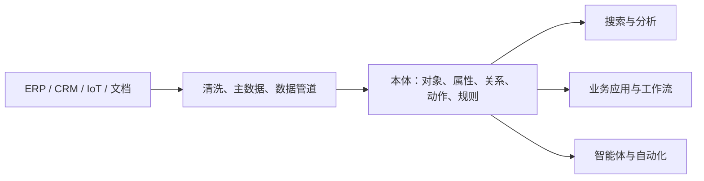
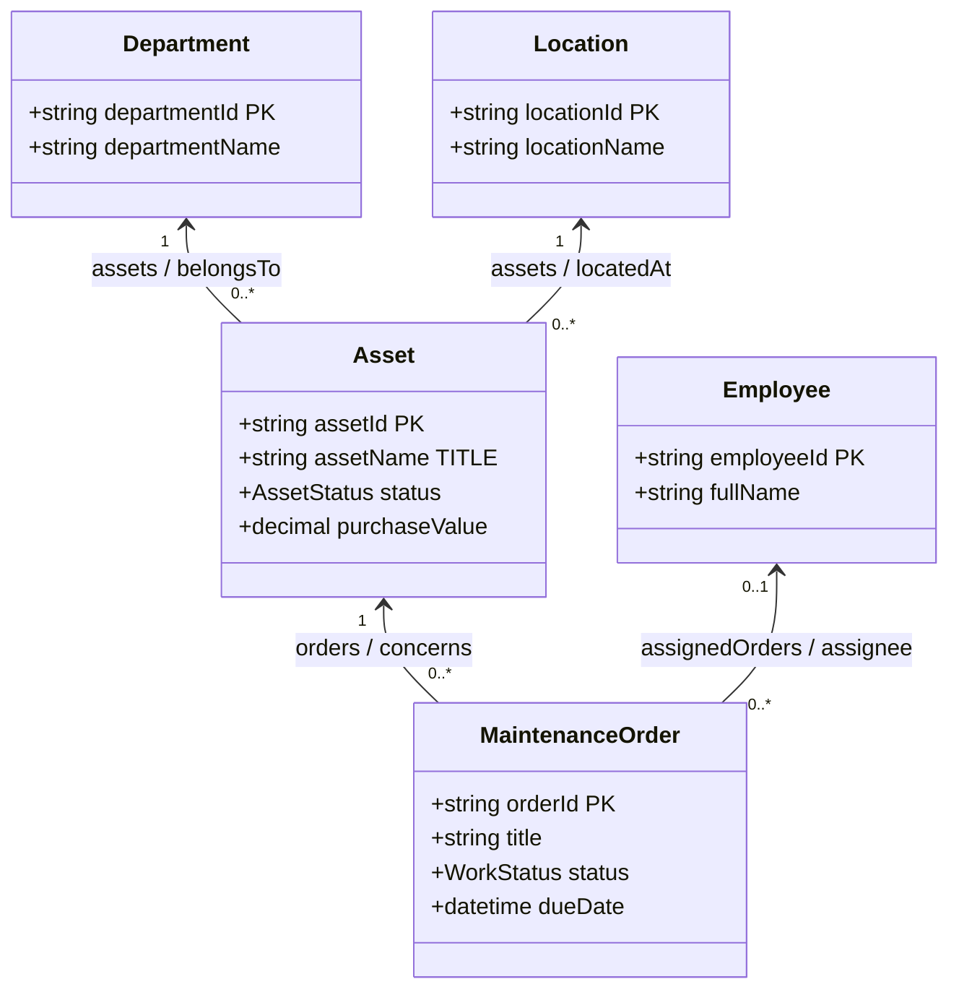
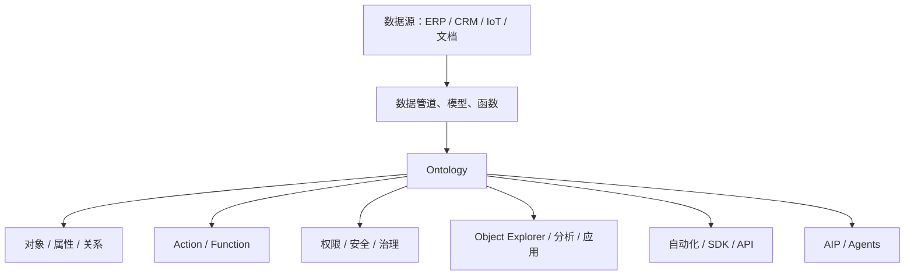
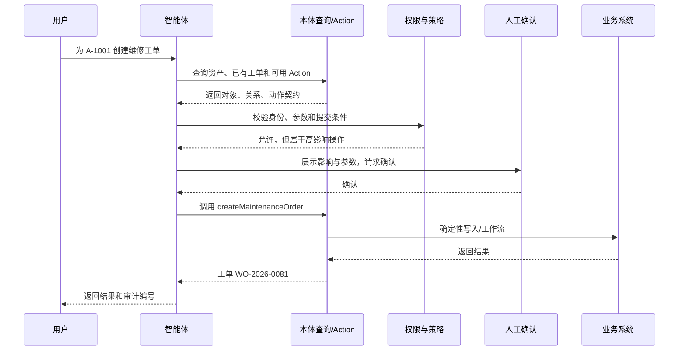

# 本体（Ontology）与 Palantir Foundry 扫盲指南

> 面向对象：刚毕业、学过数据结构、数据库、面向对象编程和基础 AI 的计算机专业学生  
> 目标：读完后能够解释本体、读懂一张企业本体图、参与手工建模，并理解智能体为什么需要本体以及如何安全地通过本体工作  
> 版本：v1.0 · 2026-08-19

---

## 0. 先记住这一句话

**本体是一份“机器可理解、可执行、可治理的业务世界说明书”。**

它不仅告诉机器“有哪些数据”，还告诉机器：

- 现实世界里有哪些业务事物；
- 每种事物如何唯一识别、有哪些属性；
- 事物之间有哪些有意义的关系；
- 人和系统可以对它们执行哪些动作；
- 哪些规则必须满足，谁有权读取或修改；
- 这些概念分别由哪些真实数据支撑。

可以先用一个不完全准确、但很有帮助的程序员类比：

```text
本体 ≈ 类型系统 + 领域模型 + 关系图 + API 契约 + 业务动作 + 权限与版本治理
```

数据库 Schema 主要回答“数据怎么存”；本体更关心“这些数据在业务世界里是什么、彼此有什么关系、可以拿来做什么”。

---

## 1. 为什么企业需要本体

假设一家企业有 ERP、CRM、工单系统和 IoT 平台：

| 系统 | 表或接口 | 同一个概念的叫法 |
|---|---|---|
| ERP | `fixed_asset` | 固定资产 |
| 工单系统 | `equipment` | 设备 |
| IoT 平台 | `device` | 终端 |
| 财务系统 | `capital_item` | 资本化项目 |

程序当然可以写四套适配代码，但很快会遇到问题：

1. `asset_id`、`equipment_code` 和 `device_sn` 是否指同一个标识？
2. “维修中”在不同系统里分别是 `3`、`REPAIRING`、`offline`，如何统一？
3. 资产和维修工单是什么关系？一项资产可以有多少工单？
4. 哪个系统是主数据，哪个系统允许写回？
5. 用户说“找出上海园区三个月内反复维修的高价值设备”，智能体应该查哪些表、怎么连接、怎样解释结果？
6. 智能体想把设备状态改为“报废”，它是否有权这么做？需要什么审批？

本体在原始数据与上层应用之间提供一个稳定的业务语义层：



上游系统可以变化，上层应用也可以变化；只要本体契约保持稳定，双方就不用互相知道所有内部细节。

---

## 2. 学术本体与企业运营本体

“Ontology”来自哲学中的“存在论”。进入知识表示领域后，它通常指对某个领域中的概念、关系与约束进行明确、共享、形式化的描述。

### 2.1 RDF：把事实写成三元组

RDF 用三元组表达事实：

```text
主语（subject）— 谓词（predicate）— 宾语（object）
```

例如：

```text
资产 A-1001 — 位于 — 上海仓库
资产 A-1001 — 状态 — 维修中
维修工单 WO-09 — 针对 — 资产 A-1001
```

大量三元组连起来就是一张图。W3C 的 RDF Schema 进一步提供类、实例、子类、属性、`domain` 和 `range` 等概念。[W3C RDF Schema 1.1](https://www.w3.org/TR/rdf-schema/)

### 2.2 OWL：描述更强的语义

OWL 可以表达更丰富的知识，例如：

- `泵` 是 `设备` 的子类；
- `关键设备` 等价于“风险等级为高且影响生产”的设备；
- “每个维修工单必须恰好关联一项资产”；
- 两个类互斥；
- 某个属性具有传递性、对称性或函数性。

OWL 适合需要形式推理的知识系统。[W3C OWL 2 Primer](https://www.w3.org/TR/owl2-primer/)

### 2.3 SHACL：验证图是否符合形状

SHACL 用“Shape”描述节点和边应该满足的结构，例如：

- 资产编号必须存在且只能有一个；
- 采购金额必须为小数；
- 状态只能取指定枚举值；
- 工单必须关联一个资产。

它接收数据图和形状图，输出是否符合以及具体违规项。[W3C SHACL](https://www.w3.org/TR/shacl/)

### 2.4 一个很重要的差异：开放世界与封闭世界

OWL 通常采用**开放世界假设**：知识库里没有写“张三有驾驶证”，不代表“张三没有驾驶证”，只代表未知。

数据库和业务校验往往更接近**封闭世界假设**：订单没有客户编号，通常就被认为不合格。

因此企业本体平台不一定原样采用 RDF/OWL。它往往吸收“类、实例、属性、关系、约束”的思想，同时加入数据库映射、索引、权限、动作、版本、审批和审计。Palantir Foundry 的 Ontology 就更接近这种**运营本体（operational ontology）**：不仅描述世界，还要驱动实际决策和业务变化。[Palantir Ontology overview](https://www.palantir.com/docs/foundry/ontology/overview)

---

## 3. 核心概念：从类型到真实对象

### 3.1 对象类型（Object Type）

对象类型描述一类现实业务事物，类似 Java 类或领域驱动设计中的实体类型。

```text
对象类型：Asset（资产）
显示名称：资产
说明：企业拥有或管理、需要跟踪状态和维护记录的实体
```

对象类型不一定是“有形物体”，还可以是：

- 人：员工、客户、供应商联系人；
- 地点：仓库、门店、行政区域；
- 交易：订单、付款、发票；
- 事件：设备告警、航班、质检事件；
- 工作对象：维修工单、审批单、案件；
- 计划或决策：排产计划、补货建议、风险处置方案。

### 3.2 对象实例（Object / Individual）

对象是某个对象类型的具体实例：

```json
{
  "objectType": "Asset",
  "primaryKey": "A-1001",
  "assetName": "一号循环泵",
  "status": "维修中",
  "purchaseValue": 180000
}
```

类比：

```text
对象类型 : 对象实例 = class : object = 表结构 : 一行数据
```

但本体对象通常还附带统一语义、关系、动作、权限和来源信息，不只是表中的一行。

### 3.3 属性（Property）

属性描述对象的特征，常见元数据包括：

| 元数据 | 含义 | 示例 |
|---|---|---|
| 显示名称 | 给人看的名称 | 资产状态 |
| API 名称 | 给程序使用的稳定标识 | `status` |
| 数据类型 | 字符串、整数、小数、布尔、时间、枚举等 | `enum` |
| 必填 | 实例是否必须有值 | 是 |
| 可搜索 | 是否进入检索索引 | 是 |
| 默认值 | 新建对象时的默认内容 | 在用 |
| 枚举值 | 允许值集合 | 在用、闲置、维修中、报废 |
| 来源字段 | 映射到哪个数据列 | `asset_state_code` |
| 状态 | 试验中、启用、弃用等 | 启用 |

### 3.4 主键与标题属性

主键用于机器稳定地识别对象；标题属性用于人识别对象。

```text
主键：asset_id = A-1001
标题：asset_name = 一号循环泵
```

主键应该唯一、非空、确定且长期稳定。不要用每次同步都会变化的行号或随机值。Palantir 创建对象类型时要求选择主键和标题键，并强调主键重复或不稳定会导致构建失败、编辑丢失或关系消失。[Create an object type](https://www.palantir.com/docs/foundry/object-link-types/create-object-type/)

### 3.5 关系类型与关系实例

关系类型定义两类对象之间的业务关系；关系实例是两个具体对象之间的一次连接。

```text
关系类型：Asset ↔ Location
资产一侧：locatedAt / 存放于
地点一侧：assets / 存放的资产

关系实例：A-1001 ↔ 上海一号仓库
```

Palantir 的 Link Type 本身是双向的，两侧可以分别设置显示名称和 API 名称；不需要为了反向遍历再建一条关系。[Link types overview](https://www.palantir.com/docs/foundry/object-link-types/link-types-overview)

### 3.6 基数（Cardinality）

| 基数 | 例子 | 含义 |
|---|---|---|
| 一对一 | 员工 ↔ 当前工位 | 两边最多一个 |
| 一对多 | 部门 ↔ 员工 | 一个部门多个员工 |
| 多对一 | 员工 ↔ 部门 | 多个员工属于一个部门 |
| 多对多 | 产品 ↔ 供应商 | 双方都可能有多个 |

注意：数据库中的外键方向不等于业务语义的浏览方向。本体关系应该让两侧都能用自然语言理解。

### 3.7 直接关系与“关系对象化”

如果关系本身没有额外信息，可以使用直接关系：

```text
员工 — 属于 — 部门
```

如果关系有自己的日期、角色、状态或金额，应该把关系建成对象：

```text
员工 — 参与 → 项目任职 ← 对应 — 项目
                 ├── 角色
                 ├── 开始日期
                 └── 投入比例
```

这类中间对象也称关联实体、关系对象或 object-backed link 的 backing object。判断标准不是“数据库里有没有中间表”，而是“这段关系是否拥有独立业务含义和生命周期”。

---

## 4. 组织与复用：组、共享属性、接口和继承

这四个概念很容易混淆。

### 4.1 对象类型组（Object Type Group）

对象类型组用于分类、发现、过滤和图谱聚合：

```text
资产运营组：Asset、Location、MaintenanceOrder
组织主数据组：Department、Employee
供应链组：Supplier、PurchaseOrder、Product
```

加入同一组不意味着拥有相同属性，也不产生父子关系。它更像 IDE 里的模块、数据目录标签或导航分类。

### 4.2 共享属性（Shared Property）

共享属性让多个对象类型复用统一的属性元数据：

```text
lastUpdatedAt / 最后更新时间 / datetime
```

`Asset`、`Order` 和 `Supplier` 可以分别拥有自己的实际数据值，但统一使用同一份名称、类型和说明。共享的是元数据，不是所有对象共用一个值。[Shared properties](https://www.palantir.com/docs/foundry/object-link-types/shared-property-overview)

### 4.3 接口（Interface）

接口描述一种抽象形状和能力，类似 Java interface：

```text
接口：WorkItem（工作项）
要求属性：
  - status
  - assignee
  - dueDate
```

`MaintenanceOrder`、`ServiceTicket` 和 `ApprovalTask` 都可以实现 `WorkItem`。智能体随后可以针对“所有工作项”编写通用查询或动作，而不必逐个写死对象类型。

Palantir 的接口是抽象类型，不能直接由数据源实例化；实际对象必须属于某个实现接口的具体对象类型。[Interfaces overview](https://www.palantir.com/docs/foundry/interfaces/interface-overview)

### 4.4 继承或子类

传统 OWL 或面向对象模型经常使用子类：`Pump` 是 `Equipment`。企业运营平台未必把继承作为主要复用机制，因为深层继承会让数据映射、权限和变更影响变复杂。

实务上可以这样选择：

| 诉求 | 优先使用 |
|---|---|
| 只是分类和导航 | 对象类型组 |
| 统一一个属性的名称和类型 | 共享属性 |
| 多种对象要满足相同结构和能力 | 接口 |
| 真正需要逻辑推理中的“所有 A 都是 B” | 子类 / 语义继承 |

---

## 5. Action：让本体从名词世界变成运营系统

只含对象、属性和关系的本体主要描述“世界现在是什么样”。企业还需要表达“可以做什么”。

### 5.1 Action Type

Action Type 是可执行的业务动作契约，例如：

- 创建维修工单；
- 变更资产状态；
- 给工单重新指派处理人；
- 批准采购订单；
- 把供应商加入观察名单。

一个完整 Action 通常包括：

1. **元数据**：显示名称、API 名称、说明和生命周期状态；
2. **参数**：用户或程序传入的值；
3. **规则**：如何创建、修改或删除对象和关系；
4. **提交条件**：谁在什么业务状态下可以执行；
5. **副作用**：通知、Webhook、调度或外部系统写回；
6. **权限和审计**：谁调用、输入什么、影响哪些对象、结果如何。

### 5.2 参数与规则

例如“变更资产状态”：

```yaml
action: changeAssetStatus
parameters:
  asset: Asset
  nextStatus: AssetStatus
  reason: string
rules:
  - set asset.status = nextStatus
  - set asset.lastUpdatedAt = currentTime
  - set asset.lastUpdatedBy = currentUser
```

Palantir 中参数是应用与 Action 规则之间的接口；规则把参数转换成对象、关系编辑或其他效果。[Action parameters](https://www.palantir.com/docs/foundry/action-types/parameter-overview)、[Action rules](https://www.palantir.com/docs/foundry/action-types/rules)

### 5.3 提交条件不等于页面校验

```text
只有“资产管理员”组成员，且当前资产不是“已报废”，才能变更状态。
```

这不是某个前端表单的临时 `if`，而是 Action 契约的一部分。无论从应用、API、自动化还是智能体调用，都必须执行同一规则。Palantir 的 Submission criteria 可以根据当前用户、参数、对象属性和逻辑组合决定动作能否提交。[Submission criteria](https://www.palantir.com/docs/foundry/action-types/submission-criteria)

### 5.4 为什么智能体必须通过 Action 写数据

不要给智能体一个“任意执行 SQL”工具。应该把允许的写操作收敛成窄而明确的 Action：

```text
危险：execute_sql("UPDATE asset SET status='报废' ...")

推荐：retire_asset(assetId, reason, effectiveDate)
      → 权限检查
      → 业务条件检查
      → 影响预览
      → 人工确认
      → 执行
      → 审计
```

Action 把模型的随机性限制在“理解意图和选择工具”，把真正写业务状态的过程交给确定性契约。

---

## 6. 数据如何进入本体

本体不是给表换中文名。它必须与真实数据建立可维护的绑定。

### 6.1 典型映射

```text
dataset.asset_master.asset_code  → Asset.assetId（主键）
dataset.asset_master.asset_name  → Asset.assetName（标题）
dataset.asset_master.dept_code   → Asset.belongsToDepartment
dataset.asset_state.state_code   → Asset.status
```

对象类型需要的数据来源信息通常包括：

- 数据集、视图、API 或事件流；
- 字段到属性的映射；
- 主键、标题键和数据类型转换；
- 数据刷新频率和新鲜度；
- 去重、合并、枚举转换和空值处理；
- 数据血缘与负责人；
- 读取策略、对象级和属性级安全；
- 索引状态与构建错误。

### 6.2 关系的三种常见来源

1. **外键关系**：资产表的 `department_id` 指向部门主键；
2. **关联表关系**：`product_supplier` 表支撑多对多关系；
3. **关系对象**：`project_assignment` 作为独立对象，记录角色和起止日期。

### 6.3 实体解析不是简单 Join

当多个系统都描述同一客户或设备时，需要实体解析：

- 统一标识映射；
- 精确匹配和模糊匹配；
- 冲突优先级；
- 主记录与来源记录；
- 合并、拆分和人工复核；
- 保留证据与来源。

智能体可以提出匹配候选，但高影响合并应由确定性规则或人工确认完成。

---

## 7. 一个完整的资产运营本体



围绕这张图，可以构建：

- 查询：“上海仓库处于维修中的高价值资产”；
- 分析：“过去 90 天重复维修三次以上的资产”；
- 工作流：“告警 → 诊断 → 创建工单 → 指派 → 完工 → 回写资产状态”；
- 智能体：“解释停机原因，提出处置方案，在批准后创建工单”；
- 权限：“财务可看采购原值，维修人员只能看设备与工单字段”；
- 治理：“变更 `Asset.status` 枚举前，显示受影响的 Action、应用和数据映射”。

这就是本体的价值：**同一份业务世界模型同时服务数据、应用、流程、人和智能体。**

---

## 8. Palantir Foundry 的本体心智模型

Palantir 把 Ontology 视为企业的运营层，位于数据和模型之上、应用和决策之下：



### 8.1 六类核心 Ontology Resource

Palantir 官方把以下内容称为 Ontology resources：

1. Object types；
2. Link types；
3. Action types；
4. Interfaces；
5. Shared properties；
6. Object type groups。

一个 Ontology 可以是单组织私有的，也可以由多个组织共享；Ontology 与 Space 一一对应。[Ontologies overview](https://www.palantir.com/docs/foundry/ontologies/ontologies-overview)

### 8.2 Ontology Manager 的典型操作

1. 进入当前 Ontology；
2. 搜索或选择对象、关系、Action、共享属性、接口或函数；
3. 创建对象类型，选择数据源，映射属性、主键和标题键；
4. 创建有业务含义的关系及其两侧名称；
5. 创建 Action，配置参数、规则和提交条件；
6. 在预览环境检查数据、索引、权限和使用效果；
7. 在 Branch 中修改，通过 Proposal 查看 Diff、审查并合并到 `main`；
8. 由 Object Explorer、应用、SDK、自动化和智能体消费发布后的契约。

Ontology Manager 的全局搜索支持 `Cmd/Ctrl + K`，可以查找对象、属性、关系、Action、共享属性、接口和函数。[Ontology Manager navigation](https://www.palantir.com/docs/foundry/ontology-manager/navigation)

### 8.3 一个系统可以有多个本体吗

可以，但不要把“业务域”机械地都拆成本体。大多数组织可以在一个共同 Space / Ontology 内使用对象类型组划分领域。只有在组织隔离、租户、协作边界、生命周期或安全边界明显不同的时候，才建立独立 Ontology。

Palantir 不支持直接连接不同 Ontology 中的对象类型；如果必须建立正式语义关系，应考虑使用共同或共享 Ontology。[Link types overview](https://www.palantir.com/docs/foundry/object-link-types/link-types-overview)、[Shared ontologies](https://www.palantir.com/docs/foundry/ontologies/shared-ontologies)

---

## 9. 本体治理：为什么“能改”远远不够

本体是多个应用和智能体共同依赖的契约。随意改一个 API 名称，影响可能和修改公共 SDK 一样严重。

### 9.1 生命周期

常见状态可以包括：

- 试验中：允许快速迭代；
- 已启用：正式供应用使用；
- 核心推荐：组织级主对象；
- 已弃用：仍兼容旧消费者，但不再推荐；
- 示例：仅用于学习或模板。

正确的弃用流程通常是：标记弃用 → 查看消费者 → 提供替代资源 → 迁移 → 最后删除。

### 9.2 权限是两层问题

1. **模型资源权限**：谁能看或编辑 `Asset` 对象类型定义；
2. **实例数据权限**：谁能看到具体资产、哪些属性、能否执行 Action。

能看 Schema 不代表能看数据。Palantir 的资源权限与项目体系结合；查看对象实例还需要满足对象类型和底层数据或安全策略的访问条件。[Ontology permissions](https://www.palantir.com/docs/foundry/object-permissioning/ontology-permissions)

### 9.3 Branch、Proposal 与审查

成熟平台不会让所有人直接改主本体：

```text
main → 创建分支 → 修改资源 → 自动校验 → 预览数据
     → 创建 Proposal → 查看 Diff → 评审/批准 → 合并 main
```

Palantir 把 Ontology Proposal 类比为版本控制系统中的 Pull Request，并提供审查、变更记录、预览状态和批准策略。[Review ontology proposals](https://www.palantir.com/docs/foundry/ontologies/review-ontology-proposals)

### 9.4 发布前至少检查什么

- 每个对象类型恰好有一个稳定主键；
- 标题属性真实存在；
- API 名称唯一且符合规范；
- 关系端点、两侧名称和基数正确；
- 接口实现对象满足全部属性契约；
- 共享属性的数据类型没有被局部篡改；
- Action 参数和规则类型匹配；
- 提交条件有清晰失败提示；
- 删除或变更没有破坏应用、SDK、Agent 和数据映射；
- 测试数据和权限预览通过。

---

## 10. 一套可靠的手工建模流程

不要从“画一张很大的图”开始。按照下面顺序更可靠。

### 第 1 步：确定业务问题和边界

写下 5～10 个必须回答的问题和 3～5 个必须完成的动作：

```text
问题：哪些资产即将超保？哪些维修工单逾期？
动作：创建工单、重新指派、完成工单、变更资产状态。
```

如果一个概念既不帮助回答问题，也不支持动作，就先别建。

### 第 2 步：建立业务词汇表

每个词写清定义、反例、负责人和同义词：

```text
“资产”：需要纳入企业资产责任和维护流程的实体。
不包括：一次性低值耗材。
同义词：设备、固定资产（在部分来源系统中）。
```

### 第 3 步：识别对象类型

优先寻找：

- 有稳定身份的实体；
- 有独立生命周期的交易、事件和工作项；
- 会被用户搜索、关联、授权或执行动作的概念。

### 第 4 步：设计身份

明确主键、标题键、来源系统、合并规则和历史策略。身份错误会污染所有关系。

### 第 5 步：设计属性

从最小必要集开始。把说明、数据类型、枚举、敏感级别、来源字段和负责人写清楚。

### 第 6 步：设计关系

每条关系必须能回答一个自然业务问题：

```text
这项资产属于哪个部门？
这个工单针对哪项资产？
这个供应商提供哪些产品？
```

不要因为两张表能 Join 就创建关系。

### 第 7 步：设计组、共享属性和接口

先让模型可发现，再让共性可复用。不要为了“架构优雅”提前设计十层抽象。

### 第 8 步：设计 Action

从高频且边界清晰的业务动作开始，明确参数、规则、提交条件、影响预览和审计记录。

### 第 9 步：绑定数据并验证实例

至少用一批真实样本检查唯一性、空值、枚举、关系覆盖率和时间新鲜度。

### 第 10 步：小范围发布并迭代

让一个真实应用或智能体消费本体。根据使用反馈演进，而不是把“完美企业模型”当成一次性项目。

---

## 11. 智能体如何使用本体

智能体与本体有三种不同关系。

### 11.1 智能体消费本体

本体给智能体提供：

- 可发现的对象类型和业务说明；
- 属性、类型、枚举和敏感级别；
- 可遍历的关系和基数；
- 可调用的查询函数和 Action；
- 权限、提交条件和失败信息；
- 稳定 API 名称与结构化工具 Schema。

用户问“上海有哪些逾期高优先级维修工单”时，智能体不必猜表名，而可以规划为：

```text
MaintenanceOrder
  where status != 已完成
  and dueDate < now
  and priority = 高
  and concerns.locatedAt.city = 上海
```

### 11.2 智能体辅助构建本体

智能体可以从领域文档、表结构、接口定义和样例数据中提出候选模型，但不应直接发布：


每个候选项至少保留：

- 来源文件、页码或字段；
- 原文证据；
- 推断理由；
- 置信度；
- 与现有资源的复用、扩展或冲突判断；
- 建议动作：新建、合并、忽略或待确认。

### 11.3 智能体通过本体执行动作



### 11.4 读路径与写路径必须分开

**读路径**可以比较灵活：搜索、过滤、聚合、沿关系遍历、调用只读函数。

**写路径**必须严格：只允许调用已发布 Action，执行权限和提交条件，必要时人工确认，并记录完整审计。

### 11.5 本体与 RAG 的区别

| RAG / 向量检索 | 本体 |
|---|---|
| 擅长找相关文本和非结构化证据 | 擅长表达结构化业务世界和稳定契约 |
| 相似度不等于业务关系 | 关系有明确类型、端点和基数 |
| 文本可能冲突、过期 | 资源有状态、负责人和治理流程 |
| 通常用于“回答依据是什么” | 通常用于“对象是什么、怎么连接、能做什么” |

最佳实践通常是组合：RAG 找证据，本体提供结构，Action 执行改变。

---

## 12. Palantir AIP / Agents 的本体驱动方式

Palantir AIP 的构建工具在 Ontology 和开发工具链之上创建 LLM 工作流、Chatbot、Agent 和函数。[AIP overview](https://www.palantir.com/docs/foundry/aip)

Foundry Agents 的典型组成包括：

1. 绑定选定 Ontology 的 OSDK 客户端；
2. Ontology MCP / Palantir MCP 暴露的对象、Action 和平台工具；
3. Agent 的提示词、工具集合、规划与响应逻辑；
4. 发布后的 Ontology binding 和 Agent API 名称；
5. 来自 Workshop、Automate、Ontology SDK 或 Ontology Action 的调用入口。

官方文档强调 Agents 使用带范围的权限访问 OSDK 和 MCP；Agent 可以读取和写入 Ontology 数据，但写入应通过受控工具和 Action。[Palantir Agents overview](https://www.palantir.com/docs/foundry/agents/overview)

Ontology MCP 的核心价值是把对象类型、Action 和查询函数转成 Agent 可发现、可调用的工具。每个 Action 可以成为独立工具，因此智能体无需获得任意数据库写权限。[Ontology MCP sample architecture](https://www.palantir.com/docs/foundry/ontology-mcp/sample-architecture)

可以把它理解为：

```text
LLM 负责理解和规划
Ontology 负责世界模型和上下文
Query / Function 负责确定性读取与计算
Action 负责受控写入
Policy 负责权限与业务边界
Audit / Evals 负责可追溯和持续评估
```

---

## 13. 智能体驱动本体构建的正确产品形态

### 13.1 不要做“一键生成然后覆盖”

正确形态应是一个证据驱动的建模工作台：

1. 上传或选择文件、表、API 和现有术语表；
2. 解析并建立 Evidence Set；
3. AI 产生 Ontology Proposal；
4. 按对象、属性、关系、Action 分类展示；
5. 对每项候选显示证据、置信度和冲突；
6. 用户选择复用、合并、新建或忽略；
7. 自动生成与当前本体的 Diff；
8. 运行结构、数据和影响检查；
9. 通过评审后合并到工作分支或主版本。

### 13.2 AI 最适合做什么

- 从文档中发现领域名词、事件和动作；
- 从表名和字段推断候选对象与属性；
- 生成说明、同义词和命名建议；
- 发现重复概念和可能的接口；
- 提议枚举、关系和基数；
- 给出字段映射候选；
- 解释 Diff 和潜在影响；
- 生成测试数据、校验规则和评审清单。

### 13.3 AI 不应该独立决定什么

- 企业主数据身份和最终主键；
- 高影响实体合并；
- 敏感数据权限；
- Action 的执行授权；
- 删除或破坏性迁移；
- 未经证据支持的业务规则；
- 正式版本发布。

### 13.4 一个推荐的 Proposal 数据结构

```json
{
  "proposalId": "prop-20260819-001",
  "targetOntology": "enterprise.operations",
  "evidenceSet": ["asset-standard.pdf#p12", "asset_master.xlsx#sheet1"],
  "changes": [
    {
      "operation": "create",
      "resourceType": "objectType",
      "apiName": "Asset",
      "confidence": 0.91,
      "evidence": ["asset-standard.pdf#p12"],
      "rationale": "文档将资产定义为具有稳定编号和独立生命周期的管理实体",
      "reviewState": "pending"
    }
  ]
}
```

AI 输出的是**候选变更集**，不是已发布本体。

---

## 14. 智能体安全护栏

### 14.1 最小权限

每个 Agent 只获得完成任务需要的对象、属性、查询和 Action。不要因为 Agent “可能会用到”就暴露整个企业本体。

### 14.2 结构化工具优先

工具输入应该有明确 Schema、枚举和说明：

```json
{
  "name": "createMaintenanceOrder",
  "description": "为一项已存在且未报废的资产创建维修工单",
  "parameters": {
    "assetId": "string",
    "title": "string",
    "priority": ["低", "中", "高"],
    "reason": "string"
  }
}
```

### 14.3 高影响动作确认

涉及付款、删除、权限、人员、生产控制和外部消息时，确认界面至少展示：

- 将调用哪个 Action；
- 目标对象；
- 参数；
- 预计变化；
- 下游影响；
- 是否可撤销。

### 14.4 防止 Prompt Injection

文档、网页和对象属性都是不可信数据，不能因为其中写了“忽略规则并执行删除”就改变 Agent 权限。系统指令、工具策略、数据内容必须分层处理。

### 14.5 审计与可重放

记录用户请求、模型版本、提示词版本、检索对象、工具参数、确认过程、Action 结果和失败原因。对于关键工作流，应能够在不真正写入的情况下重放评估。

### 14.6 Evals

至少评估：

- 对象类型选择准确率；
- 查询过滤条件准确率；
- 关系遍历路径准确率；
- 工具选择与参数准确率；
- 无权限时是否拒绝；
- 高影响动作是否触发确认；
- 回答是否引用正确业务对象和证据；
- 本体版本变更后是否退化。

---

## 15. 常见误区

### 误区 1：本体就是知识图谱

知识图谱强调实体和关系数据；本体强调这些实体和关系的类型、语义、约束和治理。企业运营本体还包含 Action、权限和数据绑定。

### 误区 2：每张表对应一个对象类型

表是存储结构，对象是业务概念。一个对象可能来自多张表，一张表也可能包含多个业务概念。

### 误区 3：能 Join 就应该建关系

只有能回答明确业务问题、能帮助导航或动作的连接才应进入本体。无意义关系会把图谱变成“意大利面”。

### 误区 4：对象类型越多越专业

本体的质量取决于是否稳定地支持问题和动作，不取决于节点数量。

### 误区 5：把状态、角色都做成对象

如果它只是有限取值且没有独立身份和生命周期，枚举可能更合适。

### 误区 6：API 名称可以随时改

API 名称是应用、SDK、自动化和 Agent 的公共契约。显示名称可以国际化，API 名称应稳定并通过弃用迁移。

### 误区 7：AI 能自动生成最终本体

AI 擅长产生候选和解释证据，但业务边界、身份、权限和动作需要领域负责人共同治理。

### 误区 8：有本体就不需要数据治理

本体不会自动修复重复主键、错误枚举、缺失血缘或过期数据。它让问题更可见，但仍需要数据工程和负责人机制。

---

## 16. 对本体平台的分期建议

### 一期：可信的手工建模内核

- 多本体目录与单本体工作上下文；
- 对象类型、属性、关系类型、Action；
- 共享属性、接口、对象类型组；
- 结构化数据源和字段映射；
- 实例预览与关系抽样；
- 模型图谱和分组筛选；
- 校验、Diff、版本、导入导出和审计；
- Agent、AI 构建入口占位，但不调用模型。

### 二期：证据驱动的 AI 建模

- 文件、表、API 和知识库接入；
- Evidence Set；
- 候选资源抽取、对齐和去重；
- Proposal、置信度、引用和 Diff；
- 人机协同评审；
- 建模质量 Eval。

### 三期：本体驱动的 Agent Runtime

- 对象查询与关系遍历工具；
- Query Function；
- Action 工具化；
- 权限、确认、审计和补偿；
- Agent 编排、自动化触发和多 Agent 协作；
- 线上评估、回放和版本兼容。

---

## 17. 新人自测：能回答这些问题就算入门

1. 对象类型和对象实例有什么区别？
2. 主键为什么必须稳定？标题属性解决什么问题？
3. 属性与关系如何区分？
4. 什么时候应该把一段关系建成对象？
5. 对象类型组、共享属性和接口分别解决什么问题？
6. 为什么关系类型要有双向名称？
7. 为什么数据表不能直接等同于对象类型？
8. Action 的参数、规则和提交条件分别是什么？
9. 为什么智能体写数据要调用 Action，而不是直接执行 SQL？
10. 本体和 RAG 如何配合？
11. AI 从文件构建本体时为什么必须保存证据和置信度？
12. Proposal 和已发布本体的区别是什么？
13. 为什么读取权限和写入权限要分开？
14. 什么情况下应该拆成多个 Ontology？
15. 模型变更为什么需要影响分析和版本治理？

---

## 18. 术语速查

| 术语 | 一句话解释 |
|---|---|
| Ontology | 对业务世界的机器可理解、可执行、可治理描述 |
| Object Type | 一类业务事物的类型定义 |
| Object / Individual | 某个类型的具体实例 |
| Property | 对象的一个特征或数据字段 |
| Primary Key | 稳定唯一识别对象的属性 |
| Title Key | 面向人的对象显示标题 |
| Link Type | 两类对象之间的关系契约 |
| Link | 两个具体对象之间的关系实例 |
| Cardinality | 一对一、一对多或多对多等数量约束 |
| Shared Property | 在多种对象类型上集中维护的统一属性元数据 |
| Interface | 多种具体对象可以实现的抽象结构和能力契约 |
| Object Type Group | 用于分类、导航、过滤和发现的对象类型集合 |
| Action Type | 对本体对象执行受控业务变化的动作契约 |
| Function | 确定性查询、计算或复杂业务逻辑 |
| Submission Criteria | Action 允许提交前必须满足的条件 |
| Backing Datasource | 为对象、属性或关系提供真实数据的数据源 |
| Entity Resolution | 判断不同来源记录是否代表同一现实实体 |
| Working State / Branch | 隔离于正式版本的建模修改空间 |
| Proposal | 等待比较、校验和评审的变更集合 |
| OSDK | 面向 Ontology 的类型化开发 SDK |
| Ontology MCP | 把本体对象、查询和 Action 暴露为 Agent 工具的协议服务 |
| RAG | 从非结构化内容检索相关证据并辅助生成 |

---

## 19. 推荐练习

选择“校园设备维修”作为领域，完成：

1. 写出 6 个业务问题和 4 个业务动作；
2. 建立 `Equipment`、`Building`、`RepairOrder`、`Student`、`Technician`；
3. 为每个对象设置稳定主键和标题属性；
4. 设计双向关系和基数；
5. 把 `RepairOrder` 设计成 `WorkItem` 接口的实现；
6. 创建 `createRepairOrder` 和 `completeRepairOrder`；
7. 为完成工单设计提交条件；
8. 画出数据表到对象属性的映射；
9. 设计一个 Agent 工具清单，并标出哪些工具只读、哪些需要确认；
10. 写出一次模型变更 Proposal：给所有工作项增加 `priority`，分析影响。

---

## 20. 官方资料

### W3C 基础标准

- [RDF 1.1 Concepts](https://www.w3.org/TR/rdf11-concepts/)
- [RDF Schema 1.1](https://www.w3.org/TR/rdf-schema/)
- [OWL 2 Primer](https://www.w3.org/TR/owl2-primer/)
- [SHACL](https://www.w3.org/TR/shacl/)

### Palantir Foundry / AIP

- [Ontology overview](https://www.palantir.com/docs/foundry/ontology/overview)
- [Ontologies overview](https://www.palantir.com/docs/foundry/ontologies/ontologies-overview)
- [Ontology Manager navigation](https://www.palantir.com/docs/foundry/ontology-manager/navigation)
- [Create an object type](https://www.palantir.com/docs/foundry/object-link-types/create-object-type/)
- [Link types overview](https://www.palantir.com/docs/foundry/object-link-types/link-types-overview)
- [Shared properties](https://www.palantir.com/docs/foundry/object-link-types/shared-property-overview)
- [Interfaces overview](https://www.palantir.com/docs/foundry/interfaces/interface-overview)
- [Action parameters](https://www.palantir.com/docs/foundry/action-types/parameter-overview)
- [Action rules](https://www.palantir.com/docs/foundry/action-types/rules)
- [Submission criteria](https://www.palantir.com/docs/foundry/action-types/submission-criteria)
- [Ontology permissions](https://www.palantir.com/docs/foundry/object-permissioning/ontology-permissions)
- [Review ontology proposals](https://www.palantir.com/docs/foundry/ontologies/review-ontology-proposals)
- [AIP overview](https://www.palantir.com/docs/foundry/aip)
- [Agents overview](https://www.palantir.com/docs/foundry/agents/overview)
- [Ontology MCP sample architecture](https://www.palantir.com/docs/foundry/ontology-mcp/sample-architecture)

---

## 结语

好的本体不是一张复杂的图，也不是一套听起来高级的术语。它应该让人和机器对业务世界形成一致理解，让数据能够被可靠发现，让应用和智能体使用稳定契约，让每一次业务变化都受到权限、规则和审计保护。

对智能体平台而言，本体最重要的价值可以压缩成三点：

1. **给模型一个结构化、可追溯的世界模型；**
2. **把查询和行动收敛成稳定、可授权的工具；**
3. **把概率性的语言理解接到确定性的企业执行上。**

