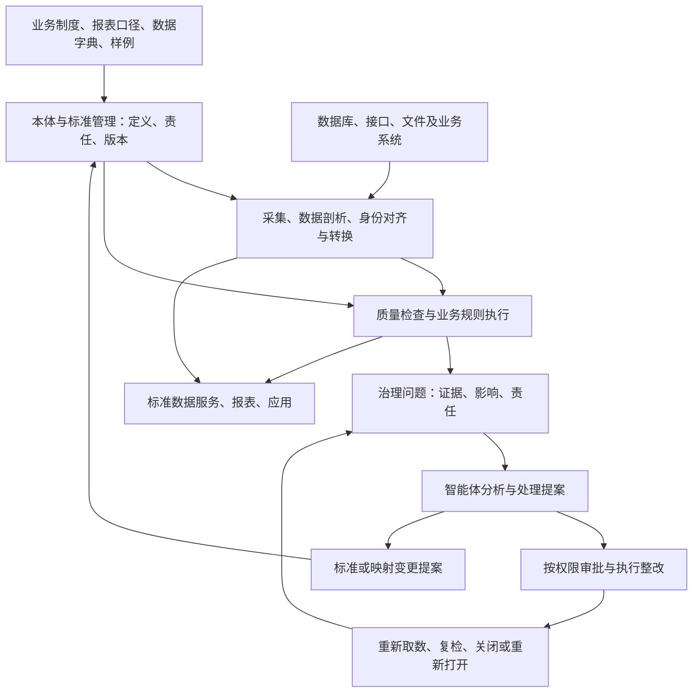

# 本体驱动的数据治理实施方案

通用工作方法、治理智能体设计与电视台一期实践

日期：2026-10-20  
状态：方案建议，待业务调研、数据基线和实施资源确认。

## 1. 项目目标与交付边界

建议将阶段目标定义为：围绕选定业务链，形成经过业务确认的数据标准，把标准映射到实际数据源，建立可重复运行的检查与整改流程，并让至少一个实际报表或应用使用治理后的数据。

一期交付应同时回答六个问题：数据是什么意思、来自哪里、不同系统如何对应、如何判断是否合格、问题由谁处理、处理后如何证明已经恢复。

推荐形成六组资产：

1. 标准包：术语、对象、属性、关系、编码、指标口径、质量规则和责任人。
2. 映射包：源系统到标准对象的字段、关联、转换、身份对照及历史生效规则。
3. 执行包：可运行的采集、转换、质量检查和规则任务。
4. 整改包：问题台账、证据、责任人、审批、处理结果和复检记录。
5. 发布包：本体、映射、规则、数据批次与消费接口的版本清单。
6. 应用包：至少一个使用标准数据的报表、查询接口或治理智能体场景。

数据标准允许保留合理差异。例如销售口径和财务口径可以同时存在，但必须有不同的标准标识、明确的适用范围和可追溯的差异解释。

这里需要同时推进两项工作：

- **治理本体定义**：保证模型、标准、映射和规则本身正确，经过评审并按版本发布。
- **通过本体治理业务数据**：按已发布定义检查真实记录、识别异常、推动整改并复检。

前者是现有系统的基础能力方向；后者需要连接真实的数据处理与工单执行能力。

## 2. 通用架构与系统分工



**本体系统管理语义和治理决策。** 对象、属性、关系、规则、Action、映射、评审和版本在这里登记和关联。

**数据执行层处理数据。** 优先使用客户已有的数据平台、ETL、调度、SQL 引擎、数据质量平台和工单系统；缺少的部分再补充。大批量数据扫描、金额聚合、关联计算和增量同步由执行层完成。

**智能体调用受治理的工具。** 它读取标准、检索证据、理解冲突、调用检查、提出修复计划、跟踪工单。规则是否命中、金额是多少、是否有权限，由确定性服务返回。

这种语义层设计参考了 Palantir 对对象、属性、关系、动作及函数的划分；本方案中的交付流程和实施范围是针对当前项目提出的设计建议。[参考：Palantir Ontology](https://www.palantir.com/docs/foundry/ontology/overview)

标准应进一步形成生产者和使用方可共同确认的数据契约，包含结构、语义、质量、新鲜度及责任。OpenMetadata 的数据契约说明可作为结构参考。[参考：OpenMetadata Data Contracts](https://openmetadatastandards.org/data-contracts/overview/)

## 3. 如何形成真正能执行的数据标准

### 3.1 标准与本体资源的对应

| 标准类别 | 需要明确的内容 | 本体或治理载体 |
|---|---|---|
| 术语标准 | 定义、别名、适用范围、易混概念、出处 | 对象及属性定义、术语登记 |
| 对象标准 | 一条记录代表什么、稳定身份、生命周期、负责人 | 对象类型 |
| 属性标准 | 类型、精度、单位、可空性、值域、敏感级别 | 对象属性或接口契约 |
| 编码与主数据标准 | 标准身份、源编码对照、码值、生效时间 | 业务字典、主数据与身份对照表 |
| 关系标准 | 业务含义、方向、基数、关联键、有效期 | 关系类型及关系映射 |
| 指标标准 | 度量、粒度、维度、期间、过滤条件、公式、舍入方法 | 规则/函数与指标契约 |
| 质量标准 | 检查范围、条件、阈值、严重级别、执行周期、责任人 | 质量规则及执行绑定 |
| 数据服务标准 | 输出字段、版本、更新时间、质量状态、访问范围 | 数据产品/API/视图契约 |

平台已有的“数据类型、映射方式”等技术字典，与客户的“业务类型、频道、成本类别”等业务码表承担不同职责。业务码表需要独立标识、来源和版本，不能为了复用菜单而塞进技术字典。

### 3.2 每条关键标准的最小卡片

| 字段 | 要求 |
|---|---|
| 标准身份 | 唯一编号、名称、业务域、状态、版本、有效期 |
| 业务语义 | 定义、适用场景、排除情形、来源证据、确认人 |
| 数据粒度 | 一行是一份合同、一次履约、一个分摊明细，还是一个期间汇总 |
| 数据结构 | 类型、长度或精度、单位、币种、时区、值域、可空性 |
| 身份与关联 | 标准主键、源主键、跨系统对照、关系基数 |
| 来源优先级 | 哪个系统负责哪个属性；冲突时依据什么决定 |
| 映射与转换 | 表/字段/API、转换逻辑、适用系统版本、失败处理 |
| 校验与服务 | 质量规则、运行频率、新鲜度要求、输出位置 |
| 管理责任 | 业务负责人、数据管家、源系统负责人、争议裁决人 |

源系统优先级要尽量定义到属性层。例如合同签署状态和到账状态可以由不同系统负责，不应笼统选出一个系统覆盖所有事实。

### 3.3 三种落标方式

- **源头落标**：在业务录入、接口或源系统中执行标准；适用于可改造且责任清晰的系统。
- **转换落标**：在数据平台中转换单位、格式、枚举，形成标准输出；保留原值与转换版本。
- **消费落标**：通过标准视图或 API 对外提供统一结构；需要明确刷新周期和使用限制。

一期可组合使用。无法修改源系统的字段，可以先在转换层落标，但仍要登记源头问题及其责任。

## 4. 通用工作步骤

### 步骤一：用业务问题圈定范围

与业务、数据和 IT 共同确认 2—3 个有结果可核对的问题，例如“哪些交易跨系统金额不同，差异发生在哪里”“哪些成本记录无法归属业务对象”。

随后确定业务链、组织范围、数据期间、源系统、消费报表和责任人，冻结一期范围。对象数量、标准条数在调研后估算，不作为唯一验收目标。

**交付：** 范围说明、场景清单、责任矩阵、现状基线。

### 步骤二：建立证据目录并做数据剖析

同时收集业务制度、流程、表结构、接口、样例记录和报表计算逻辑。记录文件版本、页码或表行、数据库快照时间、接口版本及提供人。

数据剖析覆盖记录数、空值、重复、码值分布、日期范围、更新延迟、金额单位和关联命中率。抽样结论必须说明抽样范围；全量检查使用约定数据批次。

**交付：** 数据源目录、证据清单、剖析报告、问题基线。

### 步骤三：先建业务链，再建标准对象

先说明业务如何发生、经过哪些状态、产生什么单据和事件，再确定对象、属性和关系。

每个对象类型具有一个稳定主键；复合业务身份可以映射为稳定的标准 ID，并保留组成字段。有关联金额、比例、状态或有效期的多对多关系，通常需要明细对象，例如回款认领明细、成本分摊明细。

**交付：** 候选本体、标准卡片、口径冲突清单。

### 步骤四：裁决口径，建立标准基线

智能体对同义异名、同名异义和缺失定义给出候选与证据。业务负责人确认语义；财务或其他专业负责人确认专业口径；数据管家确认数据可获得性。

冲突没有解决前保留“待确认”状态；不能把模型置信度当作批准依据。

**交付：** 已确认标准、裁决记录、待办及例外清单。

### 步骤五：完成映射与跨系统身份对齐

映射要覆盖对象身份、属性、关系以及时间有效性。建立“源系统 + 源主键 → 标准对象 ID”的对照；名称相似只构成候选证据。

对自动对齐规则评估误合并和漏匹配风险。人工确认、对照修改、合并与拆分均留痕。组织或业务归属变化按有效期管理，历史数据按当时规则解释。

**交付：** 映射矩阵、身份对照、转换逻辑、已知未匹配记录。

### 步骤六：在真实数据批次运行规则

至少分四类检查：

| 类别 | 示例 |
|---|---|
| 本体定义检查 | 主键与引用是否合法、关系端点是否存在 |
| 映射检查 | 字段是否存在、类型与单位是否兼容、关联是否产生重复 |
| 实例质量检查 | 必填、唯一、码值、时间范围、关系缺失 |
| 业务核对 | 多系统明细核对、分摊守恒、期间差异、状态不一致 |

规则记录执行引擎、输入批次、版本、适用条件和结果。失败结果应包含能定位的记录标识、失败原因及受权限控制的样例；可参考 Great Expectations 的验证结果结构，按需要返回摘要或失败记录信息。[参考：验证结果格式](https://docs.greatexpectations.io/docs/core/trigger_actions_based_on_results/choose_a_result_format/)

**交付：** 实际执行结果、问题列表、影响评估。只有静态检查通过时，不宣称真实数据已经通过。

### 步骤七：整改、复检并固化处理办法

将问题区分为源数据错误、映射错误、标准冲突、取数延迟和规则误报。不同原因进入不同处理流程。

```text
发现 → 确认 → 分派 → 处理 → 待复检 → 已关闭
                              └→ 复检失败 → 重新打开
```

批准的暂缓问题进入“例外有效中”，注明原因、责任人、补偿措施和到期时间；它仍然属于例外，不能计为检查通过。

**交付：** 有前后证据的整改记录、复检结果、可复用处理办法。

### 步骤八：发布并让消费方接入

发布清单同时记录本体、映射、规则、数据批次和接口版本。让至少一个报表或应用使用这些版本，并与业务已确认的核对样本对账。

本体定义回退、数据重算和源系统业务操作撤销分别制定方案。切换本体版本不能自动撤销已发生的财务或业务操作。

**交付：** 发布版本、标准数据服务、消费方验收及持续运行安排。

## 5. 治理智能体怎么设计

### 5.1 一个入口，六类任务能力

可在同一治理工作台提供六类能力；是否拆成独立智能体取决于工具、权限和运行周期，不必先增加多个聊天窗口。

| 能力 | 输入 | 工作 | 输出与人工责任 |
|---|---|---|---|
| 盘点与剖析 | 数据目录、表结构、证据文档 | 调用剖析工具，解释分布与缺项 | 数据画像；接口人确认来源 |
| 标准建模 | 制度、业务流程、已有本体 | 抽取、复用、识别冲突 | 标准提案；领域负责人裁决 |
| 映射落标 | 标准、字段、样例、关联统计 | 提议映射与身份对照 | 映射提案；数据管家确认 |
| 质量诊断 | 规则执行结果、血缘、数据批次 | 聚合同根问题，分析影响和可能原因 | 问题证据包；责任人确认原因 |
| 整改协同 | 已确认问题、可用 Action | 提出处理计划、建单、跟踪、调用复检 | 工单及复检记录；有副作用的操作按策略审批 |
| 变更运营 | 结构变化、模型 Diff、消费依赖 | 识别受影响对象、规则和应用 | 变更提案；负责人评审发布 |

### 5.2 最小工具接口

建议优先提供：读取标准、读取证据、查询源字段、获取剖析结果、查询对象、穿透关系、执行规则、获取失败记录、创建提案、创建或更新工单、执行批准的 Action、提交复检。

每次调用记录用户或服务身份、权限范围、任务 ID、本体版本、规则版本、映射版本、数据批次、输入参数、输出摘要、异常和耗时。生产数据访问由工具侧执行行列权限和脱敏。

规则执行引擎承担唯一性、数值计算、权限和状态判断。模型负责解释结果和形成建议，不在提示词中私自创建正式公式。

### 5.3 把治理过程本身记录成可查询对象

可复用现有资源，补足以下治理记录：

```text
标准条目 → 映射定义 → 规则执行 → 治理问题 → 整改任务 → 复检记录
   ↑                         ↓
   └──── 变更提案 ← 标准或映射确需调整
```

治理问题最少包含：问题 ID、命中规则、对象/源记录标识、期望与实际、首次和最近发现时间、影响范围、证据位置、责任人、状态、关联工单、处理动作和复检结果。

问题去重可以使用“规则 + 对象/源记录 + 业务期间 + 原因类别”的稳定键；每次巡检仍保留独立执行记录，避免一天生成大量重复工单，也避免问题复发被覆盖。

### 5.4 持续运行闭环

```text
批次到达或定时触发
→ 检查取数完成性与更新时间
→ 执行已发布规则
→ 去重、归因、确定责任与影响
→ 生成问题和处理计划
→ 按授权建单或进入审批
→ 执行源头修复、映射修复或标准变更
→ 重新取数和复检
→ 关闭、重新打开或登记有期限的例外
```

只读巡检和已批准范围内的确定性转换可以按策略自动运行；实体合并、正式标准变更、财务业务记录修改等需要对应责任人的决策。执行前检查前置条件，执行后读取业务结果，失败时支持重试、补偿或人工接管。

## 6. 与现有本体系统如何衔接

以下判断依据当前仓库 README 与相关实现的静态阅读，不代表客户生产环境已经接通。

| 能力 | 当前基础 | 本项目需要推进的工作 |
|---|---|---|
| 业务域、对象、属性、关系、接口 | 已有建模页面与数据结构 | 装载经确认的领域标准，补足标准卡片 |
| 数据源与映射 | 已有登记、部分连接和结构读取、映射配置 | 根据实际数据源补连接器、增量取数、身份对齐与转换执行 |
| AI 构建 | 已有证据、Proposal、工作状态流程 | 优化字段级证据与冲突裁决，使用真实样本评估 |
| 本体质检 | 已有语义定义及引用检查 | 独立增加真实数据的质量执行与批次结果 |
| 规则与函数 | 有资源定义入口 | 绑定 SQL/代码/规则服务，管理运行结果与适用条件 |
| 版本与评审 | 已有评审、发布快照和对比基础 | 将映射、规则部署和消费版本纳入发布清单 |
| 智能体与 Action | 有交互与受控执行演示基础 | 接真实工具、权限、工单、运行调度与复检 |
| 持续治理 | 可复用变更和治理资源 | 补问题台账、SLA、例外到期、幂等与监控 |

建议研发按以下顺序展开：

1. **第一批：能看见真实问题。** 数据批次、剖析结果、规则执行、异常定位和问题台账。
2. **第二批：能把问题处理完。** 责任分派、工单联动、处理证据、复检与重新打开。
3. **第三批：能持续维护标准。** 标准卡片导出、依赖影响分析、数据契约、版本联动与漂移监控。

若一期工期有限，可使用客户已有数据平台执行 SQL 和调度，用现有工单系统承接整改，本体系统关联执行结果与问题。仍需打通真实闭环，避免把演示运行作为生产验收证据。

## 7. 通用组织、节奏与验收

### 7.1 责任安排

| 责任方 | 核心责任 |
|---|---|
| 客户治理负责人 | 确定范围、协调跨部门争议、接受项目结果 |
| 领域负责人 | 确认业务标准、专业规则及例外 |
| 数据管家 | 维护标准与映射，确认问题并协调整改 |
| 源系统负责人 | 提供结构和数据，执行源头修改 |
| 我方本体架构师/业务分析师 | 组织场景与模型设计、标准工作坊、影响分析 |
| 我方数据工程师 | 取数、转换、身份对齐、规则执行与血缘 |
| 我方智能体/平台工程师 | 工具接入、任务编排、权限审计、智能体评估 |
| 消费方负责人 | 验证报表/API使用结果与业务口径 |

角色可以兼任，但业务口径裁决责任必须落实到客户方。

### 7.2 参考实施节奏

在范围限定为一条主业务链、约 3—5 类数据来源、可获得只读数据或可靠导出、业务负责人能持续参与的前提下，可按 10—12 周估算。系统接入难度与产品研发缺口需在第一阶段复核。

| 时段 | 工作 | 阶段门槛 |
|---|---|---|
| 第 1—2 周 | 范围、证据、源数据剖析、首批口径确认 | 数据可获得；一条样例业务能追溯 |
| 第 3—4 周 | 最小本体、标准卡片、映射及首批规则 | 在样本批次发现并解释真实问题 |
| 第 5—6 周 | 补齐接入、批量检查、工单与复检 | 至少一类问题完成实际闭环 |
| 第 7—8 周 | 扩展确认范围、建立消费服务、调整误报 | 标准数据被实际使用且结果可核对 |
| 第 9—10 周 | 稳定运行、发布验收、培训交接 | 完成约定运行周期及治理证据包 |
| 第 11—12 周（如需） | 跨月周期、复杂数据补接、遗留问题 | 按实际风险安排，不以空等替代推进 |

每周处理口径争议和高影响问题；每个阶段按证据决定是否扩大范围。连接器、规则执行与建模应在初期并行推进。

### 7.3 指标口径

| 指标 | 计算方式或验收方式 |
|---|---|
| 标准确认覆盖率 | 已确认的范围内关键标准项 / 冻结的关键标准项总数 |
| 映射覆盖率 | 已验证映射的范围内源字段 / 约定需落标的源字段总数 |
| 标准落标覆盖率 | 在约定来源中完成执行验证的标准项 / 约定需落标的标准项 |
| 数据规则通过率 | 通过的适用记录检查次数 / 全部适用记录检查次数；各规则单列 |
| 关系完整率 | 成功关联记录 / 按业务定义应有关联记录；未到期和例外单列 |
| 整改闭环率 | 已复检通过问题 / 当期应完成整改问题 |
| 按期闭环率 | 在约定时限内复检通过问题 / 当期到期问题 |
| 智能体质量 | 经人工标注评估的提案准确率、证据正确率、异常召回与误报 |
| 实际使用 | 至少一个消费方使用发布标准与数据，并完成明细核对 |

建议：冻结范围内关键标准均有责任人与审批证据，关键规则均有实际执行记录，严重问题在验收前完成复检或形成签字接受的例外。具体通过率在基线测量后约定。

智能体提案接受率只反映协作效率，不能单独证明提案正确。比例指标同时报告分子、分母、数据期间、排除项与抽样/全量范围，且按系统、业务域和严重程度分项展示。

## 8. 电视台一期怎么实践

### 8.1 建议选定的业务范围

建议先围绕广告经营与财务核对形成一条主链：

```text
客户/代理商 → 广告合同及合同明细 → 排期/投放任务 → 实际履约记录
                       ↓                          ↓
                 结算/收入确认依据 ← 按业务规则核对
                       ↓
             收入记录、开票记录、回款及认领明细

成本记录 → 成本归集/分摊明细 → 项目、频道、栏目或其他核算对象
                                      ↓
                        在相同粒度、期间与口径下分析
```

图中关系表示待调研确认的业务联系，不表示合同、收入、发票和回款之间必然一一对应，也不表示开票或回款是收入确认的充分条件。

第一批成本选择一种能够明确归属的类型，例如已有明确项目编码的直接成本。其他共享成本先核对现有分摊制度，保留未分摊金额；不要为凑出单合同利润而强行分配。

实际系统、数据粒度、合同条款与财务政策目前未提供，以下均为实施建议和示例。

### 8.2 调研时拿什么资料

| 来源类别 | 首批资料 | 主要用途 |
|---|---|---|
| 广告经营或合同管理 | 合同模板、合同及明细、客户与代理商、变更/取消记录 | 确认交易对象、合同粒度及业务状态 |
| 排期和播出/投放 | 排期、播出日志、投放回执、补播/撤播记录 | 确认履约粒度、去重键及证据来源 |
| 财务与结算 | 收入记录及依据、发票、回款、认领、核算维度 | 区分金额口径、期间及关联方式 |
| 成本与项目管理 | 成本明细、项目、部门、归集和分摊规则 | 确认成本归属、归集粒度和分摊依据 |
| 组织与基础码表 | 频道、栏目、项目、部门、客户编码及历史变更 | 统一标识并处理历史有效期 |
| 报表消费方 | 当前报表及其计算逻辑、典型争议样本 | 确定治理结果如何验收和使用 |

建议取一个完整已结算期间和一个在途期间，并包含正常、撤销、补播、跨期和冲销等样例。首批访谈确认实际存在的情形，不假定所有情形都适用。

### 8.3 首版本体应包含哪些内容

按业务需要选择：业务主体及角色、广告合同、合同明细/履约单元、排期任务、履约记录、结算或收入确认记录、发票记录、回款记录、认领明细、成本记录、成本归集/分摊明细，以及项目、频道、栏目、组织和期间。

客户、广告主、代理商和付款方可引用同一主体身份并使用不同角色；是否拆分对象取决于身份、权限和生命周期差异。不能只因名称相近就合并。

一期优先确认五组标准：

1. **身份标准**：主体、合同、项目、频道、栏目和组织的标准编码与源编码对照。
2. **粒度标准**：合同头、合同明细、单次履约、收入记录、认领明细、成本分摊明细分别代表什么。
3. **金额标准**：合同额、结算额、确认收入、开票额、回款额、成本额的定义及含税、币种、期间属性。
4. **履约与时间标准**：计划和实际履约、补播、撤播、重复记录、业务时间与会计期间的处理。
5. **质量与责任标准**：哪些记录必须关联、什么差异属于异常、何时检查、由谁处理。

收入确认公式由客户财务结合合同、履约义务和适用政策批准。这里不预设“合同额乘播出次数比例”为普遍规则。成本核对也必须注明直接/分摊、实际/计划等口径。

### 8.4 先上线三个治理场景

| 场景 | 初始检查 | 智能体产出 | 谁处理、如何复检 |
|---|---|---|---|
| 合同与履约对齐 | 有效履约记录能否关联正确合同明细；重复/撤销是否正确处理 | 缺失关联与重复候选、证据、影响范围 | 广告运营及接口人处理；重新关联并检查计数 |
| 经营与财务差异解释 | 同一主体、期间、合同集合下，口径和数据链是否一致 | 区分口径差、跨期、延迟、映射缺失与疑似业务遗漏 | 广告与财务联合确认；按确认规则重跑并核对 |
| 成本归属与分摊检查 | 归属对象是否存在且有效；分摊是否重复或守恒 | 未归属、重复归属、比例/金额异常及责任清单 | 成本/项目负责人确认；重算后核对总额与明细 |

检查“已履约未见收入记录”前，要先检查收入确认适用条件、时间窗口和源数据是否已到齐。若财务批次尚未同步，优先登记数据延迟，不能直接认定漏记收入。

### 8.5 智能体如何处理一个具体问题

以下为虚构示例，仅演示治理流程。

某广告合同在财务系统采用源合同编码，播出系统采用合同明细编码。财务有一条相关记录，但当前映射没有覆盖这组编码关系。

1. 巡检任务读取双方批次完成状态、标准合同身份及已发布关联规则。
2. 规则发现一条履约记录没有关联到财务记录，生成异常证据。
3. 智能体检索合同明细关系、来源说明与现有身份对照，发现映射缺口；名称相似仅用于寻找候选。
4. 工单附上两个源系统记录标识、规则版本、数据时间、候选关系和影响范围。问题标为“疑似映射缺失，待确认”。
5. 数据管家和业务负责人确认关联关系，批准映射变更；未确认时继续调查。
6. 数据执行层应用新映射并重跑受影响批次，保留原值、旧映射及执行记录。
7. 复检确认关联恢复、未引入重复归集，随后关闭工单。
8. 若多个问题共用同一原因，合并处理根因并保留各受影响记录清单。

这个闭环需要智能体能够查询证据、创建提案、关联工单并调用复检。只生成一段“建议检查映射”的文字还不足以完成治理。

### 8.6 成本问题怎样治理

以一个已批准的成本分摊批次为例，执行器检查：

```text
原始待分摊金额 = 已分摊金额 + 剩余未分摊金额
```

等式成立的前提是同一批次、币种、期间和口径，且冲销、调整与舍入均按已确认规则处理。要求全部分摊的批次，还需单独检查剩余金额是否为零或处于批准容差。

发现重复计入、目标对象失效或缺少分摊依据时，智能体给出证据和责任人；成本负责人确认后执行撤销、重分摊或补充依据，再核对总额和下游报表。不能由模型自行选择比例或覆盖财务记录。

### 8.7 日常如何运行

- **每天或每批次**：检查取数完成性、关键质量规则、身份关联、履约与财务数据关系，更新问题状态。
- **每周**：领域负责人处理口径冲突、重复问题和超期工单；评审标准与映射变更。
- **月度结算前后**：冻结核对批次和规则版本，形成跨期、调整及未结问题清单，核对报表消费结果。
- **系统升级或组织调整时**：读取结构变化与有效期变化，计算已登记依赖的影响，提出映射或标准变更。

一期可以提供一个“广告经营数据治理助手”入口，支持“本批次有哪些未关联记录”“这个差异依据什么口径”“哪些成本缺少归属”“问题修复后复检结果如何”等任务。

每条回答包含结论、标准版本、数据时间、对象或问题链接、证据、当前处理状态以及下一责任人。

### 8.8 最先两周怎么推进

| 时间 | 工作 | 可见结果 |
|---|---|---|
| 第 1—2 天 | 广告、财务、成本、IT 确认主链、范围及负责人 | 场景与责任清单 |
| 第 3—5 天 | 获取结构与样例，完成首轮剖析 | 数据目录、质量基线、典型问题证据 |
| 第 6—7 天 | 确认合同、履约、收入和一种成本的核心标准 | 最小本体与首批标准卡片 |
| 第 8—9 天 | 配置首批映射与规则，运行真实样本 | 可复现的异常和处理提案 |
| 第 10 天 | 选择一类可修复问题，完成确认、处理、复检 | 第一份治理闭环证据包 |

两周成果用于判断方法、接入和责任机制是否成立，不能替代后续全范围与跨期间验收。

## 9. 立项时建议采用的表述

“建设本体驱动的数据标准与治理闭环。以选定业务链为试点，形成统一业务语义和数据契约，完成多系统数据映射与质量规则执行，建立由治理智能体辅助的异常发现、证据分析、整改协同和复检机制，为报表、应用和后续智能体提供可追溯的数据服务。”

客户侧立项可进一步表述为：

“围绕电视台广告经营、收入核对及一期选定成本类型，建立跨系统身份、业务关系、金额与期间标准，打通合同、履约、财务和成本的追溯链，优先解决关联缺失、口径不一致和成本归属问题，并以实际数据批次与整改复检结果验收。”
